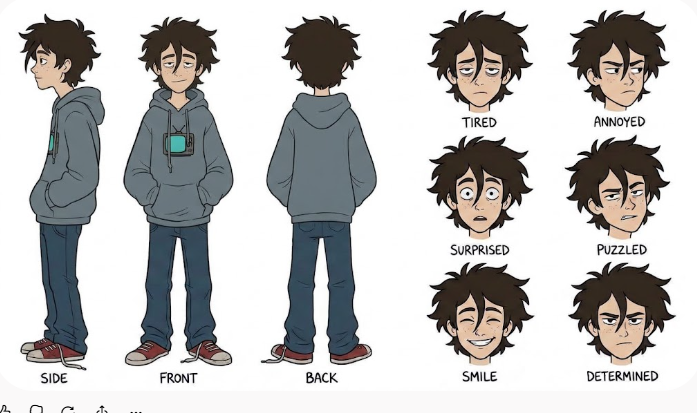
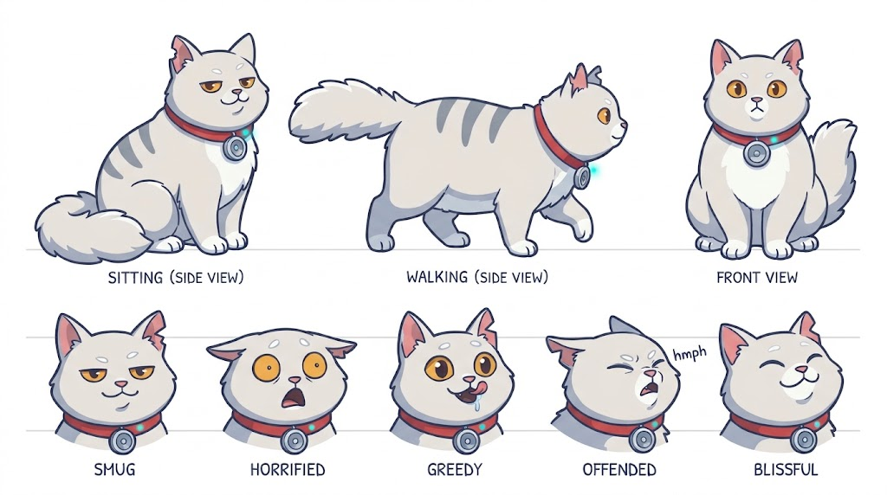

# Steckbriefe: Max und Pixel

Max ist ein schlaksiger Teenager in einem zu großen dunklen schieferblau-grauen Hoodie mit roten Sneakern; Pixel ein runder, silbergrauer Kater mit weißen Pfoten, eingerissenem Ohr und rotem Halsband mit Lautsprecher. Beide müssen auf 140 bzw. 45 Pixel sofort erkennbar sein, also zählen Umriss und zwei, drei Farbakzente mehr als Details.

## Max

| Merkmal | Festlegung | Warum |
| --- | --- | --- |
| Alter, Größe | 16 Jahre, 140 Pixel hoch, Kopf etwa 35 Pixel | Etwas größer als nötig wirkt schlaksig; Kopf groß genug für Mimik |
| Haltung | Leicht vorgebeugt, Schultern hängend, Hände in der Bauchtasche | Der Couch-Potato steckt im Umriss, nicht nur im Text |
| Haare | Dunkelbraun, wuschelig, zerzauste Strähnen fallen über Stirn und Augen (wie auf dem freigegebenen Konzeptbild) | Erkennungszeichen von der Seite; verdeckt halb den Blick, passt zu „maulfaul“ |
| Gesicht | Halb geschlossene, müde Augen, schiefes Grinsen, ein paar Sommersprossen | Grundausdruck „gelassen-genervt“ ohne zynisch zu wirken |
| Oberteil | Übergroßer dunkler schieferblau-grauer Hoodie (#3a4466), Ärmel über den Händen, ungleich lange Kordeln, kleines Retro-Fernseher-Motiv mit türkisem Bildschirm auf der Brust | Dunkles Grau trennt ihn klar von Pixels hellem Fell, auch wenn der Kater auf seiner Schulter sitzt; der Grundton #3a4466 liegt eine Stufe unter Pixels Streifen (#5a6988), damit beide nicht verschmelzen; das Fernseher-Motiv verbindet ihn mit dem Zapp-O-Mat |
| Hose | Dunkelblaue Jeans, etwas zu lang, unten aufgeschoppt | Wenig Aufmerksamkeit, solide Basis |
| Schuhe | Abgetretene rote Sneaker mit weißer Sohle, ein Schnürsenkel offen | Der stärkste Farbakzent: im Gewimmel sofort zu finden; der offene Senkel ist ein stiller Running Gag |
| Requisiten | Handy in der Bauchtasche, Kopfhörer nur in der Gegenwart | Moderner Teenager ohne zusätzliche Umriss-Unruhe in den Welten |
| Entwicklung im Bild | Prolog bis Welt 3 gebeugt (Grundpose); ab Rückkehr 3 aufrechter (Prompt „Aufrechte Fassung“ unten); im Finale gerade, Hände aus der Tasche | Seine Entwicklung ist sichtbar; kostet nur zwei zusätzliche Stand-Posen |

**Mimik (Porträt 128×128):** müde (Standard), genervt mit hochgezogener Augenbraue, überrascht, ratlos, echtes Lächeln (selten, nur bei wichtigen Momenten), entschlossen (Finale).

**Farben (Endesga 32):**

| Teil | Grundton | Schatten | Licht |
| --- | --- | --- | --- |
| Haut | #e8b796 | #c28569 | – |
| Haare | #733e39 | #3e2731 | #b86f50 |
| Hoodie | #3a4466 | #262b44 | #5a6988 |
| Fernseher-Motiv | #2ce8f5 | #0099db | – |
| Jeans | #124e89 | #262b44 | #0099db |
| Sneaker | #e43b44 | #a22633 | #ffffff (Sohle) |
| Kontur | #262b44 | – | – |

**Referenz-Konzept Max** (Gemini, freigegeben am 6. November 2026, Datei `w0_concept_max.png`): schiefergrauer Hoodie im Konzept, im Spiel auf den dunkleren Grundton #3a4466 gebracht, Hände in der Tasche, leicht gebeugt. Für das Spiel die Seitenansicht spiegeln, damit er nach rechts schaut. Die aufrechte Fassung für das Finale entsteht aus derselben Vorlage. Das fertige Sprite wird in Aseprite Pixel für Pixel von Hand nachgezogen (Produktion, Absprachen). Vor den Animationen den Silhouetten-Test unten durchführen.



## Pixel

| Merkmal | Festlegung | Warum |
| --- | --- | --- |
| Art, Größe | Kräftiger Hauskater, 45 Pixel hoch im Sitzen, etwa 65 Pixel lang im Gehen | Klein neben Max, aber groß genug für Gesten |
| Körper | Rund, kleiner Bauch, kurze Beine, sehr buschiger Schwanz | Gemütlichkeit und Verfressenheit im Umriss; der Schwanz zeigt Stimmung |
| Fell | Hell silbergrau mit drei dunkleren Streifen auf dem Rücken, weiße Brust und weiße „Socken“ an allen Pfoten | Hebt sich von Max' dunklem Hoodie und den meisten Hintergründen ab |
| Ohren | Linkes Ohr eingerissen | Erkennungszeichen; Hintergrund-Gag: verlor gegen Opas ersten Staubsauger-Prototyp, der im Prolog auf dem Dachboden steht (Objekt nur zum Ansehen) |
| Augen | Bernsteinfarben, fast immer halb geschlossen und herablassend | Grundausdruck „ich weiß es besser“ |
| Halsband | Rot, vorne ein runder silberner Lautsprecher mit türkiser Leuchte; die Leuchte ist mindestens zwei Pixel groß, sonst verschwindet sie auf 45 Pixel | Opas Erfindung; die Leuchte blinkt beim Sprechen und ersetzt eine Mund-Animation |
| Haltung | Sitzt kerzengerade mit hochgerecktem Kinn, Schwanz um die Pfoten gelegt | Hochnäsig wie ein König auf dem Thron |

**Abgrenzung:** Pixel ist verfressen und hochnäsig, darf aber nicht an bekannte Comic-Kater erinnern: kein oranges Fell, keine Lasagne, keine dicken Augenlider mit Ringen. Sein Markenzeichen ist das Lautsprecher-Halsband.

**Mimik (Porträt 128×128):** herablassend (Standard), entsetzt (Hundekuchen), gierig (Essen in Sicht), beleidigt (abgewandter Kopf), glücklich mit geschlossenen Augen (sehr selten).

**Farben (Endesga 32):**

| Teil | Grundton | Schatten | Licht |
| --- | --- | --- | --- |
| Fell | #c0cbdc | #8b9bb4 | #ffffff |
| Streifen | #5a6988 | – | – |
| Brust, Pfoten | #ffffff | #c0cbdc | – |
| Augen | #feae34 | #f77622 | – |
| Nase, Ohrinneres | #f6757a | – | – |
| Halsband | #e43b44 | #a22633 | – |
| Lautsprecher | #c0cbdc | #5a6988 | #2ce8f5 (Leuchte) |
| Kontur | #3a4466 | – | – |

**Referenz-Konzept Pixel** (Gemini, freigegeben am 6. November 2026, Datei `w0_concept_pixel.png`): helles silberweißes Fell, graue Streifen, Kerbe im linken Ohr. In der sitzenden Seitenansicht fehlt die Kerbe noch; sie wird nach dem Erzeugen in Aseprite von Hand gesetzt. Der leicht warme Fellton wird beim Anwenden der Palette kühler.



## Zusammen

Max ist dunkel und lang, Pixel hell und rund; zusammen bilden sie ein klares Paar wie ein umgedrehtes Ausrufezeichen. Gemeinsame Farbklammer: Rot (Sneaker und Halsband) und Türkis (Fernseher-Motiv und Lautsprecher-Leuchte). Wenn Pixel auf Max' Schulter sitzt, bleibt er dank hellem Fell gut sichtbar.

## Prompts

**1. Konzeptbild (ChatGPT oder Gemini), je Figur ein Bild:**

```text
Character design sheet for a 2D point-and-click adventure game, clean flat colors, plain white background, no text, no labels. Max, a lanky 16-year-old boy with a slight slouch, head about a quarter of his height, messy dark brown hair (#733e39) with shaggy strands falling over his forehead and eyes, sleepy half-closed eyes, lopsided smirk, a few freckles, fair skin (#e8b796). Oversized dark slate blue-grey hoodie (#3a4466) with sleeves covering his hands, uneven drawstrings, a tiny retro TV print with a turquoise screen (#2ce8f5) on the chest. Dark blue jeans (#124e89) slightly too long and rolled up at the hem, worn red sneakers (#e43b44) with white soles, one lace untied. Show in one row at the same height: strict side view facing right, front view, back view, all in a neutral standing pose with both hands in the hoodie pocket; below them six head-and-shoulder expressions facing right (tired, annoyed with one raised eyebrow, surprised, puzzled, rare genuine smile, determined).
```

```text
Character design sheet for a 2D point-and-click adventure game, clean flat colors, plain white background, no text, no labels. Pixel, a chubby round tomcat with short legs, light silver-grey fur (#c0cbdc) with three darker blue-grey stripes on his back (#5a6988), white chest and four white paws, a very fluffy tail, a clearly visible notch torn out of his left ear, smug half-closed amber eyes (#feae34), pink nose, a red collar (#e43b44) with a round silver speaker on the front and a small turquoise light (#2ce8f5). Not orange, no tabby markings on the face, no heavy eyelids. Show at the same scale: sitting upright in strict side view facing right with the tail around his paws, walking in strict side view facing right, sitting front view; below them five head expressions (smug, horrified, greedy, offended with head turned away, blissful with closed eyes).
```

**2. Spielfigur (Retro Diffusion Cloud, `rd_pro__default`, Konzeptbild als Referenz):**

```text
Pixel art character sprite, exactly one character, full body, strict side view facing right, about 140 pixels tall on a 192x192 canvas, head about 35 pixels, feet on the bottom edge, dark outline #262b44 (not pure black), light from upper left, flat colors without gradients, plain transparent background, no ground shadow. Max, a lanky 16-year-old boy with a slight slouch, messy dark brown hair (#733e39) with shaggy strands falling over his forehead and eyes, sleepy half-closed eyes, lopsided smirk, a few freckles, oversized dark slate blue-grey hoodie (#3a4466) with sleeves over his hands, uneven drawstrings and a tiny retro TV with a turquoise screen (#2ce8f5) on the chest, dark blue jeans (#124e89) slightly too long, worn red sneakers (#e43b44) with white soles, one lace untied, hands in his hoodie pocket. Neutral standing pose, shoulders hanging, weight on both feet, calm bored look.
```

Aufrechte Fassung von Max (ab Rückkehr 3 und im Finale), mit der fertigen Seitenansicht als Referenz:

```text
Pixel art character sprite, exactly one character, full body, strict side view facing right, about 140 pixels tall on a 192x192 canvas, feet on the bottom edge, dark outline #262b44 (not pure black), light from upper left, flat colors without gradients, plain transparent background, no ground shadow. Same boy as the reference sprite: Max, a lanky 16-year-old boy, messy dark brown hair (#733e39) with shaggy strands falling over his forehead and eyes, a few freckles, oversized dark slate blue-grey hoodie (#3a4466) with a tiny retro TV with a turquoise screen (#2ce8f5) on the chest, dark blue jeans (#124e89), worn red sneakers (#e43b44) with white soles, one lace untied. Standing upright, shoulders back, both hands out of the pocket hanging loosely at his sides, calm determined look.
```

```text
Pixel art small creature sprite, exactly one creature, full body, strict side view facing right, about 45 pixels tall on a 96x96 canvas, dark outline #3a4466 (not pure black), light from upper left, very readable silhouette, flat colors, plain transparent background, no ground shadow. Pixel, a chubby round tomcat about 45 pixels tall when sitting, short legs, light silver-grey fur (#c0cbdc) with three darker blue-grey stripes on his back (#5a6988), white chest and white paws, a very fluffy tail, a notch torn out of his left ear, smug half-closed amber eyes (#feae34), pink nose, a red collar (#e43b44) with a small round silver speaker and a clearly visible two-pixel turquoise light (#2ce8f5), not orange, no tabby markings on the face. Sitting upright with chin raised, fluffy tail wrapped around his paws, collar speaker and its light on the side facing the viewer.
```

**3. Ansichten für Animationen (`rd_plus__character_turnaround`):** fertige Seitenansicht als Referenzbild, Prompts unten, danach Laufen und Stehen mit `rd_advanced_animation__walking` und `__idle` aus der fertigen Seitenansicht.

```text
Character turnaround sheet, pixel art, same character as the reference sprite, three views in one row at identical height (about 140 pixels) and scale: strict side view facing right, front view, back view; neutral standing pose, both hands in the hoodie pocket, same colors, dark outline #262b44, plain transparent background, no text. Max, a lanky 16-year-old boy with a slight slouch, messy dark brown hair (#733e39) with shaggy strands falling over his forehead and eyes, sleepy half-closed eyes, lopsided smirk, a few freckles, oversized dark slate blue-grey hoodie (#3a4466) with sleeves over his hands, uneven drawstrings and a tiny retro TV with a turquoise screen (#2ce8f5) on the chest, dark blue jeans (#124e89) slightly too long, worn red sneakers (#e43b44) with white soles, one lace untied, hands in his hoodie pocket.
```

```text
Character turnaround sheet, pixel art, same cat as the reference sprite, three views in one row at the same scale: sitting in strict side view facing right (about 45 pixels tall), standing in strict side view facing right (about 65 pixels long), sitting front view; same colors, dark outline #3a4466, plain transparent background, no text. Pixel, a chubby round tomcat about 45 pixels tall when sitting, short legs, light silver-grey fur (#c0cbdc) with three darker blue-grey stripes on his back (#5a6988), white chest and white paws, a very fluffy tail, a notch torn out of his left ear, smug half-closed amber eyes (#feae34), pink nose, a red collar (#e43b44) with a small round silver speaker and a clearly visible two-pixel turquoise light (#2ce8f5), not orange, no tabby markings on the face.
```

**4. Porträts (Baustein PORTRÄT, `rd_pro__default` mit der Seitenansicht als Referenz):** je Ausdruck ein Bild; in der eckigen Klammer genau einen Ausdruck stehen lassen. Die Porträts dienen für Dialoge und, auf 48×48 verkleinert, für den Figurenwechsel.

```text
Pixel art character portrait, head and shoulders, 128x128, three-quarter view facing right, expressive face, dark outline #262b44, light from upper left, plain transparent background, no hands, no text. Max, a lanky 16-year-old boy, messy dark brown hair (#733e39) with shaggy strands falling over his forehead and eyes, a few freckles, fair skin (#e8b796), oversized dark slate blue-grey hoodie (#3a4466) with uneven drawstrings. Expression: [tired, half-closed eyes, lopsided smirk / annoyed, one raised eyebrow / surprised, eyes wide open / puzzled, head tilted / rare genuine smile / determined, eyes open, jaw set].
```

```text
Pixel art character portrait, head and shoulders, 128x128, three-quarter view facing right, expressive face, dark outline #3a4466, light from upper left, plain transparent background, no paws, no text. Pixel, a chubby tomcat with light silver-grey fur (#c0cbdc), white chest, a notch torn out of his left ear, amber eyes (#feae34), pink nose, a red collar (#e43b44) with a small round silver speaker and a two-pixel turquoise light (#2ce8f5), not orange. Expression: [smug, half-lidded eyes, chin raised / horrified, ears flat, eyes wide / greedy, eyes huge, tongue tip out / offended, head turned away, eyes closed / blissful, eyes closed, small smile].
```

**Prüfen vor dem Weitermachen:** Beide Figuren als schwarze Silhouette ansehen, auf einen hellen und einen dunklen Hintergrund aus dem Prolog legen und in Originalgröße (140 und 45 Pixel) betrachten. Erkennbar? Dann erst Animationen erzeugen.
