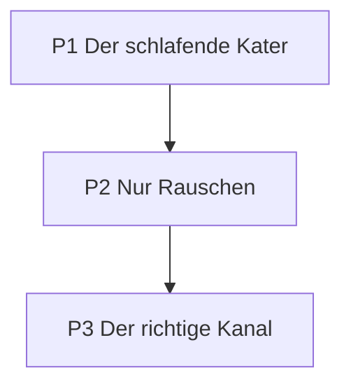
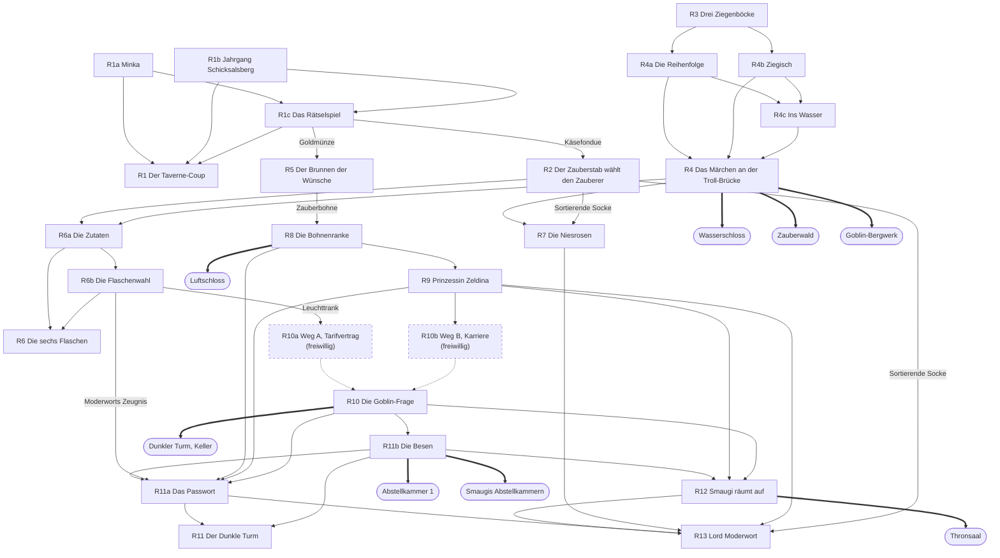
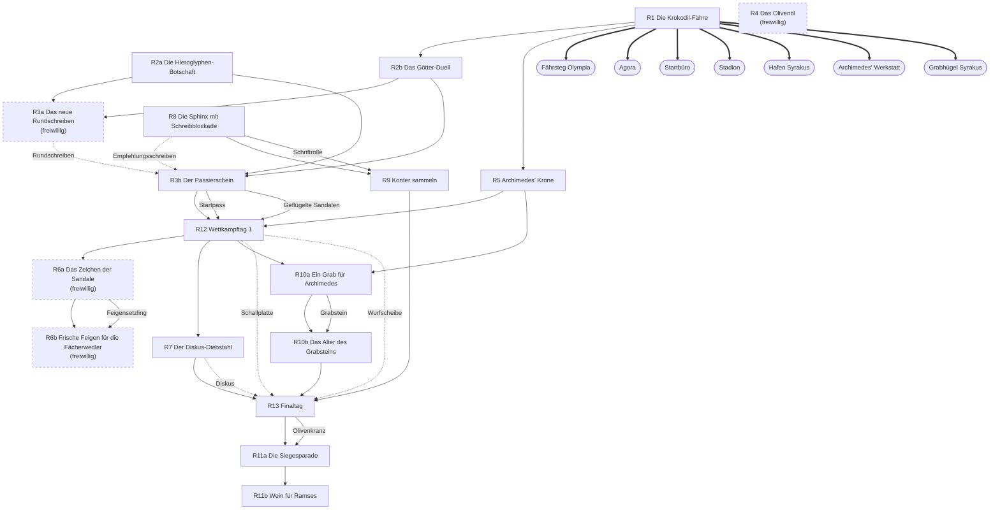
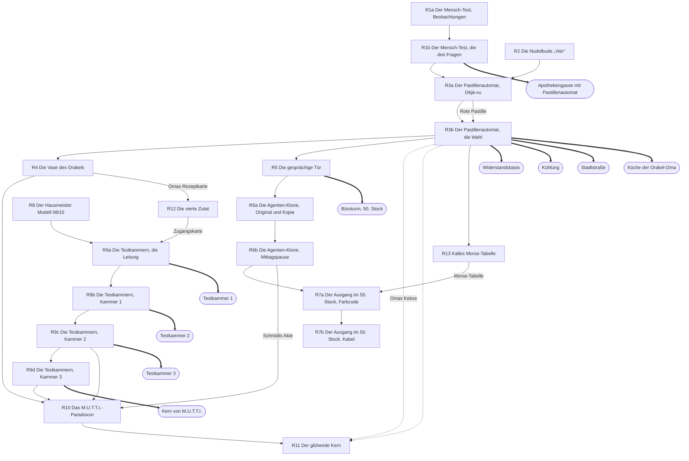
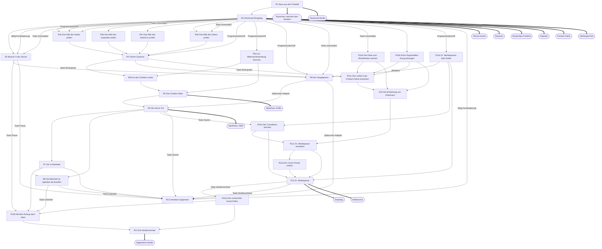
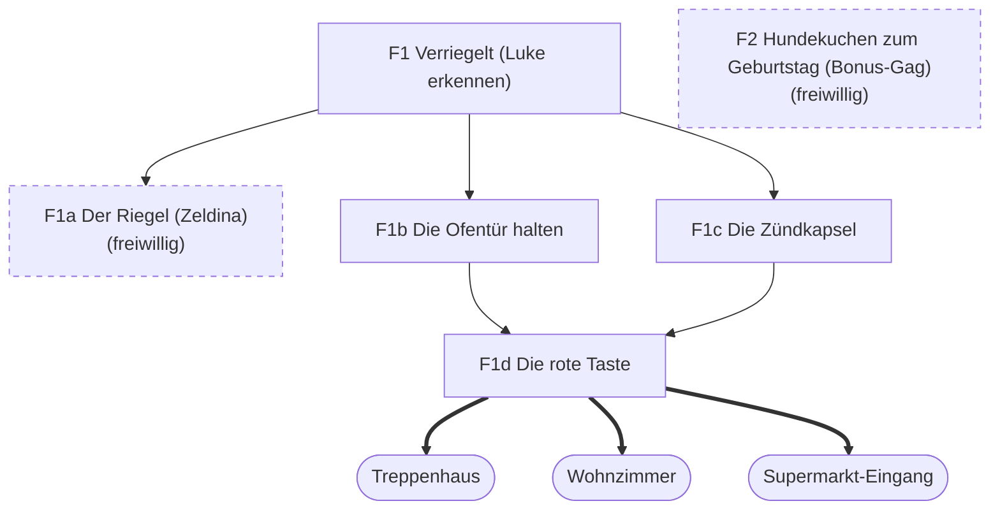

# Rätsel-Abhängigkeiten

Automatisch erzeugt aus den Welt-Tabellen (`docs/welten/*.yaml`) mit `python3 tools/diagramme.py`; nicht von Hand bearbeiten. Pfeil A → B: B braucht A oder einen Gegenstand, den A ergibt (beschriftet). Gestrichelter Pfeil: einer von mehreren Wegen. Gestrichelter Kasten: freiwilliges Rätsel. Doppelpfeil zu einem runden Kasten: das Rätsel öffnet diesen Raum. Gegenstände, die frei in Räumen liegen, sind nicht eingezeichnet; sie stehen in der Welt-Tabelle.

## Opas Dachboden (prolog)

## Schwurbelstein (welt-1)

## Antikodonien (welt-2)

## Neo-Neustadt 2099 (welt-3)

## Kanal 999 (welt-4)

## Zwischenspiele und Finale (finale)

