# Review Prolog, Welt 1 und Welt 2 (17. November 2026)

Geprüft wurde `main` auf Commit `ae6619c1` in einem eigenen Checkout auf Sebastians Rechner (Godot 4.7.2, Windows). Am Spiel, an Grafiken, Daten und an `docs/lessons-learned.md` wurde nichts geändert. Neu sind nur dieser Bericht, die Rollen-Notizen unter [`notizen/`](notizen/) und die Belege unter [`belege/`](belege/). Alle Pfade in diesem Bericht sind relativ zu `docs/review/2026-11-17/`.

## 1. Kurzfazit

Prolog und Welt 1 sind nach dem Fix-Durchgang vom 14. November in gutem Zustand: Die früheren Rätsel-Funde sind behoben (Nr. 2 und 15 nur am Code geprüft), der Durchspieltest läuft mit 884 Prüfungen grün, und es gibt keine Skriptfehler beim Betreten oder Anklicken der 28 Räume. Offen sind dort mehrere wichtige Einzelfunde, vor allem Klickflächen (Humbert, Opa, Toadi an der Tür), Körperwechsel beim Reden (Gollo, Grimmzahn), das langsame Laufen über den Dorfplatz und Zeldina, die nach Rätsel 9 im Ziegenkörper steht.

Welt 2 wurde zum ersten Mal im Spiel geprüft, und dort liegt der Großteil der Arbeit. Es gibt **einen kritischen Fund: Das Gespräch mit Hermes im Startbüro hängt das Spiel auf** (leeres Auswahlmenü, weder Klick noch Esc helfen). Dazu kommen vier Problemfelder, die jedem Spieler auffallen: Das Hinweissystem schickt in Welt 2 oft in die falsche Richtung oder „in den Fernseher“; Figuren sind dort, wo sie vor großen Hotspots stehen, kaum anklickbar (der Traubensaft gar nicht); viele Texte beschreiben etwas anderes als das Bild (Säulen ohne Zeichen, Thron ohne Kissen, „[Satz]“ als Platzhalter); und Szenen werden als Erzähltext statt als Bild erzählt, oft länger, als die Einblendung stehen bleibt. Die vier breiten Räume von Welt 2 sind Flure mit Ausgängen an den Enden, was zusammen mit vielen Fährfahrten spürbar Laufzeit kostet.

Stark sind Grafik-Einheit und Text: Die Welt-2-Räume sind aus einem Guss, ohne sichtbare Nähte, die Figuren haben Stimme, und Setup und Auszahlung (Nase, Arme, Turm) funktionieren über die ganze Welt. Kein Hänger außer dem Hermes-Gespräch, keine harte Sackgasse.

**Zählung (nach Zusammenführung, ohne Workflow):** 90 Funde, davon 1 kritisch, 43 wichtig, 46 kosmetisch (aus 94 Rollen-Funden nach Entfernen der Doppelungen). Dazu 17 Workflow-Funde (Kapitel 9) und 27 Vorschläge für die Lessons Learned (Kapitel 8).

## 2. Wie geprüft wurde

- **Aufnahmen aller 28 Räume** im laufenden Spiel (Skript `game/tests/_review_raeume.gd`, nicht committet): Panorama über die ganze Raumbreite ohne Max, Kameraausschnitt mit Max an der Startstelle, alle Hotspots, Props, Figuren, Laufbereiche und Marker als JSON, daraus Overlays (gelb Hotspot, cyan Prop, magenta Figur, grün Laufbereich). Je Raum Anfangszustand (`*_anfang*`) und Zustand nach Lösung aller Rätsel (`*_ende*`). Ordner: [`belege/raeume/`](belege/raeume/). Hinweis: Die Welt-2-Endaufnahmen zeigen außer im Stadion kaum Endzustände (siehe „Nicht geprüft“).
- **Sieben Prüfrollen** nach den Rollenbeschreibungen aus `msitarzewski/agency-agents` als eigene Unteragenten. Jede Rolle hat alle Räume aus ihrer Sicht geprüft und eine Notizdatei geschrieben:
  - Level Designer (LD): Laufwege, Raumaufbau, Pacing. Zwei Lauftests mit echter Wegfindung ([`belege/level-design/lauf/`](belege/level-design/lauf/)).
  - Narrative Designer (ND): Dialoge, Humor, Ton, Text gegen Bild, Textlängen und Szenendauer.
  - Game Designer (GD): Rätsel, Hinweise, Sackgassen. Durchlauftests und ein eigenes Welt-2-Szenario ([`belege/game-design/`](belege/game-design/)).
  - Technical Artist (TA, AN): Grafik je Raum und Animationen. Inventar aller 354 Animationen, Messwerte je Sheet, 54 Kontaktbögen, 65 GIFs aus dem Spiel ([`belege/animationen/`](belege/animationen/), [`belege/technical-art/`](belege/technical-art/)).
  - Godot Gameplay Scripter (GS): Hotspots, Überdeckung, Z-Sortierung, Trigger. Mausraster-Messung in jedem Raum: Welches Objekt gewinnt an welcher Stelle? ([`belege/godot/`](belege/godot/), Dateien `*_zeiger.png`).
  - Workflow Optimizer (WF): Git-Historie (355 Commits), 38 PRs, 240 CI-Läufe, Webseite, Grafikordner.
  - Evidence Collector: hat jeden der 94 Spiel-Funde gegen Beleg und Code geprüft (89 bestätigt, 4 teilweise, 1 nicht prüfbar, 0 falsch) und 11 fehlende Belege im Spiel aufgenommen ([`belege/evidenz/`](belege/evidenz/), [`notizen/belege.md`](notizen/belege.md)).
  - Reality Checker: Gegenprüfung dieses Berichts (Ergebnis in Kapitel 10).
- **Frühere Reviews** (360-Grad-Prüfung 10./11.11., Review Prolog/Welt 1 vom 14.11.) wurden abgeglichen. Behobenes ist nicht noch einmal gemeldet; wo ein früherer Fund noch offen oder nur halb behoben ist, steht das beim Fund („früher Fund 14.11. Nr. X“).

**Prioritäten:** kritisch = blockiert das Spiel oder macht es unlösbar; wichtig = fällt jedem Spieler negativ auf; kosmetisch = stört, aber nicht jeden. In Klammern steht die ID aus den Rollen-Notizen, dort gibt es weitere Einzelheiten.

---

## 3. Raumübergreifende Funde (alle Welten)

| Nr. | Prio | Kategorie | Fund | Beleg | Vorschlag |
| --- | --- | --- | --- | --- | --- |
| X-01 | wichtig | Klickflächen | **Bei Überdeckung gewinnt oft das falsche Objekt.** Popochiu entscheidet nach der Reihenfolge im Szenenbaum (`get_index()`), nicht nach Baseline. Die eigene Regel „das kleinere Objekt gewinnt“ (`Spiel._zeiger_flaeche()`) greift bei Figuren nie, weil Figuren im Bauplan kein `rect` haben. Folge: Figuren vor großen Hotspots sind dort, wo sie den Hotspot überdecken, nicht anklickbar (Humbert nur an 9 % seiner Fläche, Fährmann in Syrakus 22 %, Opa 37 %, Nebet 42 %, Archimedes 41 %). Außerdem hängt das Ergebnis von der Richtung der Mausbewegung ab: Die Fischsuppe in der Taverne trifft man nur von rechts kommend, von links ist es immer „Tresen“. Einzelfälle stehen bei den Räumen. (GS-01, GS-02) | [Fischsuppe je Richtung](belege/evidenz/GS-02_fischsuppe_richtungsabhaengig.png), [Taverne Zeigerkarte](belege/godot/taverne_anfang_zeiger.png), `popochiu_clickable.gd` Z. 499–503, `spiel.gd` Z. 703–713 | Bei jeder Mausbewegung neu entscheiden: unter allen Objekten am Punkt Figur vor Prop vor Hotspot, bei Gleichstand das kleinste. Figuren ein Rechteck aus dem Sprite geben. Danach die Zeigerkarten neu erzeugen und Fälle unter 70 % ansehen. |
| X-02 | wichtig | Grafik | **Raumlicht fehlt in 23 von 28 Räumen.** Die Tönung der Figuren (`licht:` im Layout) gibt es nur in Zauberwald, Bergwerk, Turmkeller, Abstellkammern und Thronsaal. In der dunklen Abstellkammer 1 leuchtet Pixel hellblau-weiß (bei früherem Fund 14.11. Nr. 20 nicht miterfasst); in Taverne und Schmiede steht Max kalt im warmen Feuerlicht; die Welt-2-Innenräume haben gar keine Tönung. (TA-01) | [Pixel in drei Räumen](belege/technical-art/raumlicht_pixel_abstellkammer1_vs_abstellkammern_turmkeller.png), [Schmiede](belege/raeume/schmiede_anfang_mitmax.png) | `licht` für Abstellkammer 1 wie Abstellkammern (`#c8c0dc`); leichte warme Tönung (etwa `#f2e2cc`) für Taverne, Schmiede, Laden und die Welt-2-Innenräume; mit allen Figuren im Raum gegenprüfen. |
| X-03 | wichtig | Laufwege, Timing | **Das Lauftempo hängt an der Tiefenskala.** Popochiu rechnet Tempo = 150 × Skala. Auf dem Dorfplatz (Skala 0,72, Tiefe 0,4) läuft Max hinten 43 px/s, vorn 108 px/s. Gemessen: 808 px in 11,5 s; Taverne bis Waldweg hochgerechnet rund 15 s, und das im Knotenraum von Welt 1. Troll-Brücke 70 px/s. Welt 2 zum Vergleich 140 px/s. (LD-14) | [Lauftest Dorfplatz](belege/level-design/lauf/14_dorfplatz_ende.png), [Troll-Brücke](belege/level-design/lauf/17_trollbruecke_ende.png), `cq_raum.gd` `tiefe_anwenden()` | Tempo von der Skala entkoppeln (in `tiefe_anwenden()` die Geschwindigkeit durch die Skala teilen) oder Untergrenze 100 px/s. Die Figur wird hinten weiter kleiner, nur die Wartezeit fällt weg. |
| X-04 | wichtig | Technik | **Szene und Layout laufen auseinander, der nächste Raum-Bau macht frühere Fixes rückgängig.** Die 20 × 20-Vergrößerungen aus den früheren Funden 16 und 31 (Ei, Zahnstocher, Okarina, Dosenöffner, Schwerterbündel) stehen nur in den `.tscn`, im Layout stehen noch die alten Rechtecke (Ei 12 × 12). `--cq-layout=<raum>` setzt sie zurück. `_zeiger_flaeche()` rechnet schon heute mit den alten Werten. (GS-20) | `tools/layout/welt-1.yaml` Z. 156, 215, 577, 584; `tools/layout/prolog.yaml` Z. 96; `bauer.gd` Z. 405–422; [Taverne Overlay](belege/raeume/taverne_anfang_klick.png) | Rechtecke im Layout nachziehen und Daten neu erzeugen; in `pruefen.py` prüfen, dass Klickpolygon der Szene und Rechteck im Bauplan gleich sind. |
| X-05 | wichtig | Timing | **Erzähltexte (NAR) stehen höchstens 5 Sekunden.** `spiel.gd` Z. 285 zeigt NAR-Zeilen Zeichen/15, höchstens 5 s. Ab etwa 75 Zeichen wird gekappt. Welt 2 hat 29 NAR-Zeilen, 27 davon länger (bis 211 Zeichen, also 42 Zeichen je Sekunde zum Lesen); Welt 1 hat 4 zu lange (bis 122). (ND-02, ND-24) | [NAR mit 211 Zeichen im Spiel](belege/evidenz/ND-02_nar_211_zeichen.png), `spiel.gd` Z. 285 | Anzeigedauer an die Länge koppeln (Obergrenze 8 s, Klick schaltet weiter) und NAR-Zeilen auf etwa 75 Zeichen kürzen oder teilen. |
| X-06 | kosmetisch | Klickflächen | **Viele Ausgänge sind schmaler als 50 px** (früher Fund 14.11. Nr. 31 ist nur an der Troll-Brücke umgesetzt): Wasserschloss und Zauberwald 30 px, Werkstatt, Grabhügel, Sphinx, Troll-Brücke-Waldweg 40 px, Nil-Delta, Agora 42 bis 44 px, Dorfplatz und Laden 48 px. Am Bildrand halb so schlimm, mit Controller mühsam. (GS-14) | Polygonbreiten aus [`belege/raeume/*_anfang.json`](belege/raeume/), z. B. [Wasserschloss](belege/raeume/wasserschloss_anfang_klick.png) | Ausgangsrechtecke auf mindestens 50 px verbreitern, gern über den Bildrand hinaus. |
| X-07 | kosmetisch | Klickflächen | **Klickflächen unter der Oberfläche:** Teile von Dachfenster (Dachboden, 42 %), Fenster (Laden), Wasserorgel (Werkstatt), Glockenturm (Stadion) und der Adlersäule (Agora) liegen unter Porträts, Pfote oder dem oberen Rand, der die Leiste aufklappt. (GS-23) | weiße Flächen in [`belege/godot/*_zeiger.png`](belege/godot/), z. B. [Dachboden](belege/godot/dachboden_anfang_zeiger.png) | Rechtecke unter y 24 und neben Porträts und Pfote legen. |
| X-08 | kosmetisch | Klickflächen | **Ansehen-Bedingung „vor dem Training“ wirkt nicht:** `_bedingung_text()` kennt sie nicht, die Zeile zum Wurfhebel in der Werkstatt gilt deshalb auch nach dem Training (am Code bestätigt). Laut Klicktest der Godot-Rolle bringt außerdem ein Rechtsklick auf Ausgänge, auf Pixel (außer im Dachboden) und auf Fähre und Fährmann in Olympia und Syrakus nur eine Ersatzzeile; dieses Protokoll ist nicht abgelegt und nicht nachgeprüft. (GS-22, teilweise bestätigt) | `welt_2.gd` Z. 304–324; [Agora Overlay](belege/raeume/agora_anfang_klick.png) | Für Ausgänge eine kurze Standardzeile aus dem Ausgangsnamen („Da geht's zum Hafen.“). |

---

## 4. Prolog

### 4.1 Wohnzimmer

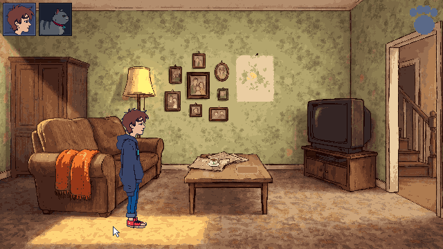

| Nr. | Prio | Kategorie | Fund | Beleg | Vorschlag |
| --- | --- | --- | --- | --- | --- |
| P-04 | wichtig | Animation | **Nachtrag (Sebastian): Liegt Max auf dem Sofa und redet, bewegt sich nicht der Mund, sondern etwas am Hals.** Die Redebewegung wird offenbar an der Stelle des stehenden Max eingeblendet, nicht an der Liege- oder Sitzpose. Vom Review nicht gefunden, weil das Wohnzimmer nicht im Spiel aufgenommen wurde. Beleg im Spiel steht noch aus. | Sebastians Beobachtung; [Wohnzimmer](belege/raeume/wohnzimmer_anfang_mitmax.png); `CQFigur.pose_zeigen()` in `cq_figur.gd` Z. 72 | Für die Posen (liegt, sitzt, kniet) eigene Mundbilder oder den Mund-Versatz je Pose; bis dahin während einer Pose nur das Standbild zeigen. Alle Posen von Max und Pixel beim Reden einmal vergrößert ansehen. |
| P-01 | kosmetisch | Klickflächen | Im schwarzen Einstieg aus dem Off steht unter dem Mauszeiger schon die Beschriftung „Fernseher“, obwohl noch nichts zu sehen ist (im Web-Build gesehen). (WF-17) | [Web-Build](belege/workflow/web_intro_fernseher_label.jpg) | Während der Off-Einleitung Hover-Beschriftungen ausblenden. |

**Animationen:** Nicht neu aufgenommen. Aufstehen vom Sofa war früher Fund 8 und ist umgesetzt. Max' Ruhe-Schleife zuckt am Schleifenende leicht (siehe Kapitel 7, A-05).

### 4.2 Treppenhaus

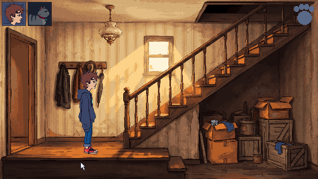

Keine neuen Funde. **Animationen:** Treppengang nicht neu aufgenommen (früher Fund 30 laut Umsetzung erledigt).

### 4.3 Dachboden

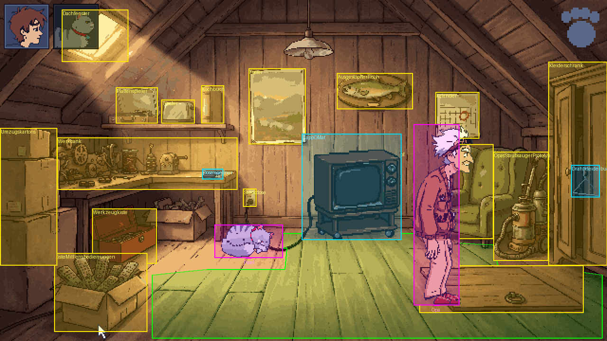

| Nr. | Prio | Kategorie | Fund | Beleg | Vorschlag |
| --- | --- | --- | --- | --- | --- |
| P-02 | wichtig | Klickflächen | Opa ist nur an 37 % seiner Fläche anklickbar (Ohrensessel und Bodenluke liegen vor ihm, Fall von X-01). Die Bodenluke deckt außerdem 19 % des Laufbereichs; Klicks dort laufen nicht, sondern lösen die Luke aus. (GS-03, GS-15) | [Zeigerkarte](belege/godot/dachboden_anfang_zeiger.png) | Mit X-01; Luke nur per Rechtsklick ansprechbar oder kleiner. |
| P-03 | kosmetisch | Timing | Die Rückkehr mit dem Ei (Zwischenspiel 1) ist eine einzige Szene mit 32 Zeilen, geschätzt gut 4 Minuten ohne Eingriff, die längste Strecke ohne Klick im geprüften Umfang. Inhaltlich trägt sie. (ND-23) | `room_dachboden.gd` Z. 401–436, [Dachboden](belege/raeume/dachboden_anfang_mitmax.png) | Nach der Ei-Übergabe teilen; Zapp-O-Mat-Vortrag und Einkaufsliste an Klicks hängen (Opa ansprechen, Notizbuch). |

**Animationen:** Max geht links und rechts sauber, die Füße greifen ([GIF](belege/animationen/p_dach_max_gehen_links.gif)). Opa redet und geht mit einem Körper, früher Fund 1 ist erledigt ([gehen](belege/animationen/p_dach_opa_gehen.gif), [erklären](belege/animationen/p_dach_opa_erklaeren_rede.gif)). Kopfkratzen und Panik passen zum Text ([Panik](belege/animationen/p_dach_opa_panik_rede.gif)). Ein Klick während Max' Geste `benutzen` bricht sie sauber ab ([GIF](belege/animationen/p_dach_max_benutzen_abbruch.gif)). Opas Atem-Schleife hat einen Sprung am Schleifenende (A-05, Kapitel 7).

---

## 5. Welt 1

### 5.1 Dorfplatz

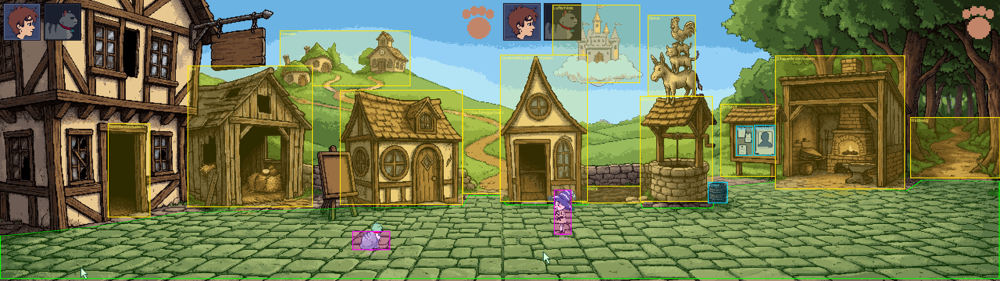

| Nr. | Prio | Kategorie | Fund | Beleg | Vorschlag |
| --- | --- | --- | --- | --- | --- |
| W1-01 | kosmetisch | Timing | Die Ankunftsszene hat 27 Zeilen bis zum ersten Klick, geschätzt gut 3 Minuten reine Redezeit (Welt 2: 13 Zeilen). Das Review vom 14.11. hatte „um ein Drittel kürzen“ empfohlen, umgesetzt ist rund ein Fünftel. (ND-22) | `room_dorfplatz.gd` ab Z. 25; [Startbild](belege/raeume/dorfplatz_anfang_mitmax.png) | Weitere 4 bis 5 Zeilen streichen oder nach dem ersten Klick als Zuruf nachreichen. |
| W1-02 | kosmetisch | Laufwege | Die große, detailliert gemalte Tür des Ringladens sieht aus wie ein Ausgang, ist aber nur zum Ansehen da; Benutzen gibt eine Ersatzzeile. (LD-12) | [Overlay](belege/raeume/dorfplatz_anfang_klick.png) | Eigene Benutzen-Zeile („Geschlossen. Ausverkauf.“). |
| W1-03 | kosmetisch | Klickflächen | Der Bestellzettel ist nur aus einer Mausrichtung anklickbar, sonst gewinnt der Hotspot dahinter (Fall von X-01). (GS-02) | [Zeigerkarte](belege/godot/dorfplatz_anfang_zeiger.png) | Mit X-01. |

Das lange Laufen über den Platz steht in X-03.

**Animationen:** Tiefenskalierung und Gehen nach vorn und hinten greifen ([nach hinten](belege/animationen/w1_dorf_max_nach_hinten.gif), [nach vorn](belege/animationen/w1_dorf_max_nach_vorn.gif)). Toadi rennt, keucht und zeigt passend ([rennt](belege/animationen/w1_dorf_toadi_rennt.gif)); sein Gang ist 12 % kleiner als sein Stand (AN-12). Max hebt auf und pflanzt die Bohne sauber ([aufheben](belege/animationen/w1_dorf_max_aufheben.gif), [Bohne](belege/animationen/w1_dorf_max_bohne.gif)). XXL-Ziege siehe A-01.

### 5.2 Taverne

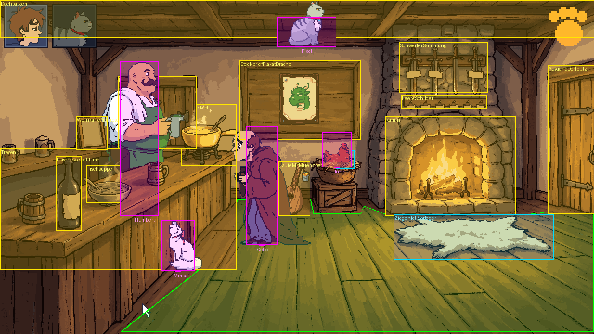

| Nr. | Prio | Kategorie | Fund | Beleg | Vorschlag |
| --- | --- | --- | --- | --- | --- |
| W1-04 | wichtig | Klickflächen | Humbert ist nur an 9 % seiner Fläche anklickbar (Körper hinter Kellertür und Tresen, nur der Kopf bleibt). Die Fischsuppe trifft man nur von rechts kommend. (GS-03, GS-02; Fall von X-01) | [Zeigerkarte](belege/godot/taverne_anfang_zeiger.png), [Fischsuppe](belege/evidenz/GS-02_fischsuppe_richtungsabhaengig.png) | Mit X-01; bis dahin Kellertür erst über Humberts Kopf beginnen lassen. |
| W1-05 | wichtig | Animation | **Gollo hat beim Reden einen anderen Körper.** `talk` ist eine gebückte, nach vorn geschobene Zeichnung, bis 12,5 % kleiner als der Stand. Bei jedem Satz sackt er zusammen und springt danach hoch (gleiches Muster wie früher Opa, Fund Nr. 1). Vermutlich eine Folge des Nachtrags vom 14.11. „Mund in den Redebildern von Humbert, Gollo und Stabmacher“; Humbert und Stabmacher sind dabei unauffällig (Humbert 3,5 % kleiner, aber 20 px seitlich versetzt; Stabmacher gleich groß). (AN-01) | [Stand gegen Reden](belege/technical-art/gollo_idle_vs_talk.png), [GIF](belege/animationen/w1_tav_gollo_rede.gif) | Talk aus der Standpose bauen (Kopf, Mund, Hände), Höhe höchstens 5 % Abweichung. |

**Animationen:** Gollos `ring_werfen` und Humberts Gang in den Keller laufen sauber und kehren in die Ruhe zurück ([Ring](belege/animationen/w1_tav_gollo_ring_werfen.gif), [Keller](belege/animationen/w1_tav_humbert_keller.gif)). Huhn Berta hat laut Inventar einen Gang, der den Standbildern entspricht; wenn sie flattert, gleitet sie (AN-14, nicht nachgerechnet). Raumlicht fehlt (X-02).

### 5.3 Schmiede

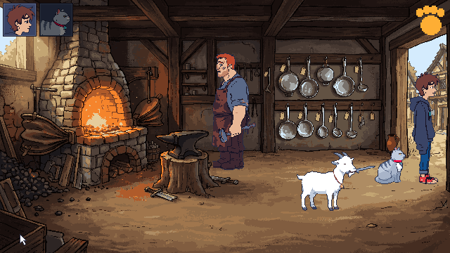

| Nr. | Prio | Kategorie | Fund | Beleg | Vorschlag |
| --- | --- | --- | --- | --- | --- |
| W1-06 | wichtig | Animation | **Max melkt die Ziege nicht.** Die Bewegung `melken` (R6, Skriptzeile `W1_SCHM_MAX_0440` „Melk-Animation“) ist gebaut, wird aber nirgends aufgerufen; der Raumcode spielt nur die Sätze. Die Bildfolge steht zudem 6 px über der Fußlinie. (AN-05) | [GIF der ungenutzten Bewegung](belege/animationen/w1_schm_max_melken_ungenutzt.gif), `character_schmiede_ziege.gd` Z. 46 | `geste_halten("melken", …)` vor 0440; Bilder 6 px absenken. |

**Animationen:** Hämmern als Ruhe-Schleife mit Funken, auch während der Schmied redet ([Hämmern](belege/animationen/w1_schm_schmied_haemmern.gif), [beim Reden](belege/animationen/w1_schm_schmied_rede_waehrend_haemmern.gif)); Schweiß abwischen und das Drehen der Ziege sauber. Die Arbeitsgesten sind 13 bis 14 % kleiner als der Stand (AN-12). Raumlicht fehlt, die Ziege ist reinweiß im Feuerlicht (X-02).

### 5.4 Zauberstabladen

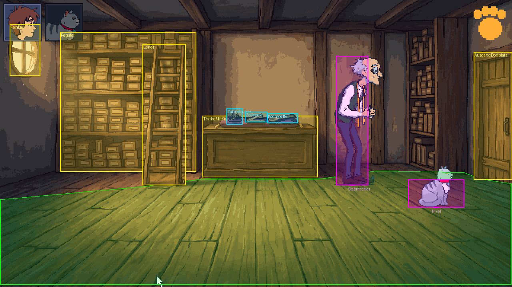

| Nr. | Prio | Kategorie | Fund | Beleg | Vorschlag |
| --- | --- | --- | --- | --- | --- |
| W1-07 | kosmetisch | Klickflächen | Die Regale sind nur an 70 % ihrer Fläche anklickbar (Leiter davor), der Zollstock nur aus einer Mausrichtung. (GS-03, GS-02) | [Zeigerkarte](belege/godot/zauberstabladen_anfang_zeiger.png) | Mit X-01. |

**Animationen:** Nicht im Spiel aufgenommen. Raumlicht fehlt (X-02).

### 5.5 Klassenzimmer

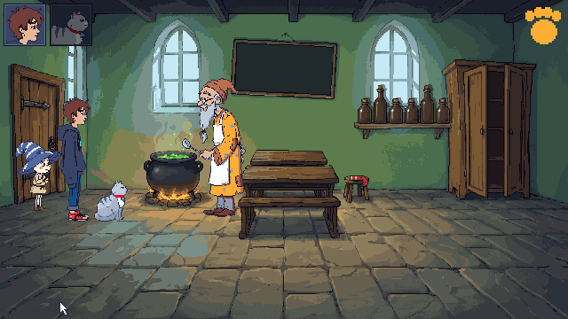

| Nr. | Prio | Kategorie | Fund | Beleg | Vorschlag |
| --- | --- | --- | --- | --- | --- |
| W1-08 | wichtig | Klickflächen, Positionierung | **Toadi steht vor der einzigen Tür.** Er ist nur an den Füßen anklickbar; wer auf seinen Körper klickt, trifft den Ausgang und verlässt den Raum. Max und Pixel kommen direkt daneben an, drei Figuren drängen sich in der Türecke, der Rest des Raums ist leer. (GS-03, LD-10) | [Zeigerkarte](belege/godot/klassenzimmer_anfang_zeiger.png), [Startbild](belege/raeume/klassenzimmer_anfang_mitmax.png) | Toadi an die Schulbank oder unter das rechte Fenster (etwa 470, 262). |
| W1-09 | wichtig | Animation | **Max als Pilz gleitet.** Sein Gang besteht aus denselben vier Bildern wie der Stand. Das Sheet zeigt noch das alte Max-Design (ohne die Augenpixel aus früherem Fund 32), die „Pilzkappe“ liest sich als braune Topffrisur. (AN-04) | [Kontaktbogen Stand und Gang](belege/technical-art/max_pilz_idle_gleich_walk.png) | Gang aus dem aktuellen Max-Gang ableiten, Kappe als eigenes Teil im Teile-Rig, mit Lamellen und Punkten. |

**Animationen:** Übungsbesen saust durchs Bild, Alwin rührt am Kessel ([Besen](belege/animationen/w1_klass_uebungsbesen.gif), [Alwin](belege/animationen/w1_klass_alwin_ruehren.gif)). Früher Fund 17 (Übungsbesen) ist umgesetzt.

### 5.6 Troll-Brücke

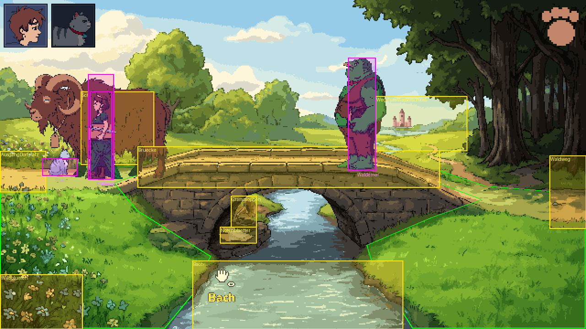

| Nr. | Prio | Kategorie | Fund | Beleg | Vorschlag |
| --- | --- | --- | --- | --- | --- |
| W1-10 | wichtig | Positionierung | **Nach Rätsel 9 steckt Zeldina in der XXL-Ziege.** Beide stehen bei (110, 196). Ursache: `welt_1.gd` `_platz()` zählt nur folgende Figuren hoch, die Ziege und Zeldina als erste Folgende bekommen beide Platz 0. Betrifft jeden Gang zum Bergwerk ab R9; die Stelle verdeckt auch ein Drittel des Schilds. (LD-02) | [Ausschnitt](belege/evidenz/LD-02_zeldina_in_xxl_ziege.png), `welt_1.gd` Z. 58–90 | Folgende und ortsfeste Figuren getrennt zählen oder die Ziege auf einen eigenen Marker. |
| W1-23 | wichtig | Positionierung, Perspektive | **Nachtrag (Sebastian): Waldemar steht nicht auf der Brücke, sondern auf ihrer Brüstung.** Seine Füße sitzen auf der vorderen Kante der Brückenmauer; darunter ist nur Mauerwerk, die Lauffläche liegt dahinter. Er wirkt, als schwebe er über dem Bogen. Vom Review nicht gefunden, weil die Fußlinie nur im Sheet gemessen wurde, nicht gegen die gemalte Kante im Raum. | [Ausschnitt 4-fach](belege/nachtrag/waldemar_bruecke.png); Position (395, 186) in [`trollbruecke_anfang.json`](belege/raeume/trollbruecke_anfang.json) | Waldemar 15 bis 25 px höher auf die Lauffläche stellen (Füße hinter der Mauerkante) oder einen Vordergrund-Ausschnitt der Brüstung vor seine Füße legen; danach im Raum mit Max auf der Brücke prüfen. |
| W1-11 | kosmetisch | Laufwege, Klickflächen | Der Hotspot „Brücke“ liegt auf dem Brückenweg (9 % des Laufbereichs). Wer dort hinklickt, um zu gehen, läuft zur Brückenmitte und bekommt nach R4 eine Ersatzzeile. (LD-04) | [Overlay](belege/raeume/trollbruecke_anfang_klick.png) | Boden-Hotspots ohne Benutzen-Zeile beim Linksklick wie Boden behandeln (dorthin laufen, wo geklickt wurde). |

**Animationen:** Waldemar Regelbuch, Fußbad und Musical laufen im Raum ([Regelbuch](belege/animationen/w1_brue_waldemar_regelbuch.gif), [Fußbad](belege/animationen/w1_brue_waldemar_fussbad.gif), [Musical](belege/animationen/w1_brue_waldemar_musical.gif)); das Regelbuch steht 3 px über der Fußlinie (AN-11). Früher Fund 5 (Waldemar vor dem Wasserschloss) ist behoben.

### 5.7 Wasserschloss

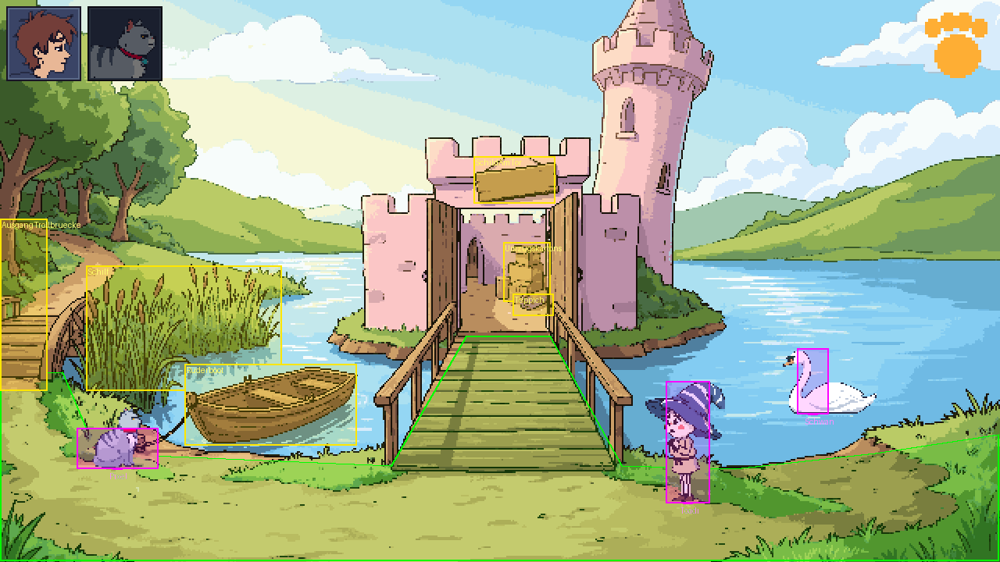

Keine eigenen Funde außer dem 30 px schmalen Ausgang (X-06). **Animationen:** Nicht im Spiel aufgenommen (Schwan nur im Sheet geprüft; sein Gang entspricht dem Stand, AN-14).

### 5.8 Zauberwald

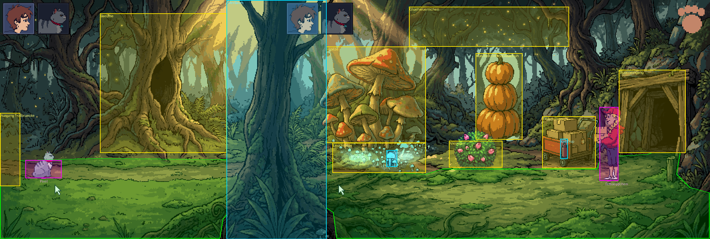

(Das Panorama war in der ersten Aufnahme rechts von x 640 falsch zusammengesetzt und wurde neu aufgenommen; die Rollen-Notizen beziehen sich teils noch auf die alte Fassung.)

| Nr. | Prio | Kategorie | Fund | Beleg | Vorschlag |
| --- | --- | --- | --- | --- | --- |
| W1-12 | kosmetisch | Laufwege, Klickflächen | Der Vordergrund-Baum „Alter Baum“ ist klickbar und sperrt einen 150 px breiten Streifen über die ganze Bildhöhe (8 % des Bodens) für Laufklicks. (LD-04) | [Overlay](belege/raeume/zauberwald_anfang_klick.png) | Vordergrund-Baum nicht klickbar machen. |

**Animationen:** Nicht im Spiel aufgenommen. Raumlicht ist gesetzt und wirkt.

### 5.9 Luftschloss

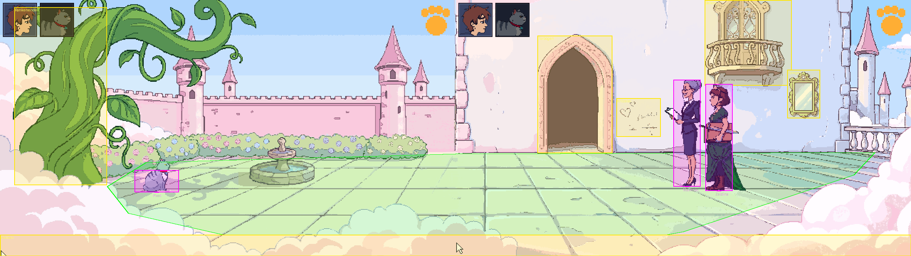

| Nr. | Prio | Kategorie | Fund | Beleg | Vorschlag |
| --- | --- | --- | --- | --- | --- |
| W1-13 | wichtig | Laufwege | **Max läuft durch den Springbrunnen.** Das Becken liegt ganz im Laufbereich und ist weder Prop noch Hindernis; im Lauftest steht Max im Wasser. (LD-09) | [Laufbereich am Brunnen](belege/level-design/LD13_luftschloss_brunnen.png), [Lauftest](belege/level-design/lauf/b03_luftschloss_ende.png) | Brunnen aus dem Laufbereich ausschneiden oder als Prop mit Baseline am Beckenrand. |
| W1-14 | kosmetisch | Positionierung | Beim Betreten liegt ein Blatt der Bohnenranke vor Max' Gesicht. (TA-03) | [Ausschnitt](belege/technical-art/luftschloss_ranke_vor_max_gesicht.png) | Startmarker 30 bis 40 px nach rechts. |
| W1-15 | kosmetisch | Grafik | Früher Fund 14.11. Nr. 33, in `offene-punkte.md` als nachgezogen vermerkt, sichtbar aber nur halb behoben: Bei x = 640 endet die rosa Mauer mit einer harten senkrechten Kante; die Bodenfugen links und rechts sind weiter verschieden. Alle anderen Breiträume sind ohne sichtbare Naht. (TA-02) | [Naht 4-fach](belege/technical-art/luftschloss_naht_640.png) | Mauerende als Pfeiler übermalen, Fugen angleichen. |

**Animationen:** Nicht im Spiel aufgenommen (Maklerin und Zeldina nur im Sheet; Zeldinas `kiste_schwert` ist 22 % größer als ihr Stand, AN-12).

### 5.10 Goblin-Bergwerk

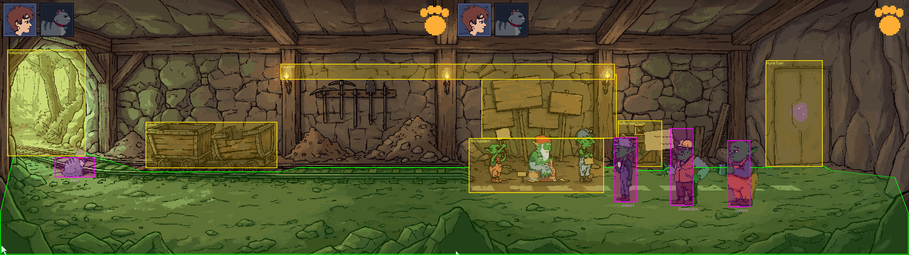

| Nr. | Prio | Kategorie | Fund | Beleg | Vorschlag |
| --- | --- | --- | --- | --- | --- |
| W1-16 | wichtig | Animation | **Grimmzahns Schild wechselt bei jedem Satz.** Im Stand hat es Kritzel (früher Fund 20 umgesetzt), beim Reden ist es wieder leer und hell, und er ist bis 18,5 % größer. Früher Fund 14.11. Nr. 20 ist damit nur halb behoben. (AN-02) | [Stand gegen Reden](belege/technical-art/grimmzahn_idle_vs_talk.png), [GIF](belege/animationen/w1_berg_grimmzahn_rede.gif) | Kritzel und Größe aus dem Stand in die Talk-Bilder übernehmen. |
| W1-17 | kosmetisch | Positionierung | Fünf Goblins und Grimmzahn stehen fast auf derselben Bodenlinie, wie bei einer Gegenüberstellung. Der Laufbereich reicht zudem über die Füße der gemalten Streikposten. (TA-07, LD-17) | [Figuren auf einer Linie](belege/technical-art/bergwerk_figuren_auf_einer_linie.png) | Zwei bis drei Figuren 15 bis 30 px nach vorn oder hinten staffeln; Laufbereich an den gemalten Goblins einbuchten. |
| W1-18 | kosmetisch | Klickflächen | Goblin 1 ist nur an 61 % seiner Fläche anklickbar (Kaffeemaschine davor; Fall von X-01). (GS-03) | [Zeigerkarte](belege/godot/bergwerk_anfang_zeiger.png) | Mit X-01. |

**Animationen:** Grimmzahns Protest läuft ([GIF](belege/animationen/w1_berg_grimmzahn_protest.gif)). Goblin 2 `gaehnen` ist 20 % größer als sein Stand (AN-12).

### 5.11 Turmkeller

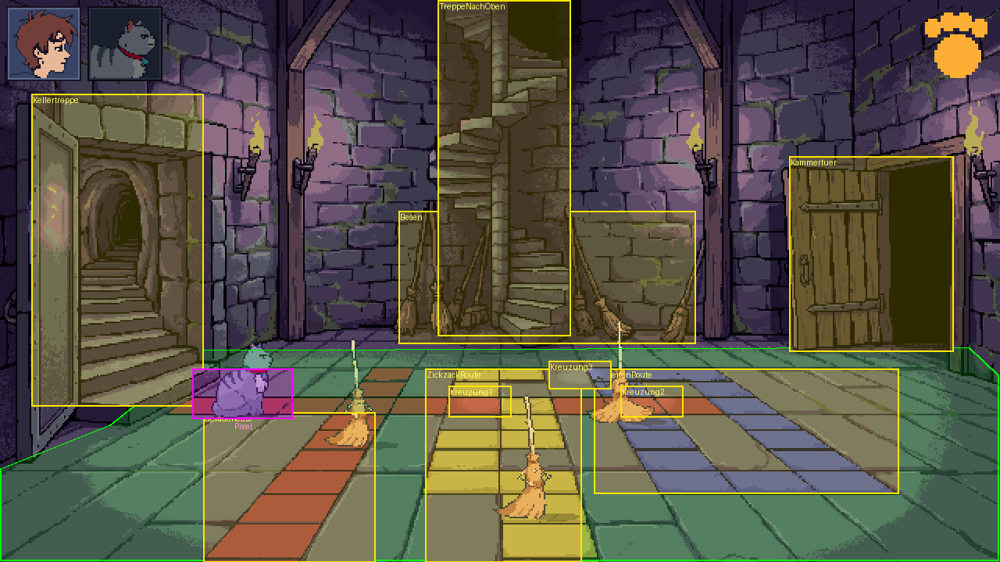

| Nr. | Prio | Kategorie | Fund | Beleg | Vorschlag |
| --- | --- | --- | --- | --- | --- |
| W1-19 | wichtig | Animation | **Pixel legt keine Haare.** Die Bewegung `haare` (R11, `W1_TURM_PIX_0200` „Haare-Animation“, auch an den Kreuzungen 2 und 3) ist gebaut, wird aber nicht aufgerufen (`room_turmkeller.gd` Z. 168). Der Kern des Rätsels bleibt Text. (AN-06) | [Kontaktbogen Pixel](belege/animationen/kontaktboegen/pixel.png), [Inventar](belege/technical-art/animations_inventar.csv) | Geste vor 0200 und an jeder Kreuzung; ein Haarhäufchen als Prop liegen lassen. |

**Animationen:** Drei Besen fegen ihre Routen, früher Fund 17 ist umgesetzt ([GIF](belege/animationen/w1_turm_besen_patrouille.gif)). Der Turmkeller-Besen ist an 59 % anklickbar (Treppe davor, X-01); dass die Besenrouten 49 % des Bodens belegen, ist gewollt.

### 5.12 Abstellkammer 1

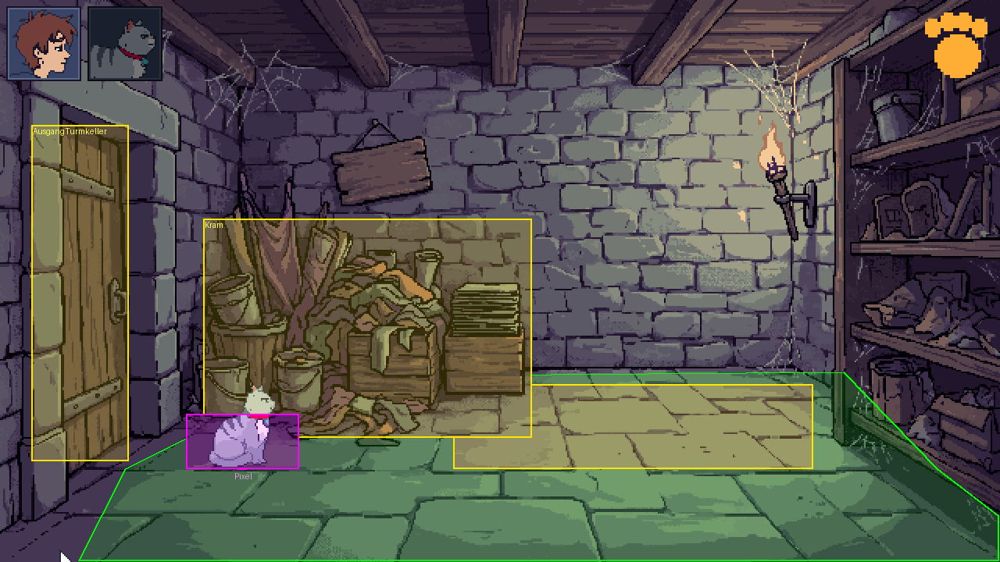

| Nr. | Prio | Kategorie | Fund | Beleg | Vorschlag |
| --- | --- | --- | --- | --- | --- |
| W1-20 | wichtig | Klickflächen | **Hotspot „Besen“ liegt auf leerem Boden.** Im Bild ist kein Besen; die Fläche deckt 23,5 % des Laufbereichs. Wer rechts hinlaufen will, bekommt „Besen“ und eine Ersatzzeile. Der Text beschreibt fegende Besen (`W1_TURM_MAX_0310`). (LD-03) | [Overlay](belege/raeume/abstellkammer_1_anfang_klick.png) | Zwei bis drei Besen-Sprites (gibt es im Turmkeller) hinstellen und den Hotspot auf sie verkleinern. |

Pixel leuchtet hier ohne Raumlicht (X-02, früher Fund 20). **Animationen:** Smaugi gibt den Kram sauber her ([GIF](belege/animationen/w1_abst_smaugi_kram.gif)).

### 5.13 Abstellkammern

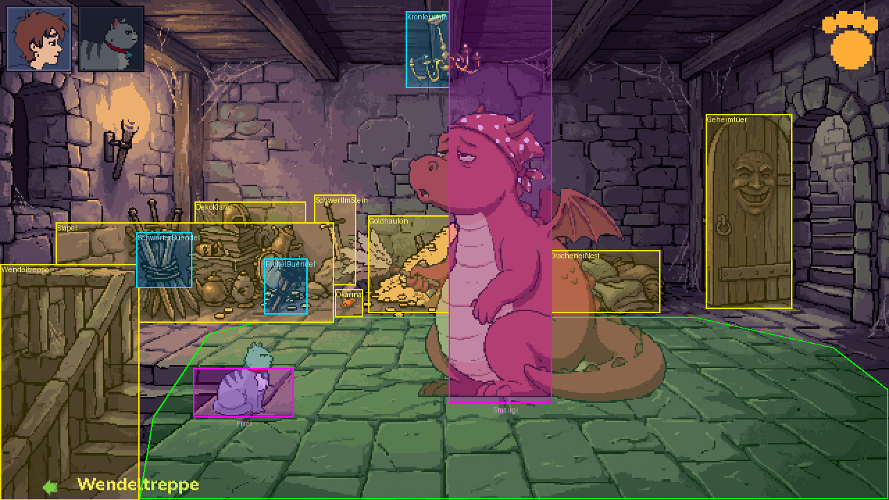

| Nr. | Prio | Kategorie | Fund | Beleg | Vorschlag |
| --- | --- | --- | --- | --- | --- |
| W1-21 | kosmetisch | Laufwege | Der offene Rundbogen mit Treppe rechts neben der Geheimtür sieht aus wie ein Ausgang, hat aber keine Klickfläche. (LD-12) | [Overlay](belege/raeume/abstellkammern_anfang_klick.png) | Hotspot mit Zeile („Da geht's nur zu noch mehr Kram.“). |
| W1-22 | kosmetisch | Klickflächen | Das Schwerterbündel ist nur aus einer Mausrichtung sicher anklickbar (17 %). (GS-02) | [Zeigerkarte](belege/godot/abstellkammern_anfang_zeiger.png) | Mit X-01. |

**Animationen:** keine eigenen Funde; die Abnehmer-Reihe (Humbert, Grimmzahn, Zeldina) ist ordentlich gestellt.

### 5.14 Thronsaal (Moderwort)

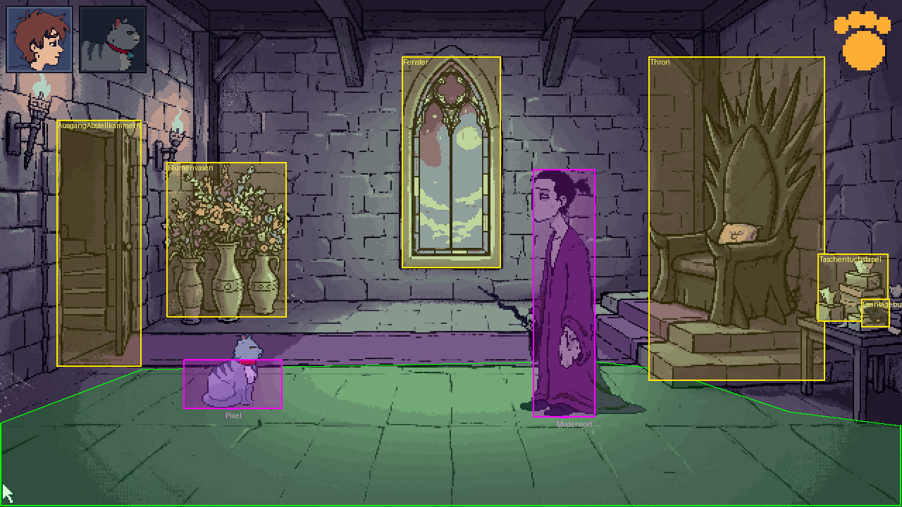

Keine neuen Funde; früher Fund 15 (Pollen) ist behoben. **Animationen:** Moderwort niest und zaubert sauber ([niesen](belege/animationen/w1_thro_moderwort_niesen.gif), [zaubern](belege/animationen/w1_thro_moderwort_zaubern.gif)).

### 5.15 Rätsel Welt 1 und Prolog

Alle früheren Rätsel-Funde (14.11. Nr. 6, 13 bis 17, 21, 34, 35; 360-Prüfung Abschnitt J) sind behoben und durch den Durchlauftest abgedeckt. Keine neuen Rätsel-Funde. Übersicht in Anhang A.

---

## 6. Welt 2 (erstmals im Spiel geprüft)

### 6.0 Welt 2 übergreifend

| Nr. | Prio | Kategorie | Fund | Beleg | Vorschlag |
| --- | --- | --- | --- | --- | --- |
| W2-01 | wichtig | Rätsel | **Die Hilfe-Pfote sagt in Welt 2 „Es ist alles erledigt. Jetzt fehlt nur noch, dass du in den Fernseher steigst.“** Welt 2 hat keine eigene „nichts offen“-Zeile, es greift die des Prologs (`hinweise.gd` Z. 205). Ein Schritt gilt erst als offen, wenn sein Raum besucht wurde (`zustand.gd` Z. 160); gleich nach der Fähre ist deshalb nichts offen, auch das Notizbuch ist leer. Aus demselben Grund gibt es nach der Audienz keinen Hinweis Richtung Startbüro und mit dem Grabstein keinen Richtung Grabhügel. (GD-01, GD-03) | [Pfote im Spiel](belege/evidenz/GD-01_pfote_fernseher.png), [Szenario A2, A5, A8](belege/game-design/szenario_lauf1.txt) | Eigene Zeile `W2_HINT_PIX_0010`; Pflichtschritte in unbesuchten Räumen bekommen eine Stufe-1-Zeile, die nur den Ort nennt. |
| W2-02 | wichtig | Rätsel | **Die Pfote empfiehlt freiwillige Rätsel bis zum Schluss.** Sie nimmt den offenen Schritt mit der kleinsten Nummer; die freiwilligen R4 (Öl) und R6a (Sandale) schließen nie, wenn man sie auslässt. Folge: mit dem Grabstein in der Hand und sogar während der Parade „Öl gibt es in der Küche“. Das Notizbuch listet beide ebenfalls bis zum Ende. (GD-02) | [Szenario A6 bis A9](belege/game-design/szenario_lauf1.txt), `hinweise.gd` Z. 59 | Freiwillige Schritte nur wählen, wenn kein Pflichtschritt offen ist; R4 nach Tag 1 und R6a/R6b nach dem Finaltag als verpasst schließen. |
| W2-03 | wichtig | Timing | **26 Sprechblasen über 140 Zeichen** (Prolog und Welt 1: keine). Sechs davon sind Hinweise der Stufe 3, also Zeilen, die ein festsitzender Spieler ganz lesen muss. Längste: `W2_RING_MAX_0030` (203 Zeichen, drei Konter in einer Blase). `pruefen.py` warnt nur für Prolog und Welt 1; früher Fund 14.11. Nr. 10 ist damit nur halb umgesetzt. (ND-01) | [Blase mit 203 Zeichen](belege/evidenz/ND-01_blase_203_zeichen.png), [Pixel 172 Zeichen](belege/evidenz/ND-01_blase_pixel_172_zeichen.png), `pruefen.py` Z. 382–385 | Die 26 Zeilen mit „//“ teilen, Warnung in `pruefen.py` für alle Abschnitte. |
| W2-04 | wichtig | Timing, Animation | **Welt 2 erzählt Handlung als Text statt im Bild.** Viele NAR-Zeilen beschreiben, was man nicht sieht, darunter Pointen: Sobeks Verbeugung vor Pixel (im Skript ausdrücklich „Animation ohne Text“), Kaugummiblase und Lichtblitz im Götter-Duell, Verbeugung aller, Socke im Aktenberg, Pixel angelt die Sandale, Max fliegt aufs Rednerpult, die Parade. Die einzelnen Stellen sind am Code belegt; die Zahl „rund 19“ ist geschätzt. Gut: Die Folgen der Probewürfe sind ab R13 als neue Hintergründe zu sehen. (ND-03, teilweise bestätigt) | [NAR im Spiel](belege/evidenz/ND-02_nar_211_zeichen.png), `welt_2.gd` Z. 382, 768, 779, 794, 894, 1277, 1322, 1652, 1792 | Für die Pointen mit Auszahlung (Sobek, Duell-Wunder, Sandale) wenigstens einen Bildwechsel (Prop ein/aus, Pose, kurzer Lauf); reine Regiezeilen streichen, wo eine Figur den Vorgang ohnehin kommentiert. |
| W2-05 | wichtig | Technik, Timing | **Klicks werden angenommen, während Figuren zwischen zwei Szenen laufen.** Hermes (Nil-Delta, Startbüro), Archimedes' Heureka-Lauf, Max barfuß an Tag 1 und der Fährmann vor jeder Abfahrt laufen außerhalb von `Spiel.szene`, die Oberfläche ist nicht gesperrt. Nachgestellt: Während Hermes hereinjoggt, nimmt das Spiel einen Bodenklick an, Max läuft los und in die folgende Szene hinein weiter. Was bei einem Klick auf einen Ausgang passiert, wurde nicht getestet; vermutlich liefe die Szene dann im nächsten Raum weiter, das wäre kritisch. (GS-18; Protokoll nur im Notiztext, Code geprüft) | `welt_2.gd` Z. 389–390, 521, 939, 1111, 1172; [Nil-Delta](belege/raeume/nil_delta_anfang.png) | Läufe in die Szene holen (als Callable in `_szene([...])`) oder vorher `G.block()` und danach `G.unblock()`; dann sind sie auch überspringbar. |
| W2-06 | kosmetisch | Timing | Esc überspringt nur jeweils eine Teilszene. Längere Abläufe (Heureka, Tag 1, Schalter, Fährfahrt) bestehen aus mehreren Szenen mit Läufen und Gegenstands-Animationen dazwischen; man muss mehrmals Esc drücken und warten (am Code geprüft, nicht im Spiel). In Welt 1 war dasselbe bei der Ankunft behoben worden (früher Fund 23). (GS-21) | `popochiu.gd` Z. 270–284; `welt_2.gd` Z. 919–944, 1101–1130, 1158–1183; [Werkstatt](belege/raeume/werkstatt_anfang.png) | Zusammengehörige Abläufe in eine Szene packen; Gegenstände bei übersprungener Szene ohne Animation geben. |
| W2-07 | wichtig | Laufwege, Pacing | **Die vier breiten Räume sind Flure.** Nil-Delta, Thronsaal, Agora und Stadion (je 1280 px) haben ihre Ausgänge an den Enden, je rund 8 s Durchgang. Gemessen: Fähre Olympia bis Wurfhebel rund 19 s Laufen plus zwei Raumwechsel, Fähre Nil-Delta bis Palastküche rund 17 s. Wurfhebel und Sandgrube liegen am entgegengesetzten Ende zum einzigen Stadion-Eingang. Bei den vielen Fährfahrten summiert sich das. (LD-15) | [Lauftests 01 bis 05](belege/level-design/lauf/01_nil_delta_ende.png), [Stadion](belege/level-design/lauf/05_stadion_ende.png) | Doppelklick auf Ausgänge auch außerhalb des Bildes (Randpfeil), oder Ausgänge näher zusammenlegen; alternativ in breiten Räumen schneller laufen. |
| W2-08 | kosmetisch | Humor | Wiederholungen, die man kurz hintereinander hört: „in einem anderen Büro“ sechsmal (in der ersten Hermes-Szene zweimal in sieben Zeilen, 0910 nimmt die Pointe 0970 vorweg); „Die spinnen, die Griechen“ weiter zweimal (360-Fund 21 halb behoben); Zenon und die Schildkröte zweimal; Abschluss- und Erschöpft-Zeilen von Cicero und Archimedes wiederholen dieselben Zitate; „freiwillig“ siebenmal (das Konzept spart das Wort fürs Finale; 360-Fund 24 hatte dieselbe Häufung im Finale bemängelt); vier Medienvergleiche von Max im Nil-Delta, zwei direkt hintereinander im Thronsaal. (ND-05, ND-16, ND-17, ND-18) | Zeilen-IDs in [`notizen/narrative.md`](notizen/narrative.md); `texte.csv` | 0910 ohne Büro; `STAD_MAX_0010` ohne Griechen-Satz; eine Zenon-Stelle streichen; Erschöpft-Zeilen ohne Zitat; `GRAB_MAX_0090`, `PARA_MAX_0280` ohne „freiwillig“; `NIL_MAX_0730`, `THRO_MAX_0120` ohne Spielbezug. |
| W2-09 | kosmetisch | Humor | Kleinigkeiten im Ton: Max spricht über die Spielstruktur („seit Welt eins nervös“, `W2_INV_MAX_0060`); Max kennt den Sandalen-Film und nimmt die Pointe der späteren Szene vorweg (`W2_AGOR_MAX_0225`; gleiche Art wie 360-Fund 16 und 58). (ND-19, ND-11) | `texte.csv`; [Agora](belege/raeume/agora_anfang.png) | „seit Schwurbelstein“; 0225 ohne Filmbezug („Die Leute knien vor ihm, und er guckt, als hätte er nur nach dem Weg gefragt.“). |

### 6.1 Nil-Delta

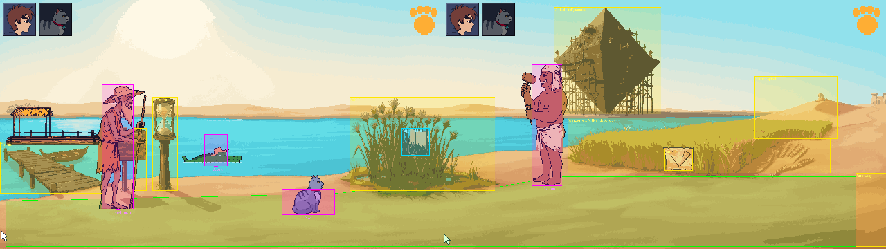

| Nr. | Prio | Kategorie | Fund | Beleg | Vorschlag |
| --- | --- | --- | --- | --- | --- |
| W2-10 | wichtig | Positionierung, Klickflächen | **Der Fährmann steht vor der Fährtafel** und verdeckt sie zu großen Teilen. Die Tafel erklärt die Zeitrechnung der Fähre (Rätselinformation). Umgekehrt ist der Fährmann selbst nur an 43 % anklickbar, weil die Tafel vor ihm gewinnt, obwohl er vor ihr gemalt ist. (LD-06, GS-16) | [Fährtafel verdeckt](belege/level-design/LD06_nil_delta_faehrtafel.png), [Zeigerkarte](belege/godot/nil_delta_anfang_zeiger.png) | Fährmann rechts neben die Tafel (etwa 235, 302); Ankunftsmarker so, dass Max nicht im Fährmann steht. |
| W2-11 | kosmetisch | Grafik, Humor | Der Bauplan liegt als Blatt im Weizenfeld, der Text sagt „Er hält den Plan verkehrt herum. Mit beiden Händen“ (`W2_NIL_MAX_0710`, auch `W2_NIL_FAE_0350`). Das Bauplan-Prop hat außerdem eine dicke dunkle Kontur und steht wie ein Aufkleber im gemalten Gras. (ND-06, TA-06) | [Prop vergrößert](belege/technical-art/nil_delta_bauplan_prop.png), [Panorama bei x 980](belege/raeume/nil_delta_anfang.png) | Text: „Der Bauplan liegt im Feld, verkehrt herum. Keiner traut sich, ihn umzudrehen.“ Kontur auf Raumfarbe abdunkeln. |

**Animationen:** Max geht sauber über den Sand ([GIF](belege/animationen/w2_nil_max_gehen.gif), [nach hinten](belege/animationen/w2_nil_max_nach_hinten.gif)), der Steinmetz meißelt, der Fährmann stakt ([Steinmetz](belege/animationen/w2_nil_steinmetz_meisseln.gif), [Fährmann](belege/animationen/w2_nil_faehrmann_staken.gif)).
- AN-10 (kosmetisch): **Hermes rutscht beim Joggen.** Sein Fuß wandert im Sheet rund 125 px/s, das Skript schiebt ihn mit festen 160 px/s; die Füße gleiten etwa 25 % vorwärts. Beleg: [GIF](belege/animationen/w2_nil_hermes_joggen.gif), `welt_2.gd` Z. 390, 939. Vorschlag: Tempo auf etwa 125 px/s oder mit der Raumskala multiplizieren.
- AN-17 (kosmetisch): **Sobeks Verbeugung fehlt.** `W2_NIL_NAR_0110` und `W2_NIL_FAE_0410` erzählen sie, im Wasser bewegt er sich nicht; `verbeugen` gibt es nur an Land und ist ungenutzt, ebenso `faehre_ziehen` (die Fahrt hat kein Bild). Beleg: [Kontaktbogen Sobek an Land](belege/animationen/kontaktboegen/sobek_land.png). Vorschlag: Kurzes Abtauchen oder Kopfnicken im Wasser (2 bis 3 px Versatz aus `idle`).

### 6.2 Thronsaal des Ramses

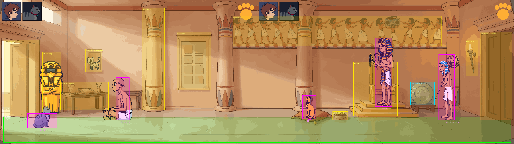

| Nr. | Prio | Kategorie | Fund | Beleg | Vorschlag |
| --- | --- | --- | --- | --- | --- |
| W2-12 | wichtig | Technik, Rätsel | **Platzhalter „[Satz]“ im Hieroglyphen-Rätsel.** Bei falschen Kombinationen ohne eigene Pointe sagt der Schreiber wörtlich „Das liest sich: „[Satz]“. … Ich les es vor.“, danach kommt nichts: kein Vorlesen, kein Hinweis, welches Feld falsch ist. Auch auf Englisch. (ND-04) | [Im Spiel](belege/evidenz/ND-04_satz_platzhalter.png), `texte.csv` Z. 3086, `welt_2.gd` Z. 645–691 | Gelegten Satz aus den Kachelnamen einsetzen, oder Zeile ohne Platzhalter plus eine allgemeine Pointe für den Restfall. |
| W2-13 | wichtig | Grafik, Rätsel | **Text und Bild passen im Thronsaal mehrfach nicht.** (a) „Säulen voller Zeichen: Augen, Vögel, Hände“: die Säulen sind glatt. (b) Schreiber („Steht an der Säule“) und Pfote schicken den Spieler zur Säule; die Grammatik hängt aber am Hotspot „Inschrift“ an der Wand, der im Raumbild wie ein leeres Fenster mit acht Feldern aussieht. Wer der Pfote folgt, klickt das Falsche. (c) „Gold, Stufen, Kissen … plattgesessen. Ramses sitzt hier sehr lange“: Holzthron ohne Kissen, Ramses steht. (d) „Zwei Männer mit Palmwedeln“: im Bild ein Wedler mit Federfächer. (ND-07, ND-13) | [Säule, Inschrift, Thron](belege/narrative/thronsaal_ramses_saeule_inschrift_thron.png), `W2_THRO_MAX_0260`, `W2_HIER_SCH_0050`, `W2_HINT_PIX_0221` | (a) Hieroglyphen auf die Säulen oder Text ändern; (b) „an der Wand“ in 0050 und 0221 oder Nahansicht auch am Hotspot „Säulen“; (c) Text an den stehenden Ramses anpassen; (d) zweiten Wedler setzen oder Text auf einen. |
| W2-14 | kosmetisch | Rätsel | Die Grammatik-Nahansicht zeigt für „Gehör“ Wellen und für „Gold“ eine Scheibe mit Punkt. Wellen lesen sich wie die Kachel „Wasser“, die Scheibe wie „Sonne“. Wer nur dem Bild folgt, legt die falsche Bitte. (ND-08) | [Nahansicht](../../../game/grafik/nahansichten/hieroglyphen_grammatik.png), `W2_THRO_MAX_0280` | Zeichen für Gehör und Gold eindeutig zeichnen oder im Text die Bildzeichen benennen. |
| W2-15 | kosmetisch | Rätsel | **Der Bonus „alle drei Wunderdinge behalten“ ist unerreichbar.** Der Brennspiegel zählt im Götter-Duell nur, wenn der Kaugummi schon weg ist; der Kaugummi verlässt die Tasche nur im Duell oder bei Nebet. Das Duell ist Pflicht, also kommt `W2_PARA_PIX_0260` nie. Wer den Spiegel mit Kaugummi in der Tasche versucht, bekommt auch keine Rückmeldung. Die Rätseldoku verspricht den Bonus; der Spieler selbst erfährt nichts davon, darum nur kosmetisch. (GD-05, GD-06) | [Szenario C1 bis C3, I2](belege/game-design/szenario_lauf2.txt), `welt_2.gd` Z. 776–778, 1791 | Bedingung `not _hat("kaugummi")` streichen; der Spiegel ist immer ein gültiges Wunder. |
| W2-16 | wichtig | Positionierung | **Der folgende Sobek steht im Thronsaal fast ganz außerhalb des Bildes.** Er wird immer auf Pixel + (−150, 5) gesetzt; vom Nil-Delta kommend steht Pixel bei x 105, Sobek also bei x −45, sichtbar ist nur die Schnauze. Genau hier läuft die Duell-Szene mit Sobeks Zeile. (GS-19) | [Bild](belege/godot/sobek_folgt_thronsaal.png), `welt_2.gd` Z. 369–371 | Seite abhängig von der Raumkante wählen (wie `partner_aufstellen`) oder auf den Marker `Sobek`. |

**Animationen:** Ramses' Rede und der Abgang des Hofkaters sind aufgenommen und passen ([Ramses](belege/animationen/w2_thro_ramses_rede.gif), [Hofkater](belege/animationen/w2_thro_hofkater_weggehen.gif), [Schreiber](belege/animationen/w2_thro_schreiber_schreiben.gif)). Ramses `unentschlossen`, Fächerwedler `faecheln` und Hofkater `abziehen` lagen außerhalb des Kameraausschnitts und sind nur im Sheet geprüft: Das Fächeln steht 3 px über der Fußlinie, liegt 43 px neben der Körpermitte des Stands und ist 22 % größer (AN-11, AN-12). Raumlicht fehlt (X-02). Sobek: siehe W2-04.

### 6.3 Palastküche

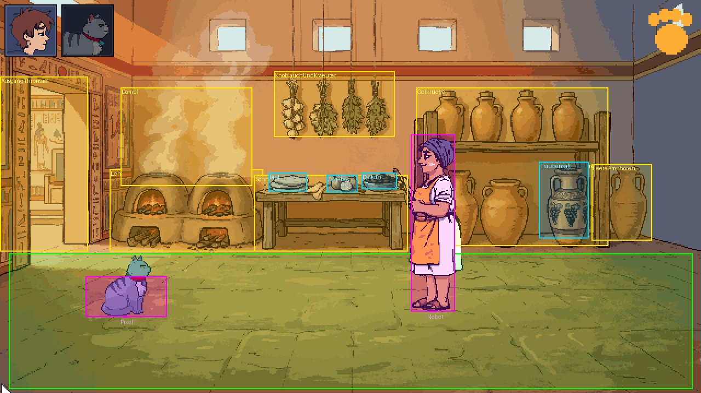

| Nr. | Prio | Kategorie | Fund | Beleg | Vorschlag |
| --- | --- | --- | --- | --- | --- |
| W2-17 | wichtig | Klickflächen | **Der Traubensaft ist nicht anklickbar.** Prop „Traubensaft“ (nehmbar) und Hotspot „TraubensaftAmphore“ haben dasselbe Rechteck; an allen 77 Rasterpunkten gewinnt der Hotspot, Linksklick bringt eine Ersatzzeile. Der Saft (falsche Fährte für R11b mit eigenem Wein-und-Essig-Gag) ist nicht zu bekommen. (GS-10) | [Messung](belege/evidenz/GS-10_traubensaft_nie_getroffen.png), [Zeigerkarte](belege/godot/palastkueche_anfang_zeiger.png) | Hotspot entfernen oder nur zeigen, wenn der Saft genommen ist. |
| W2-18 | wichtig | Animation, Positionierung | **Nebet rührt in der Luft.** Ihre Ruhe-Schleife `ruehren` zeigt den Löffel ohne Topf; Tisch und Schüsseln stehen hinter ihr. Sie ist außerdem nur an 42 % anklickbar (Ölkrüge davor; wichtig für R4). (AN-08, GS-17) | [Bild](belege/technical-art/nebet_ruehren_ohne_topf.png), [GIF](belege/animationen/w2_kueche_nebet_ruehren.gif) | Nebet hinter den Tisch an die Schüssel stellen oder einen Topf als Prop vor sie setzen. |
| W2-19 | kosmetisch | Grafik | Die rechte Seitenwand ist eine flache, kalte blaugraue Fläche ohne Struktur im sonst warmen Raum. (TA-05) | [Ausschnitt](belege/technical-art/palastkueche_rechte_wand.png) | In der Raumfarbe nachfärben (Lehmputz, Schatten). |
| W2-20 | kosmetisch | Rätsel | „Traubensaft, der in hundert Jahren Essig wird“ (`W2_KUCH_MAX_0105`, `0110`). Laut Fährtafel wird er nach 112 Jahren erst Wein, dann Essig. Eher irreführend als rätselbrechend. (ND-20) | `texte.csv`; [Nahansicht Fährtafel](../../../game/grafik/nahansichten/faehrtafel.png) | „… in hundert Jahren Wein wird. Und dann sauer.“ |

**Animationen:** Teig kneten sauber ([GIF](belege/animationen/w2_kueche_nebet_teig.gif)). Raumlicht fehlt (X-02).

### 6.4 Sphinx

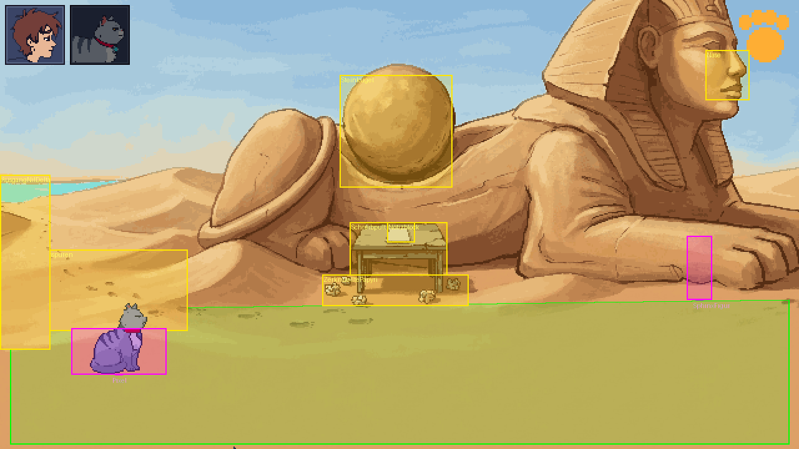

| Nr. | Prio | Kategorie | Fund | Beleg | Vorschlag |
| --- | --- | --- | --- | --- | --- |
| W2-21 | wichtig | Klickflächen | **Die Sphinx selbst ist kaum anklickbar.** Die Gesprächsfigur für R8, R7 und Weg C ist ein ganz durchsichtiges Bild mit einer Klickfläche von 20 × 51 px an der Vorderpfote. Auf dem Kopf liegt nur „Nase“ (Benutzen gibt eine Ersatzzeile), der übrige Körper hat keine Klickfläche. Wer mit der Sphinx reden will und auf den Kopf klickt, bekommt nichts. (GS-11, LD-11) | [Overlay, magenta Streifen an der Pfote](belege/raeume/sphinx_anfang_klick.png) | Klickpolygon über Kopf und Brust legen, „Nase“ als kleineres Objekt darin. |
| W2-22 | wichtig | Rätsel | **Sphinx-Rätsel mit zu wenigen Bausteinen bringt nur eine Zufalls-Ersatzzeile** („Fast. Also, gar nicht.“), kein Wort dazu, dass Hinweise fehlen. Zwei von drei Bausteinen je Wunderding gibt es nur beim zweiten Ansehen des Gegenstands; „leuchtet“ sonst nur über das Handy auf den Hofkater, der nach R2b weg ist. Stufe 3 nennt die Sätze, nicht das zweite Ansehen. (GD-04) | [Szenario B1](belege/game-design/szenario_lauf1.txt), `welt_2.gd` Z. 1507 | Eigene Sphinx-Zeile bei weniger als drei Bausteinen („Du hast {n}. Sieh dir deine Wunderdinge genauer an.“); zweite Ansehen-Zeile gleich beim ersten Ansehen anhängen. |
| W2-23 | kosmetisch | Grafik, Humor | „Ein Schreibpult, so groß wie ein Auto“: Das Pult ist ein kleiner Tisch, niedriger als Max. Die Pointe lebt vom Größenkontrast, der im Bild fehlt. (ND-09) | [Panorama bei x 320](belege/raeume/sphinx_anfang.png) | Pult vergrößern oder Text: „Ein Schreibpult in Menschengröße. Für eine Sphinx ist das ein Notizzettel.“ |

**Animationen:** keine Figurenanimation (Sphinx ist gemalt). Max geht sauber zum Tisch ([GIF](belege/animationen/w2_sphinx_max_zum_tisch.gif)). Das Sheet `sphinx_figur` ist absichtlich leer.

### 6.5 Fährsteg Olympia

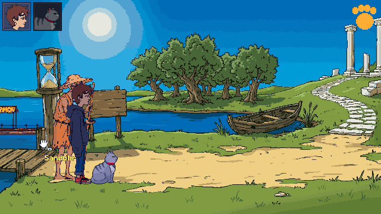

| Nr. | Prio | Kategorie | Fund | Beleg | Vorschlag |
| --- | --- | --- | --- | --- | --- |
| W2-24 | wichtig | Positionierung | **Max kommt im Fährmann an.** Der Ankunftsmarker liegt 12 px neben dem Fährmann, beide verschmelzen. Dass Max dabei Tafel und Sanduhr verdeckt, ist übertrieben gemeldet worden; das tut eher der Fährmann. Der Fährmann ist hier an 69 % anklickbar. (LD-05, TA-04, GS-16; teilweise bestätigt) | [Startbild](belege/technical-art/faehrsteg_max_verdeckt_faehrmann.png), [Zeigerkarte](belege/godot/faehrsteg_olympia_anfang_zeiger.png) | Ankunftsmarker auf etwa (230, 315), Pixel weiter rechts. |

Fähre und Fährmann bringen hier und in Syrakus beim Rechtsklick eine Ersatzzeile (X-08). **Animationen:** Fährmann wie im Nil-Delta, nicht gesondert aufgenommen.

### 6.6 Agora

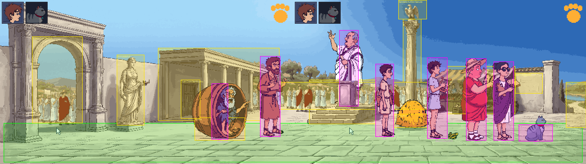

| Nr. | Prio | Kategorie | Fund | Beleg | Vorschlag |
| --- | --- | --- | --- | --- | --- |
| W2-25 | wichtig | Größen, Laufwege | **Die Tür zum Startbüro ist kaum zu finden.** Sie ist 85 px hoch, Max steht dort mit 167 px; sie liegt dunkel in der Säulenhalle, ein Drittel hinter Diogenes' Tonne, und der Ausgang ist nur 42 px breit. Das Startbüro ist Pflichtweg. (LD-07, GS-14) | [Tür gegen Max](belege/level-design/LD08_agora_tuer_startbuero.png) | Tür größer und heller (Schild „Startbüro“), Tonne und Philosoph 60 bis 80 px nach rechts. |
| W2-26 | wichtig | Klickflächen, Grafik | **Die Sandale verrät sich und bleibt hängen.** Der Hotspot „Sandale“ am Adler ist vom ersten Betreten an sichtbar und klickbar, obwohl dort erst nach Tag 1 etwas liegt; der Name verrät das spätere Rätsel. Nach R6a (Max trägt die Sandale) bleibt das Hintergrundbild mit Sandale bis R13 stehen. Die Kletterei selbst ist nur NAR-Text (W2-04). (GS-13, ND-10) | [Zeigerkarte](belege/godot/agora_anfang_zeiger.png), [Hintergrund-Fassungen](belege/narrative/w2_hintergrund_varianten.png), `welt-2.json` Z. 2433–2435 | Hotspot nur zwischen R12 und R6a zeigen; dritte Hintergrundfassung ohne Sandale ab R6a. |
| W2-27 | kosmetisch | Klickflächen | Mehrere Nebenfiguren sind nur teilweise anklickbar: Touristin und Tourist knapp 40 % (Marktstände dahinter), Cicero 64 % (ein Klick auf seine Beine startet das Gespräch mit der Menge), Tiro 60 %, Philosoph 62 %; das Rednerpult nur 38 %. (GS-17, Fall von X-01) | [Zeigerkarte](belege/godot/agora_anfang_zeiger.png) | Mit X-01; „Menge“ auf die Menschen links und rechts des Pults zuschneiden. |
| W2-28 | kosmetisch | Positionierung, Laufwege | Tiro, Brian, Tourist und Touristin stehen auf derselben Bodenlinie (y ≈ 300), Max läuft auf gleicher Tiefe durch sie hindurch. Der Laufbereich reicht über den Sockel der linken Bogensäule. (TA-07, LD-17) | [Figuren auf einer Linie](belege/technical-art/agora_figuren_auf_einer_linie.png) | Tiefe staffeln, Laufbereich am Sockel einbuchten. |

**Animationen:** Cicero `rede`, Philosoph `schimpfen`, Brian `abwehren` und Max `zeigen` sind sauber und gut lesbar ([Cicero](belege/animationen/w2_agora_cicero_rede.gif), [Philosoph](belege/animationen/w2_agora_philosoph_schimpfen.gif), [Brian](belege/animationen/w2_agora_brian_abwehren.gif), [Max zeigt](belege/animationen/w2_agora_max_zeigen.gif)). Ein Klick während `zeigen` bricht sauber ab ([GIF](belege/animationen/w2_agora_max_zeigen_abbruch.gif)).

### 6.7 Startbüro

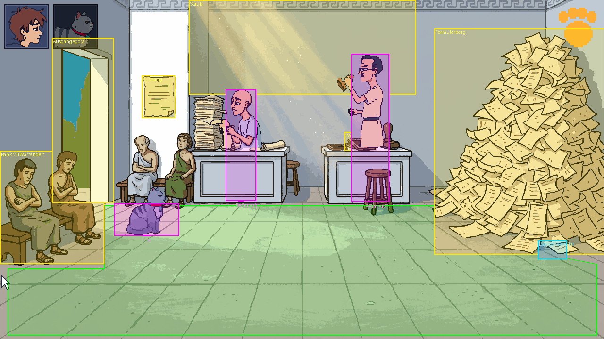

| Nr. | Prio | Kategorie | Fund | Beleg | Vorschlag |
| --- | --- | --- | --- | --- | --- |
| W2-29 | **kritisch** | Technik | **Das Gespräch mit Hermes hängt das Spiel auf.** Der Dialog hat nur eine Option („Was hältst du von den Römern?“) und keine Abschiedsoption. Nach der Wahl bleibt eine leere Menüleiste stehen, das Gespräch läuft weiter, ein Klick auf den Boden bewegt Max nicht mehr, Esc beendet es nicht. Im Spiel nachgestellt (vor dem Gespräch läuft Max auf denselben Klick). Hermes steht im Startbüro, solange `W2_HERMES_IM_BUERO` gilt und R12 nicht gelöst ist, also auf dem Pflichtweg. Er steht dabei direkt vor Max und Pixel. (ND-12) | [Menü vorher](belege/evidenz/ND-12_hermes_menue_vorher.png), [Menü leer](belege/evidenz/ND-12_hermes_menue_leer.png), [nach Klick und Esc](belege/evidenz/ND-12_hermes_nach_klick_und_esc.png); `welt-2.json` Dialog `hermes`; `welt_2.gd` Z. 349 | Abschiedsoption mit `beendet` ergänzen (oder 0650 als beendend markieren). Zusätzlich in `CQDialog` stoppen, wenn keine Option sichtbar ist, und in `pruefen.py` jedes Gespräch ohne beendende Option melden. |
| W2-30 | kosmetisch | Rätsel | Nach dem Startpass lässt sich noch ein Rundschreiben schreiben, das den Kugelschreiber (Wunderding) verbraucht. Am Schalter laufen dann die Stempel-Szene und die Sandalen-Übergabe noch einmal, auch wenn die Sandalen längst weg sind. Die Socke ist richtig gesperrt. (GD-07) | [Szenario E1 bis E4](belege/game-design/szenario_lauf2.txt), `welt_2.gd` Z. 871, 882, 919 | In beiden Kombinationen und in `_schalter` zuerst R3b prüfen. |
| W2-31 | kosmetisch | Grafik, Humor | Der „Mann mit dem Bart bis zum Boden“ fehlt; an ihm hängt ein kleiner Running Gag über vier Zeilen („Der Bart war schneller“). Der „Berg Schriftrollen“ ist ein Berg loser Blätter, Beamter 1 hält keine lange Rolle. (ND-14) | [Ausschnitt Bank](belege/narrative/startbuero_bank_beamter.png) | Einem Wartenden einen langen Bart geben; „Schriftrollen“ in „Formulare“ ändern. |
| W2-32 | kosmetisch | Positionierung, Klickflächen | Die Wartebank steht vor der Eingangstür, Max wirkt beim Betreten, als müsse er darüber steigen. Die zwei Wartenden auf der mittleren Bank haben keine Klickfläche; die Wachstafeln sind nur aus einer Mausrichtung sicher anklickbar; Beamter 2 ist an 58 % anklickbar (Kopf im Hotspot „Staub“). (LD-13, GS-23, GS-02, GS-17) | [Overlay](belege/raeume/startbuero_anfang_klick.png), [Zeigerkarte](belege/godot/startbuero_anfang_zeiger.png) | Bank an die linke Wand; mittlere Bank in `BankMitWartenden` aufnehmen. |

**Animationen:** Beamter 2 stempelt, Beamter 1 döst ein, beide sauber und lustig ([Stempel](belege/animationen/w2_buer_beamter2_stempeln.gif), [eindösen](belege/animationen/w2_buer_beamter1_eindoesen.gif)). Raumlicht fehlt (X-02). Die Beamten stehen sauber hinter den Pulten.

### 6.8 Stadion

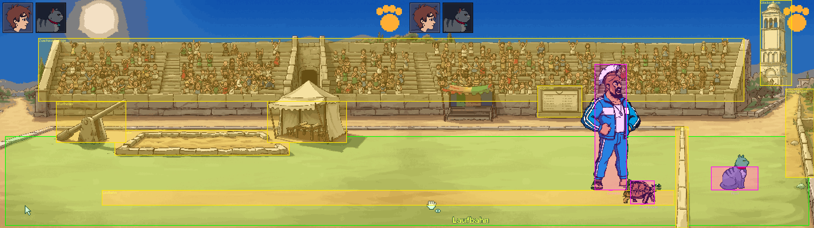

| Nr. | Prio | Kategorie | Fund | Beleg | Vorschlag |
| --- | --- | --- | --- | --- | --- |
| W2-33 | wichtig | Laufwege, Klickflächen | **Laufbahn und Startlinie fangen Laufklicks ab.** Der Hotspot „Laufbahn“ ist ein 900 px langer Streifen mitten im Laufbereich (12 % des Bodens); ein Linksklick schickt Max immer zur Mitte und gibt eine Ersatzzeile. Die „Startlinie“ schneidet den Boden senkrecht und kann Tag 1 starten. (LD-04, GS-15) | [Overlay](belege/raeume/stadion_anfang_klick.png) | Laufbahn auf die gemalte Bahn außerhalb des Laufbereichs legen oder nur per Rechtsklick; Startlinie nur oben. |
| W2-34 | wichtig | Rätsel | **Die acht Aussagen des Diskus-Diebstahls hört man genau einmal.** Sie stehen nirgends im Notizbuch, obwohl Rätseldoku und Code-Kommentar das sagen; „Reden“ wiederholt sie nicht. Die Verdächtigen stehen an drei Orten in zwei Epochen. Für das einzige echte Logikrätsel der Welt heißt das: mitschreiben oder raten. (GD-08) | [Szenario G1](belege/game-design/szenario_lauf2.txt), `welt_2.gd` Z. 1403, 1406 | Notizbuch-Seite „Aussagen“; mindestens die Option „Was hast du noch mal gesagt?“. |
| W2-35 | kosmetisch | Rätsel | **Aufgeben beim Diskus-Diebstahl kostet nichts.** Aufgeben geht erst, wenn alle acht Aussagen gehört sind (`welt_2.gd` Z. 1406); dann löst der Ersatz bei Leonidas R7 sofort; die Wurfscheibe zählt beim Diskuswurf wie der echte Diskus, auch für „Fünfkampf“. Das schwerste Rätsel der Welt hat damit keinen Anreiz. (GD-09) | [Szenario G2, I1](belege/game-design/szenario_lauf2.txt), `welt_2.gd` Z. 1425, 1666 | Bestleistung nur mit dem echten Diskus, oder Ersatz erst nach einem falschen Anklageversuch anbieten. |
| W2-36 | kosmetisch | Rätsel | Die Startlinie sagt vor dem Finaltag immer „Kein Diskus, keine Konter, kein Gegner“, egal was fehlt. Ohne Brennspiegel sagt Archimedes beim Paradenplan nur „Ohne Mittagssonne ist mein Spiegel nur ein Teller“; das klingt nach falscher Position, nicht nach fehlendem Gegenstand. (GD-10, GD-12) | [Szenario I3](belege/game-design/szenario_lauf2.txt), `W2_STAD_MAX_0300`, `W2_PARA_ARC_0090` | Je fehlendem Teil eine eigene Zeile; Archimedes: „Mein Spiegel liegt noch in der Werkstatt.“ |
| W2-37 | kosmetisch | Grafik, Laufwege | Der Wurfhebel ist ins Hintergrundbild gemalt und steht schon beim ersten Besuch da, bevor Archimedes ihn im Training baut und mitbringt. Der Sandweg links oben führt sichtbar aus dem Bild, ist aber kein Ausgang. (ND-15, LD-12) | [Panorama bei x 140](belege/raeume/stadion_anfang.png) | Hebel als Prop ab dem Training; Weg im Bild abschneiden oder Hotspot mit Zeile. |
| W2-38 | wichtig | Animation | **Beim Rennen an Tag 1 läuft nur Max.** Leonidas „rennt los, biegt falsch ab“ und die Schildkröte überholt laut Erzähler, beide stehen aber still, obwohl `losrennen` und `rennen` gebaut sind und im Raum gut aussehen. Laut Entscheidung 10 bewusst offen; die sichtbarste Pointe der Welt bleibt trotzdem Text. (AN-07) | [Leonidas losrennen](belege/animationen/w2_stad_leonidas_losrennen.gif), [Schildkröte](belege/animationen/w2_stad_schildkroete_rennen.gif), [Max barfuß](belege/animationen/w2_stad_max_barfuss.gif), `welt_2.gd` Z. 1158–1185 | Zwei Marker an der Bahn: Leonidas mit `laufen_zu(…, "losrennen")` links hinaus, Schildkröte mit `rennen` an Max vorbei. |

Leonidas ist an 70 % anklickbar (Zuschauerränge, X-01). **Animationen:** Leonidas brüllt sehr gut ([GIF](belege/animationen/w2_stad_leonidas_bruellen.gif)); Max `diskus`, `speer`, `barfuss` sauber ([Diskus](belege/animationen/w2_stad_max_diskus.gif), [Speer](belege/animationen/w2_stad_max_speer.gif)). Die Parade im Endzustand ist richtig aufgestellt ([Endzustand](belege/raeume/stadion_ende_klick.png)).

### 6.9 Hafen Syrakus

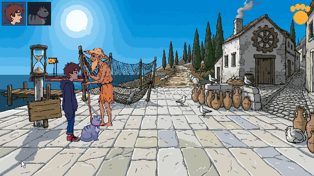

| Nr. | Prio | Kategorie | Fund | Beleg | Vorschlag |
| --- | --- | --- | --- | --- | --- |
| W2-39 | wichtig | Positionierung, Klickflächen | **Pixel kommt auf den Füßen des Fährmanns an, Max direkt vor ihm**, und der Fährmann ist nur an 22 % anklickbar (die Fischernetze dahinter gewinnen, nur die Beine bleiben). (TA-04, GS-16) | [Startbild](belege/technical-art/hafen_start_ueberlappung.png), [Zeigerkarte](belege/godot/hafen_syrakus_anfang_zeiger.png) | Ankunftsmarker eine Figurbreite neben den Fährmann; Netz-Rechteck verkleinern. |
| W2-40 | kosmetisch | Laufwege | Der Ausgang zur Werkstatt liegt 17 px außerhalb des Laufbereichs; Max bleibt vor der Gasse stehen und wechselt dort den Raum. Der Pfad zum Grabhügel beginnt über der Hinterkante des Laufbereichs. (LD-16) | [Lauftest](belege/level-design/lauf/06_hafen_syrakus_ende.png) | Laufbereich in die Gassenmündung und hinten bis unter den Pfad erweitern. |

**Animationen:** Fährmann nicht gesondert aufgenommen.

### 6.10 Werkstatt des Archimedes

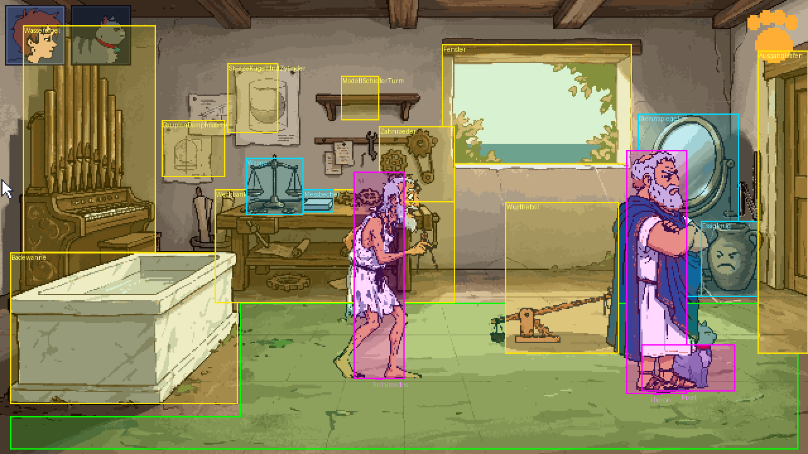

| Nr. | Prio | Kategorie | Fund | Beleg | Vorschlag |
| --- | --- | --- | --- | --- | --- |
| W2-41 | wichtig | Positionierung | **König Hieron steht im einzigen Durchgang.** Jeder Weg zur Tür führt hinter ihm vorbei; im Lauftest verschwindet Max bei x 520 ganz hinter ihm. Max und Pixel kommen auf Hierons Füßen an; Hieron verdeckt 39 % des Brennspiegels (Pflichtgegenstand), Max bei der Ankunft 71 % des Essigkrugs. (LD-01, TA-04) | [Lauftest in vier Bildern](belege/level-design/LD_werkstatt_brennspiegel_lauf.png), [Startbild](belege/technical-art/werkstatt_start_ueberlappung.png) | Hieron nach links zur Badewanne und Waage stellen (er beaufsichtigt die Kronenprobe); Ankunft auf (600, 330), Pixel mit Abstand daneben. |
| W2-42 | wichtig | Klickflächen | Archimedes ist nur an 41 % anklickbar (Oberkörper hinter der Werkbank; R5, Training, Grab-Entwurf), Hieron an 34 %; Waage und Brennspiegel sind richtungsabhängig. (GS-17, GS-02) | [Zeigerkarte](belege/godot/werkstatt_anfang_zeiger.png) | Mit X-01. |
| W2-43 | kosmetisch | Grafik, Humor | Der Hotspot „Modell“ liegt auf einem leeren Regalbrett; die Zeile beschreibt ein schiefes Turmmodell mit Zettel (wichtig für den Turm-Gag). Max sagt zu Hieron erst „Ihr“, dann „du“. (GS-12, ND-21) | [Regal leer](belege/godot/werkstatt_modell_leer.png), `W2_WERK_MAX_0250`, `0450`, `0490` | Modell ins Regal malen oder Hotspot entfernen; „Du bist der König?“. |

**Animationen:** Archimedes `zirkel` gut ([GIF](belege/animationen/w2_werk_archimedes_zirkel.gif)). Max `katapult` sitzt 6 px über dem Boden, laut Regie gewollt ([GIF](belege/animationen/w2_werk_max_katapult.gif)).
- AN-09 (kosmetisch): **Heureka springt.** Die Posen enden etwa 50 px neben dem Start nach links; der anschließende Lauf beginnt wieder am Startpunkt und geht nach rechts, also Sprung zurück und Richtungswechsel. Beleg: [Posen](belege/animationen/w2_werk_archimedes_heureka_posen.gif), [Lauf](belege/animationen/w2_werk_archimedes_heureka_lauf.gif). Vorschlag: Lauf am Endpunkt der Posen beginnen oder letzte Pose spiegeln.

### 6.11 Grabhügel

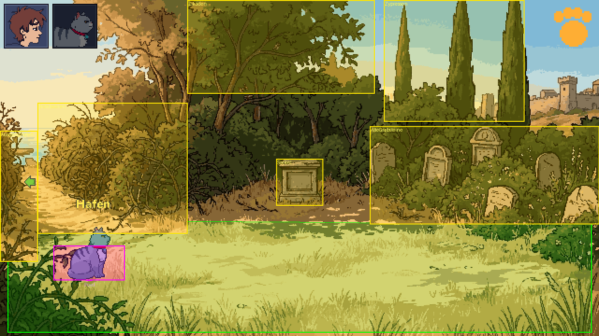

| Nr. | Prio | Kategorie | Fund | Beleg | Vorschlag |
| --- | --- | --- | --- | --- | --- |
| W2-44 | wichtig | Klickflächen | **Der sichtbare Weg zum Hafen liegt unter dem Hotspot „Brombeeren“.** Der Ausgang ist nur der 40 px breite Streifen am linken Rand; wer den gemalten Pfad anklickt, bekommt Brombeeren. (LD-08) | [Overlay](belege/raeume/grabhuegel_anfang_klick.png) | Ausgang auf den Pfad erweitern, Brombeeren auf das Gebüsch darüber verkleinern. |
| W2-45 | kosmetisch | Rätsel | „137 Jahre“ ist ein Botengang, kein Rätsel: Der Sockel steht nur in Syrakus, dort ist der Stein immer richtig alt. Die vorbereitete Zeile für einen zu jungen Stein kann nie kommen, Stufe 3 deutet eine Gefahr an („ohne Umweg“), die es nicht gibt. Bewusst so gebaut, nimmt der Zeitfähre aber ihr zweites Rätsel. (GD-11) | [Szenario H3, H4](belege/game-design/szenario_lauf2.txt), `welt_2.gd` Z. 1619 | Entweder Stufe 3 ohne „ohne Umweg“, oder Cicero sucht in Olympia und Max muss umlenken. |

Ein Busch rechts unten liegt knapp im Laufbereich (LD-17). **Animationen:** Max geht zum Sockel, Größe zum Sockel plausibel ([GIF](belege/animationen/w2_grab_max_zum_sockel.gif)).

---

## 7. Animationen gesamt

Vollständiges Inventar: [`belege/technical-art/animations_inventar.csv`](belege/technical-art/animations_inventar.csv) (Status und Aufrufstellen je Animation), Messwerte je Animation (Höhe gegen Stand, Fußlinie, Versatz, Schleifennaht): [`sheet_messwerte.csv`](belege/technical-art/sheet_messwerte.csv), Kontaktbögen aller 54 Figuren: [`belege/animationen/kontaktboegen/`](belege/animationen/kontaktboegen/), Inventar je Figur als Tabelle: [`notizen/animationen.md`](notizen/animationen.md).

### 7.1 Inventar und Abgleich

354 Animationen in 55 Sheets (`game/daten/figuren/*.json`), dazu 4 Einzelposen von Max (`max_posen/`) und die gemalten Ambiente-Bildfolgen je Raum (`tools/ambiente.yaml`, `effekte` im Layout; Code-Effekte in `cq_ambiente.gd`). Abgeglichen mit allen Aufrufen (`geste(`, `geste_halten(`, `rede_geste(`, `warte_geste(`, `play_animation(`, `laufen_zu(…)`, `_figur_laeuft(…)`, Tabellen ZEILE, RUHE, WARTEN in `gesten_*.gd`) und mit `docs/grafik/gesten-regie.md`.

| Status | Anzahl |
| --- | --- |
| generisch (idle, talk, walk, gehen_vorn/hinten, Treppe, Ersatzgänge) | 149 |
| per Tabelle oder Code aufgerufen | 133 |
| nur über Sonderweg im Raumcode (Besen, Sprung, Varianten) | 15 |
| **ungenutzt** | 13 |
| Altfassungen `_alt` | 44 |

- **Ungenutzt (gebaut, nie aufgerufen):** Max `melken` (W1-06), Pixel `haare` (W1-19), Schildkröte `rennen` (W2-38), Sobek an Land `verbeugen` und Sobek `faehre_ziehen` (AN-17), Hermes `joggen_posen` (doppelt zu `joggen`), Schmied `ins_feuer`, `blasebalg`, `zum_amboss`, `abschrecken` (laut Regie bewusst), Pixel `tragen`, `ohrfeige`, `vom_schrank_fallen` (für Welt 3 oder Finale).
- **Fehlend (Aufruf ohne Animation):** keine. Laut Skript gewünscht, aber bewusst nicht gebaut (Entscheidung 14): Minka und Hofkater fauchen, Toadi rennt auf der Stelle, Fährmann verbeugt sich, Leonidas außer Atem.
- **Doppelt:** `sphinx_figur` (gewollt leer), Ziegen-`walk` neben `gehen`, Hermes `joggen_posen`, die 44 `_alt`-Fassungen und 327 pixelgleiche Einzelbilder (AN-15).

### 7.2 Querschnittsfunde

**Gebaut, aber nicht aufgerufen** (keine eigene Zählung, die Funde stehen bei den Räumen): Melken (W1-06), Pixels Haare (W1-19), Tag-1-Rennen von Leonidas und Schildkröte (W2-38), Sobeks Verbeugung (AN-17). Das sind genau die Szenen, die heute nur Text sind; jede braucht nur eine Zeile in der Gesten-Tabelle oder ein `laufen_zu`.

| Nr. | Prio | Kategorie | Fund | Beleg | Vorschlag |
| --- | --- | --- | --- | --- | --- |
| A-01 | wichtig | Animation | **Reden oder Ruhe ist bei drei Figuren eine andere Zeichnung**: Gollo (W1-05), Grimmzahn (W1-16) und die XXL-Ziege: Ihre Ruhe-Schleife `kauen` ist eine Dreiviertel-Ansicht statt Seitenansicht, schmaler und 6 px über dem Boden; bei jedem Anhalten und Losgehen dreht sie sich, schrumpft und hebt ab (Dorfplatz, Schmiede, Troll-Brücke). (AN-01, AN-02, AN-03) | [XXL-Ziege](belege/technical-art/xxl_ziege_kauen_andere_zeichnung.png) | Kauen aus der Seitenansicht des Stands bauen oder `idle` als Ruhe lassen und Kauen nur als Warte-Geste. |
| A-03 | kosmetisch | Animation | Mehrere Bewegungen stehen höher als die Fußlinie des Stands und hüpfen beim Wechsel: Fächerwedler `faecheln` 3 px (dazu 43 px seitlich versetzt), Waldemar `regelbuch` 3 px, Sobek `kriechen` 3 px, XXL-Ziege `kauen` 6 px, Max `melken` 6 px. (AN-11) | [`sheet_messwerte.csv`](belege/technical-art/sheet_messwerte.csv) (Spalten `fuss_min`, `fuss_max`, `cx_abw_idle`) | Auf die Fußlinie des Stands setzen (`tools/sheet_verschieben.py`); automatische Prüfung „Fußlinie gleich Stand“. |
| A-04 | kosmetisch | Animation | Die Regel „höchstens 5 % Größenabweichung zum Stand“ wird oft gerissen, teils sinnvoll (Arme hoch), teils nicht: Fächerwedler `faecheln` 22 %, Zeldina `kiste_schwert` 22 %, Goblin 2 `gaehnen` 20 %, Hofkater `talk` 12 %, Toadi `walk` 12 % kleiner, Schmied-Arbeitsgesten 13 bis 14 %. (AN-12) | [`sheet_messwerte.csv`](belege/technical-art/sheet_messwerte.csv) (`h_abw_max`), [Kontaktbögen](belege/animationen/kontaktboegen/) | Liste gegen die Kontaktbögen durchgehen; nur Gesten mit gestreckten Armen ausnehmen. |
| A-05 | kosmetisch | Animation | Atem-Schleifen zucken am Schleifenende: Bei Opa `idle` ist der Wechsel von Bild 7 zu Bild 0 siebenmal so stark wie zwischen den übrigen Bildern, bei Max `idle` 4,5-mal, Max `gehen_hinten` 3,6-mal. Ob das im Spiel auffällt, wurde nicht angesehen. (AN-13) | [`sheet_messwerte.csv`](belege/technical-art/sheet_messwerte.csv) (`naht_faktor`), [Kontaktbogen Opa](belege/animationen/kontaktboegen/opa.png) | Letztes Bild ans erste angleichen oder Zwischenbild. |
| A-06 | kosmetisch | Animation | Huhn Berta, Schwan, Smaugi und Zauberbesen haben laut Inventar einen Gang aus Standbildern; wenn sie bewegt werden, gleiten sie. Nicht nachgerechnet. (AN-14, nicht prüfbar) | [Inventar](belege/technical-art/animations_inventar.csv) | Für Berta zwei Flatterbilder; bei den anderen klären, ob sie je laufen. |
| A-07 | kosmetisch | Workflow | 44 Altfassungen liegen ungenutzt in den Sheets, dazu 327 pixelgleiche Einzelbilder (Gesten speichern das Standbild erneut). Das Max-Sheet ist 16 240 px breit, knapp unter der üblichen Texturgrenze von 16 384 px. (AN-15) | [Inventar](belege/technical-art/animations_inventar.csv) | In `tools/figur.py` ohne `_alt` neu packen, gleiche Bilder über `folge` einmal speichern. |
| A-08 | kosmetisch | Workflow | Die Doku hinkt hinterher: `gesten-regie.md` nennt veraltete Dauern (Max `gehen_vorn` 4 × 110 ms, im JSON 8 × 60), `status-alle-shots.md` führt Bewegungen, die längst auf main sind, als „auf Zweig eingebaut“. (AN-16, gleiche Ursache wie WF-09) | [`gesten-regie.md`](../../grafik/gesten-regie.md) Z. 213; [`status-alle-shots.md`](../../grafik/status-alle-shots.md) Z. 45, 56, 130 | Dauern und Status aus den JSONs erzeugen. |

### 7.3 Ablauf, Einbau, Sinnhaftigkeit

- **Ablauf:** keine leeren Bilder, keine Magenta-Reste in 354 Animationen. Blickrichtung bei gespiegelten Läufen überall richtig. Max' Gang passt zum Tempo (rund 165 px/s Fußweg bei 150 px/s), früher Fund 3 (Fußrutschen) ist erledigt; ebenso Max barfuß und Archimedes' Heureka-Lauf. Es rutscht nur Hermes (AN-10); Max als Pilz und einige Tiere gleiten, weil ihr Gang aus Standbildern besteht (W1-09, A-06).
- **Einbau:** Gesten kehren in den Aufnahmen sauber in die Ruhe zurück; ein Klick während einer Geste bricht sie sofort ab, ohne hängende Pose ([Dachboden](belege/animationen/p_dach_max_benutzen_abbruch.gif), [Agora](belege/animationen/w2_agora_max_zeigen_abbruch.gif)). Harte Wechsel gibt es dort, wo Reden oder Ruhe eine andere Zeichnung sind (A-01), und kleine Hüpfer, wo eine Bewegung über der Fußlinie steht (A-03).
- **Sinnhaftigkeit, was die Pointe trägt:** Archimedes' Heureka-Lauf mit flatterndem Handtuch, Besen-Patrouille, Opas Panik als Redebewegung, Cicero mit erhobenem Arm, Leonidas brüllt, Beamter 2 stempelt.
- **Regie-Empfehlung (Nachtrag auf Sebastians Frage): Braucht Max bei jedem Satz eine Bewegung?** Nein. Max spricht in fast jeder zweiten Zeile; eine volle Geste bei jedem Satz wirkt unruhig und nutzt sich ab. Vorschlag: beim normalen Reden nur Mund und leichtes Kopfnicken; Gesten gezielt bei Pointen, Ärger, Staunen und beim Zeigen auf etwas (grob jede fünfte Zeile); beim Ansehen von Gegenständen meist keine. Die Gesten-Tabellen (`ZEILE` je Zeilen-ID in `gesten_einsatz.gd`) können das schon, es ist eine Regie-Entscheidung, keine Technik; die Regel gehört in `docs/grafik/gesten-regie.md`.
- **Wo eine Animation fehlt, die die Szene deutlich besser machen würde:** Tag-1-Rennen (W2-38), Pixels Haare (W1-19), Max melkt (W1-06), Sobek verbeugt sich (AN-17), Pixel klettert zur Sandale, Duell-Wunder (Kaugummiblase, Lichtblitz), Max fliegt aufs Rednerpult (alle W2-04), Nebet rührt in einem Topf (W2-18).

---

## 8. Lessons Learned – Vorschläge

Abgeglichen mit `docs/lessons-learned.md` (Stand 15. November), `CLAUDE.md`, `docs/quellen.md`, `docs/entscheidungen.md`, `docs/offene-punkte.md` und den früheren Reviews. Aufgeführt ist nur, was dort fehlt oder nur halb steht. Das Dokument selbst wurde nicht geändert.

### 8.1 Aus diesem Review

| Vorschlag | Begründung | Beleg |
| --- | --- | --- |
| **Jede neue Welt bekommt vor dem Melden einen Klick-Durchlauf im echten Spiel**, nicht nur den Regeltest: jedes Gespräch bis zum Ende, jeden Hotspot einmal links und rechts, jede Ankunftsstelle ansehen. | Welt 2 war grafisch fertig gemeldet; der Regeltest umgeht Räume und Klickflächen. Der einzige Hänger (Hermes) und der unerreichbare Traubensaft fallen nur beim Klicken auf. | W2-29, W2-17; `welt_2_anspiel.gd` Z. 2–6 |
| **Prüfregeln für alle Abschnitte einschalten, nicht für die gerade bearbeiteten.** Wenn eine Regel aus einem Review kommt (Blasen über 140 Zeichen), gilt sie für alle Welten. | `pruefen.py` warnt nur für Prolog und Welt 1; Welt 2 hat 26 solche Blasen. | W2-03; `pruefen.py` Z. 385 |
| **Jedes Gespräch braucht eine beendende Option; das prüft ein Werkzeug.** | Ein Gespräch mit nur einer Option hängt das Spiel auf. | W2-29 |
| **Nach dem Grafikeinbau Text gegen Bild lesen.** Jede Ansehen-Zeile des Raums mit dem fertigen Hintergrund vergleichen (Anzahl, Material, wer hält was). | In Welt 2 widersprechen Säulen, Thron, Wedler, Pult, Bart, Bauplan, Modell und Wurfhebel dem Text. Die Texte entstanden vor den Bildern. | W2-11, W2-13, W2-23, W2-31, W2-37, W2-43 |
| **Startstellen und Figurenplätze automatisch prüfen**: kein Ankunftsmarker näher als eine Figurbreite an einer Figur, keine zwei Figuren am selben Platz, keine Figur außerhalb des Bildes. | Drei Räume mit Max oder Pixel auf oder in einer Nebenfigur (Fährsteg, Hafen, Werkstatt), Zeldina in der Ziege, Sobek bei x −45. | W1-10, W2-16, W2-24, W2-39, W2-41 |
| **Überdeckung von Klickflächen messen statt schätzen.** Ein Mausraster je Raum zeigt, welches Objekt wirklich gewinnt; Figuren unter 70 % gelten als Fehler. | Viele Figuren sind nur zu 9 bis 45 % anklickbar; das sieht man im Overlay nicht. | X-01; `belege/godot/*_zeiger.png` |
| **Fixes gehören ins Layout, nicht in die `.tscn`.** Was nur in der Szene geändert wird, macht der nächste `--cq-layout`-Bau rückgängig. | Die 20 × 20-Vergrößerungen aus dem Review vom 14.11. stehen nur in den Szenen. | X-04 |
| **Gebaute Animationen gelten erst als fertig, wenn sie aufgerufen werden.** Das Inventar (gebaut gegen aufgerufen) gehört als Prüfung in die CI. | 13 Animationen sind gebaut und ungenutzt, darunter vier, die Skriptzeilen ausdrücklich verlangen. | Kapitel 7.1 |
| **Figuren im Raum vergrößert ansehen, nicht nur im Sheet.** Fußlinie gegen die gemalte Kante (Brücke, Stufe, Steg), Mund beim Reden auch in Posen (liegt, sitzt). Jede Figur einmal redend und stehend im Raum, 3- bis 4-fach. | Zwei Funde hat erst Sebastian gesehen: Waldemar auf der Brüstung und Max' Mund am Hals auf dem Sofa. Das Review hatte Sheets gemessen und Räume ohne Rede-Aufnahme gelassen. | W1-23, P-04 |
| **Reden und Ruhe aus der Standpose bauen.** Die 5-%-Regel gilt auch für `talk` und Ruhe-Schleifen, nicht nur für Gesten. | Opa war der Präzedenzfall (14.11.), jetzt dasselbe bei Gollo, Grimmzahn und der XXL-Ziege. | A-01 |
| **Neue Welt, neue Sonderzeilen.** Das Hinweissystem braucht je Welt eine eigene „nichts offen“-Zeile und eine Regel für freiwillige Rätsel. | In Welt 2 greift die Prolog-Zeile („in den Fernseher steigen“), freiwillige Rätsel blockieren die Pfote. | W2-01, W2-02 |
| **Abläufe mit Läufen gehören in eine Szene.** Was außerhalb von `Spiel.szene` läuft, nimmt Klicks an und lässt sich nicht überspringen. | Welt 2 lässt Hermes, Archimedes, Max und den Fährmann zwischen Szenen laufen. | W2-05, W2-06 |
| **Lauftempo und Tiefe getrennt einstellen.** Starke Tiefenskalierung macht in Popochiu auch das Laufen langsam. | Dorfplatz hinten 43 px/s. | X-03 |

### 8.2 Aus Git-Historie, PRs und Doku

| Vorschlag | Begründung | Beleg |
| --- | --- | --- |
| **Der Web-Export ist eine eigene Plattform und braucht einen eigenen Test.** Grüne Desktop-Tests heißen nicht, dass die Seite läuft. | Die Seite hing beim ersten Dialog, `web.yml` war durchgehend grün; ein Hinweis stand seit 11.11. in `offene-punkte.md` A9. | PR #38; `offene-punkte.md` A9 |
| **Popochiu ist bei uns gepatcht.** Fünf Addon-Dateien sind geändert; vor einem Update die Stellen suchen und neu einsetzen. | Sonst geht der Web-Fix beim nächsten Update stillschweigend verloren. | PR #38 |
| **Werkzeuge gehören ins Repo, nicht nur die Ergebnisse.** Eine gültige Fassung statt `_2`, `_3`; Pfade über eine Umgebungsvariable. | Die Pflichtprüfung „zwei Beine, keine Löcher“ aus `CLAUDE.md` gibt es nur außerhalb von Git; Läufe und Gesten sind nur auf einem PC baubar. | WF-01 |
| **Leerlauf macht den Bildvergleich unzuverlässig, auch nach Fund 22.** Die Sperre aus Fund 22 hält nur `AnimationPlayer` an; Ambiente-Bildfolgen, Tweens (Leuchten, Wasser) und Code-Effekte laufen weiter. Alles Bewegte gehört in dieselbe Sperre; bei knapp über 0,5 % erst die Ursache suchen. | Die Lessons nennen nur Windows gegen Linux. Zwei Neuaufnahmen kamen nach dem 14.11. von Leerlauf-Phasen. | PR #28 (0,51 %), PR #29 (0,62 %) |
| **Lokal dieselben Prüfungen wie in der CI.** | Drei rote Läufe nur wegen veralteter erzeugter Dateien. | `b2e0c00d`, `e54050a4`, `edc24817` |
| **main bleibt grün, nie direkt auf main.** | 13./14.11.: 75 direkte Commits, 7 rote Läufe am Stück über 26 Stunden, die Seite wurde trotzdem veröffentlicht. | CI-Läufe `8ca74416` bis `47c40433` |
| **Der Screenshot-Test sieht bei Breiträumen nur den Kameraausschnitt.** | 8 von 28 Räumen sind breiter als 640 px. | `bildschirm_vergleich.gd` Z. 109 |
| **Statusliste nach jedem Merge nachführen, besser erzeugen; nur „in main“ zählt.** | `status-alle-shots.md` führt 211 IDs als „auf Zweig“, beide Zweige sind seit 16.11. gemergt. | WF-09, A-08 |
| **Schrift und Ziffern in Nahansichten per Werkzeug setzen**, bei Spielgröße auf Verwechslung prüfen (1/7, 2/9, 5/6/8). | Die Fährtafel brauchte einen eigenen Nachbesserungs-PR (112 und 25 sahen wie 118 und 29 aus). | `b612a2f6`, PR #37 |
| **Originale nur als PNG mit festem Namensschema.** | 184 JPEG und Tippfehler in Dateinamen im Grafikordner. | WF-13 |
| **Fertige PRs nicht stapeln; gemergte Zweige löschen.** | #30 bis #34 waren 9 bis 17 Stunden offen und wurden in einer Minute gemergt; zehn alte Zweige liegen noch auf GitHub. | WF-10, WF-12 |
| **Werkzeug-Ausstattung je Sitzung festhalten** (wer hat `gh`, Blender, die GitHub-Anmeldung im Browser). | Die PC-Sitzung hat kein `gh`; PR- und CI-Daten kamen hier nur über die öffentliche API. | WF-15 |
| **`quellen.md` ergänzen:** Codixel (Vorlage für `figur.py`), Palette Endesga 32, Popochiu 2.2.1, Godot-Doku zum Web-Export ohne Threads. | Die Datei soll jede prägende Quelle enthalten. | `tools/figur.py` Z. 4–6; Commit `7c5eb869` |
| **Widerspruch zu `.import`-Dateien auflösen.** `.gitignore` sagt „werden eingecheckt“, die Lessons sagen „nie mitcommitten“ (gemeint: nicht aus der Arbeitskopie nach einem Import). | Missverständlich für neue Threads. | `.gitignore`; `lessons-learned.md` Z. 144 |

---

## 9. Workflow

Ausführlich mit Messwerten in [`notizen/workflow.md`](notizen/workflow.md). Grundlage: 355 Commits aller Zweige (6. bis 16. November), 38 PRs, 240 CI-Läufe, Doku, Webseite und der Grafikordner `E:\Game Engine\Grafiken` (nur gelesen).

### 9.1 Ist-Zustand in Zahlen

| Messwert | Wert |
| --- | --- |
| Rote CI-Läufe „Prüfen“ | 22 von 199; davon 13 wegen des Screenshot-Vergleichs |
| Commits, die Screenshot-Referenzen ändern | 81 auf main, 15 davon nur das |
| main rot am Stück | 13.11. 16:23 bis 14.11. 18:13 UTC (7 Läufe) |
| Direkte Commits auf main ohne PR | 78 (fast alle am 13. und 14.11.; seit 15.11. nur noch 2) |
| Laufzeit „Prüfen“ | Median 15 min, höchstens 57 min |
| Grafikordner außerhalb von Git | 3,0 GB, 4.646 Dateien, darunter 110 Python-Skripte |
| Webseite heute | lädt, Menü und erster Dialog laufen, keine Konsolenfehler ([Beleg](belege/workflow/web_erster_dialog.jpg)) |

### 9.2 Funde

| Nr. | Prio | Bereich | Fund | Beleg | Vorschlag | Aufwand, Nutzen |
| --- | --- | --- | --- | --- | --- | --- |
| WF-01 | wichtig | Grafik-Pipeline | Die Pipeline ist zum großen Teil nicht versioniert: 110 Python-Skripte nur unter `E:\Game Engine\Grafiken`, die Teile-Rig-Läufe in mehreren Fassungen nebeneinander (`teile_rig.py`, `…2`, `…3`, `bein_rig*`, `rig_gang*`). Die Pflichtprüfung „zwei Beine, keine Löcher“ hat im Repo keinen Code. Sechs Tools im Repo haben feste `E:/`-Pfade. | Ordnerliste; `tools/gesten_einbau.py` Z. 2; `tools/ambiente.py` Z. 51 | Gültige Fassungen nach `tools/grafik/`, alte löschen, Pfad über `CQ_ASSETS`, Prüfskript mit `--pruefen`. | mittel, hoch |
| WF-02 | wichtig | Ablage | 3 GB Originale (Gemini-Bilder, Meshy-GLB, Blender) ohne Versionierung und ohne erkennbare Sicherung auf einer Platte. | Ordnergröße; Rücknahme `5e1b4a22` (330 MB) | Eigenes Asset-Repo mit Git LFS oder wenigstens tägliche Sicherung. | klein bis mittel, hoch |
| WF-03 | wichtig | Tests | Der Screenshot-Vergleich ist die größte Quelle von Nacharbeit (13 von 22 roten Läufen, 15 reine Referenz-Commits). Zwei Abweichungen knapp über der Schwelle kamen von Leerlauf-Phasen, obwohl `bildschirm_vergleich.gd` seit Fund 22 die `AnimationPlayer` anhält; was sich sonst bewegt (Ambiente, Tweens), erfasst die Sperre vermutlich nicht. Neu aufnehmen geht nur unter Linux. | PR #28, #29; Jobs-API; `bildschirm_vergleich.gd` Z. 98–104 | Sperre auf Ambiente und Tweens ausweiten; CI-Knopf „Referenzen erneuern“, der unter Linux aufnimmt und auf den PR-Zweig committet. | klein und mittel, hoch |
| WF-04 | wichtig | Tests | Der Screenshot-Test sieht nur den Kameraausschnitt beim ersten Betreten; 8 von 28 Räumen sind breiter, Zustände nach Rätseln sind ungeschützt. | `bildschirm_vergleich.gd` Z. 80–109 | Panorama wie in `_review_raeume.gd`, je Welt auch den Endzustand. | mittel, mittel |
| WF-05 | wichtig | Tests | Für Welt 2 gibt es keinen Durchlauf mit echten Klicks und Wegen; Klickflächen, Laufbereiche und Figurenplätze der neuen Grafik prüft die CI nicht. | `welt_2_anspiel.gd` Z. 2–6; `pruefen.yml` | `--echt`-Modus für Welt 2, als Vorlage für Welt 3 und 4. | mittel bis groß, hoch |
| WF-06 | wichtig | Web-Build | Die Seite hing beim ersten Dialog, obwohl `web.yml` grün war; der Workflow testet nur Desktop-Godot. Die Reparatur ändert fünf Popochiu-Dateien. | PR #38; [Web heute](belege/workflow/web_hauptmenue.jpg) | Rauchtest im Headless-Chromium (Seite laden, „Neues Spiel“, erste Zeile, Konsolenfehler lassen scheitern); Patch-Liste in `entscheidungen.md`. | mittel und klein, hoch |
| WF-07 | wichtig | Branches | main war über einen Tag rot, in der Zeit kamen 75 direkte Commits; `web.yml` hat trotzdem veröffentlicht. Seit 15.11. laufen alle Änderungen über PRs. | CI-Läufe 13./14.11. | Branch-Schutz mit Pflicht-Checks; `web.yml` per `workflow_run` erst nach grünem „Prüfen“. | klein, hoch |
| WF-08 | wichtig | Tests | Lokal läuft weniger als in der CI: `CLAUDE.md` verlangt nur `pruefen.py`, die CI fährt neun Prüfungen. Dreimal rot nur wegen veralteter erzeugter Dateien. | `b2e0c00d`, `e54050a4`, `edc24817` | Ein Befehl `tools/alles_pruefen.py` mit genau den CI-Schritten, optional als Pre-Commit-Hook. | klein, mittel |
| WF-09 | wichtig | Doku | Die Statustabelle der Shots wird von Hand geführt und ist veraltet (211 IDs „auf Zweig“, beide Zweige gemergt). | `status-alle-shots.md` Z. 3–17 | Status aus dem Repo erzeugen, mit `--pruefen` in der CI. | mittel, hoch |
| WF-13 | kosmetisch | Ablage | 184 JPEG unter den Originalen (Regel: PNG), uneinheitliche und falsch geschriebene Namen, ein „Neuer Ordner“. | Ordnerliste | Ablageschema `assets/<welt>/<raum-oder-figur>/<id>_v<n>.png`, Eingangsprüfung in `pixelieren.py` und `figur.py`. | klein, mittel |
| WF-10 | kosmetisch | Merges | Fünf PRs 9 bis 17 Stunden offen und dann in einer Minute gemergt; Zwischenstände wurden nicht geprüft. | Merge-Zeiten #30 bis #34 | Auto-Merge bei grüner CI nach Freigabe. | klein, mittel |
| WF-11 | kosmetisch | CI | „Prüfen“ dauert im Median 15 min, auch bei reinen Doku-Änderungen; Godot-Download und Import stehen dreifach in den Workflows, ohne Cache. | API-Laufzeiten; `.github/workflows/*.yml` | Pfadfilter, Godot und Import cachen, gemeinsame Schritte zusammenlegen. | klein bis mittel, mittel |
| WF-12 | kosmetisch | Branches | 23 Zwischen-Merges in Zweigen, zehn gemergte Zweige nicht gelöscht. | `git branch -r` | „Automatically delete head branches“; Rebase statt Merge, wo kein Quellmaterial drin ist. | klein, mittel |
| WF-14 | kosmetisch | Repo | Unversionierte Dateien im gemeinsamen Ordner: `tools/gemini_bild_mcp.py` (Bild-Server) und drei Aufnahme-Skripte, die als Vorlagen genutzt werden. | `git status` in `E:\Claude\Couch Quest` | `gemini_bild_mcp.py` ohne Schlüssel committen; die Skripte committen oder ignorieren. | klein, mittel |
| WF-15 | kosmetisch | Werkzeuge | `gh` ist auf dem PC nicht installiert; laut Lessons übernimmt „der Thread, der `gh` hat“ die Merges. | `gh: command not found` | GitHub CLI installieren oder festhalten, welche Sitzung es hat. | klein, klein |
| WF-16 | kosmetisch | Doku | Stand-Angaben veralten (`offene-punkte.md` „Stand 11. November“, 57 Commits später). | `offene-punkte.md` Z. 5 | Datumszeilen weglassen oder je Abschnitt. | klein, klein |
| WF-18 | kosmetisch | Build | Der Workflow „Testbuild“ (Linux, Windows, Web) ist nie gelaufen; ob die Desktop-Exporte funktionieren, ist unbelegt. | API (240 Läufe, keiner davon Testbuild) | Einmal starten, dann wöchentlich per `schedule`. | klein, mittel |

(WF-17 steht als P-01 beim Wohnzimmer und zählt dort; Kapitel 9 hat damit 17 Funde.)

### 9.3 Engpässe, doppelte Arbeit, Qualitätsverlust

- **Engpass Sebastian:** Er liefert die Bilder und nimmt ab. Alles, was eine Abnahme vorbereitet (Zeigerkarten, Panoramen mit Overlay, Kontaktbögen, GIFs in Spieltempo), spart ihm Zeit. Die Aufnahme-Skripte dieses Reviews sind dafür eine gute Grundlage.
- **Doppelte Arbeit:** Screenshot-Referenzen werden mehrfach aufgenommen (Klassenzimmer 24 Fassungen, Taverne und Dachboden je 22). Statuslisten und Regie-Dauern werden von Hand gepflegt, obwohl sie aus den Daten folgen.
- **Qualitätsverlust:** Zwischen Text (zuerst geschrieben) und Bild (später gemalt) gibt es keinen Abgleich; zwischen gebauter Animation und Aufruf auch nicht; Klickflächen werden nur im Overlay angesehen, nicht gemessen. Daher kommen die meisten Welt-2-Funde dieses Reviews.

### 9.4 Reihenfolge nach Aufwand und Nutzen

| Rang | Vorschlag | Funde | Aufwand | Nutzen |
| --- | --- | --- | --- | --- |
| 1 | Pipeline-Skripte ins Repo, Pfade per Umgebungsvariable, Originale sichern | WF-01, WF-02, WF-14 | mittel | hoch |
| 2 | Screenshot-Test stabilisieren (Leerlauf anhalten, CI-Knopf, Panorama) | WF-03, WF-04 | klein bis mittel | hoch |
| 3 | Branch-Schutz, Web-Deploy erst nach grüner Prüfung, Browser-Rauchtest | WF-06, WF-07 | klein bis mittel | hoch |
| 4 | Klick-Durchlauf je Welt mit Gesprächen, Hotspots und Zeigerkarte | WF-05, Kapitel 8.1 | mittel bis groß | hoch |
| 5 | Statusliste und Animations-Inventar erzeugen statt pflegen | WF-09, A-08, Kapitel 7.1 | mittel | hoch |
| 6 | Ein Befehl für alle lokalen Prüfungen | WF-08 | klein | mittel |
| 7 | Auto-Merge, Zweige löschen, Rebase | WF-10, WF-12 | klein | mittel |
| 8 | CI beschleunigen | WF-11 | klein bis mittel | mittel |
| 9 | Ablageschema und PNG-Pflicht | WF-13 | klein | mittel |

Schnelle Gewinne unter einer Stunde: Branch-Schutz, `workflow_run` für `web.yml`, Zweige automatisch löschen, `gh` installieren, `gemini_bild_mcp.py` committen, Leerlauf im Testmodus einfrieren, `alles_pruefen.py`.

---

## 10. Reality-Check

Die erste Fassung dieses Berichts hat die Rolle Reality Checker gegengeprüft ([`notizen/reality-check.md`](notizen/reality-check.md)). Urteil damals: Nacharbeit nötig, aber nur an Zählung, Verweisen und Formulierungen. Ergebnis der Prüfung:

- **Belege:** Alle 169 Link-Ziele existieren. Rund 30 Funde, darunter alle wichtigen aus Welt 2 und der kritische, wurden gegen Bild und Code nachgeprüft; keiner hielt nicht stand. Der Hermes-Dialog ist der einzige von 15 Welt-2-Dialogen ohne beendende Option.
- **Eingearbeitet:** Zählung im Kurzfazit und Kapitelverweise berichtigt; der Sammelfund „gebaut, aber nicht aufgerufen“ zählt nicht mehr doppelt; P-03 (Max dicht an Opa) gestrichen, weil der Beleg keine Überdeckung zeigt; Rechtsklick-Liste (X-08) und Ausgangsklick während Szenen (W2-05) als nicht nachgeprüft gekennzeichnet; W2-39 an den Beleg angepasst (Pixel, nicht Max, steht auf dem Fährmann); Prioritäten vereinheitlicht (Pflicht-Gesprächspartner unter 50 % Klickfläche sind wichtig: Opa hoch, Touristen runter; Bonus der Wunderdinge W2-15 und Aufgeben beim Diskus W2-35 runter auf kosmetisch); Verweise auf frühere Funde ergänzt (Gollo vermutlich Folge des Mund-Nachtrags vom 14.11., Leerlauf-Sperre aus Fund 22 erfasst nur `AnimationPlayer`, 360-Funde 16, 24, 58); X-04 in die Top 10.
- **Nicht übernommen:** Der Hinweis auf das falsch zusammengesetzte Zauberwald-Panorama betraf die erste Aufnahme; das Panorama wurde neu aufgenommen und ist richtig.
- **Offen gelassen:** W2-05 wurde nicht im Spiel mit einem Ausgangsklick nachgestellt. Hält die Vermutung, ist der Fund kritisch; vor dem Beheben einmal nachspielen.

---

## 11. Top 10 der wichtigsten Baustellen

1. **Hermes-Gespräch reparieren (kritisch, W2-29).** Abschiedsoption ergänzen und eine Prüfung, die jedes Gespräch ohne beendende Option meldet. Klein, sofort.
2. **Klick-Auswahl bei Überdeckung neu regeln (X-01).** Figur vor Prop vor Hotspot, sonst das kleinste Objekt, unabhängig von der Mausrichtung. Behebt auf einen Schlag Humbert, Opa, Fährmann, Nebet, Archimedes, Toadi an der Tür und den Traubensaft (W2-17). Mittel.
3. **Hinweissystem für Welt 2 (W2-01, W2-02).** Eigene „nichts offen“-Zeile, Orte für unbesuchte Pflichtschritte, freiwillige Rätsel nachrangig und schließbar. Klein bis mittel.
4. **Text und Bild in Welt 2 abgleichen (W2-12, W2-13, W2-11, W2-23, W2-31, W2-37, W2-43).** Meist reicht es, den Text ans Bild anzupassen; „[Satz]“-Platzhalter und „Grammatik an der Säule“ zuerst. Klein.
5. **Figurenplätze und Ankunftsstellen (W1-23, W2-41, W2-24, W2-39, W2-10, W2-16, W1-10, W1-08, W2-18).** Hieron aus dem Durchgang, Fährmann neben die Tafel, Ankunft nicht in Figuren, Zeldina aus der Ziege, Waldemar von der Brüstung, Sobek ins Bild, Nebet an einen Topf. Klein, am besten mit einer automatischen Prüfung (Kapitel 8.1).
6. **Szenen sperren und überspringbar machen (W2-05, W2-06), Erzähltexte lesbar (X-05, W2-03).** Läufe in die Szene holen, NAR-Dauer an die Länge koppeln, lange Blasen teilen, Prüfregel für alle Welten. Klein bis mittel.
7. **Laufzeit senken (X-03, W2-07, W2-33, W1-20, W2-44).** Tempo von der Tiefe entkoppeln, Doppelklick auf Randausgänge, Boden-Hotspots (Laufbahn, Besen, Brombeeren) aus dem Laufweg. Klein bis mittel.
8. **Diskus-Diebstahl und Sphinx fair machen (W2-34, W2-35, W2-22, W2-15).** Aussagen im Notizbuch, Aufgeben mit Preis, eigene Sphinx-Zeile bei fehlenden Bausteinen, Brennspiegel immer gültig. Klein bis mittel.
9. **Gebaute Animationen einsetzen, Körperwechsel und Mund in Posen beheben (Kapitel 7.2, A-01, P-04, W2-38, W1-09).** Rennen an Tag 1, Haare, Melken, Sobeks Verbeugung aufrufen; Gollo, Grimmzahn und XXL-Ziege aus der Standpose; Max als Pilz mit echtem Gang. Mittel.
10. **Pipeline und Tests absichern (X-04, WF-01, WF-02, WF-03, WF-05, WF-07).** Klick-Rechtecke ins Layout zurückschreiben (sonst nimmt der nächste Raum-Bau frühere Fixes still zurück), Grafik-Skripte und Originale sichern und versionieren, Screenshot-Test stabilisieren, Branch-Schutz, Klick-Durchlauf für Welt 2. Mittel.

---

## Anhang A: Rätsel-Übersicht

Zeit: grobe Schätzung für Erstspieler ohne Hilfe-Pfote, ab dem Moment, wo das Rätsel erreichbar ist.

| Rätsel | Fairness | Zeit | wichtigster Fund |
| --- | --- | --- | --- |
| P1 Der schlafende Kater | gut, Opa gibt Hinweise | 5–8 min | keiner |
| P2 Nur Rauschen | gut | 1–2 min | keiner |
| P3 Der richtige Kanal | gut (Kanalnummer jetzt beim ersten Ansehen) | 1–2 min | keiner |
| W1 R1 Taverne-Coup | gut | 8–12 min | keiner |
| W1 R2 Zauberstab | gut | 2–4 min | keiner |
| W1 R3 Drei Ziegenböcke | gut | 5–8 min | keiner |
| W1 R4 Troll-Brücke | gut | 6–10 min | keiner |
| W1 R5 Brunnen | gut | 2–3 min | keiner |
| W1 R6 Sechs Flaschen | gut | 8–12 min | W1-06 (Melken nur Text) |
| W1 R7 Niesrosen | mittel | 3–5 min | keiner |
| W1 R8 Bohnenranke | gut | 1–2 min | keiner |
| W1 R9 Zeldina | gut | 3–5 min | W1-10 (Zeldina in der Ziege) |
| W1 R10 Goblin-Frage | gut, zwei Wege | 4–6 min | keiner |
| W1 R11 Dunkler Turm | gut | 8–12 min | W1-19 (Haare nur Text) |
| W1 R12 Smaugi | gut | 3–5 min | keiner |
| W1 R13 Moderwort | gut | 2–3 min | keiner |
| W2 R1 Krokodil-Fähre | gut | 2–3 min | W2-01 (danach kein Wegweiser) |
| W2 R2a Hieroglyphen | gut, Pointen bei Fehlversuch | 5–8 min | W2-12, W2-13 |
| W2 R2b Götter-Duell | gut lösbar | 5–8 min | W2-15 (Bonus unerreichbar) |
| W2 R3a Rundschreiben (freiwillig) | gut, vier Wege | 4–6 min | W2-30 |
| W2 R3b Passierschein | gut | 1–2 min | W2-01, W2-29 |
| W2 R4 Olivenöl (freiwillig) | gut | 3–5 min | W2-02 |
| W2 R5 Archimedes' Krone | gut | 3–5 min | keiner |
| W2 R12 Tag 1 | gut, Nachsicht nach zwei Fehlversuchen | 3–5 min | W2-38 (Rennen nur Text) |
| W2 R6a Sandale (freiwillig) | gut | 2–4 min | W2-26, W2-02 |
| W2 R6b Feigen (freiwillig) | mittel | 5–8 min | W2-02 |
| W2 R7 Diskus-Diebstahl | schwach | 10–15 min (1 min mit Ersatz) | W2-34, W2-35 |
| W2 R8 Sphinx | mittel | 8–15 min | W2-21, W2-22 |
| W2 R9 Konter | gut | 3–5 min | keiner |
| W2 R10a Grabstein | gut | 4–6 min | W2-01 |
| W2 R10b Alter des Grabsteins | lösbar, ohne Entscheidung | 2–3 min | W2-45 |
| W2 R13 Finaltag | gut | 4–8 min | W2-36 |
| W2 R11a Paraden-Plan | gut | 2–4 min | W2-36 |
| W2 R11b Wein | gut, schönstes Zeitfähren-Rätsel | 4–8 min | keiner |

## Anhang B: Frühere Funde, Stand heute

| Früherer Fund | Stand | Hier |
| --- | --- | --- |
| 14.11. Nr. 1 (Opa zwei Körper), 2, 3 (Fußrutschen), 5, 6, 8, 13 bis 17, 21, 24, 26, 32, 34, 35 | behoben (soweit geprüft; Nr. 2 und 15 nur aus dem Code) | – |
| 14.11. Nr. 10 (lange Blasen) | für Prolog und Welt 1 behoben, Welt 2 nicht | W2-03 |
| 14.11. Nr. 20 (Raumlicht, Grimmzahns Schild) | halb: Schild im Stand behoben, im Reden nicht; Raumlicht in Abstellkammer 1 fehlt | X-02, W1-16 |
| 14.11. Nr. 31 (kleine Klickflächen) | Brückenausgang und kleine Dinge behoben, viele Ausgänge weiter unter 50 px; die Vergrößerungen stehen nur in den Szenen | X-06, X-04 |
| 14.11. Nr. 33 (Luftschloss-Naht) | halb behoben | W1-15 |
| 360-Prüfung Nr. 2, 7, Abschnitt J | behoben | – |
| 360-Prüfung Nr. 21 (doppelte Gags) | halb behoben | W2-08 |

## Anhang C: Gut gelöst

- **Keine Skriptfehler** beim Betreten aller 28 Räume und beim Anklicken von rund 340 Objekten; Durchlauftests grün (Prolog und Welt 1: 884 Prüfungen, Welt 2: 58).
- **Keine harte Sackgasse in Welt 2:** Wunderdinge haben Zweitwege, Zeitfähren-Zustände hängen nur am Steg, Fehlschläge setzen sich zurück. Fehlversuche sind belohnt (Hieroglyphen-Pointen, Essig und Saft bei Ramses, Haufen-Gag).
- **Grafik aus einem Guss:** gleiche Kontur und Palette in Hintergründen und Figuren, keine Nähte in Nil-Delta, Agora, Stadion und Thronsaal, keine Magenta-Reste in 354 Animationen.
- **Setup und Auszahlung über Welt 2:** Nase, Arme und Turm werden dreifach angekündigt, in einem Satz eingelöst und danach in den Hintergründen gezeigt.
- **Stimmen:** Ramses' Unentschlossenheit mit Auszahlung, Leonidas brüllt und bekommt einen leisen Moment, die Beamten als Kreis. Rede-Ringen: jeder Konter hat eine Quelle im Spiel. Max' „Noch mal.“ beim Training als Entwicklungsmoment.
- **Animationen:** Max-Gang und Opas Körper stimmig, Besen-Patrouille, Heureka-Lauf, Gesten brechen bei Klick sauber ab.
- **Welt-2-Raumgraph:** jeder Raum höchstens zwei Wege von seiner Anlegestelle, Ein- und Ausgänge räumlich stimmig; Laufbereiche stimmen in allen 28 Räumen mit dem Bauplan überein.
- **Webseite:** lädt und ist spielbar, Build-Kennung sichtbar.

## Anhang D: Nicht geprüft

- **Welt-2-Endzustände außer dem Stadion:** Die Aufnahme nach `Zustand.loese()` aller Rätsel zeigt in 10 von 11 Räumen den Anfangszustand, vermutlich weil die Welt-2-Schalter (`W2_…`) nicht mitgesetzt werden. Mittlere Spielstände (Agora zwischen R12 und R6a, Stadion an Tag 1, Startbüro mit Hermes) sind nur stellenweise über Szenarien geprüft.
- **Echte Maus und Controller:** Klicks wurden simuliert (`push_input`), nicht mit der Hand im Fenster gespielt; Controller gar nicht.
- **Echte Spielzeit:** Szenendauern sind aus der Redezeit-Formel geschätzt, Rätselzeiten geschätzt; nur Laufwege sind gemessen.
- **Animationen nicht im Spiel aufgenommen:** Wohnzimmer, Treppenhaus, Zauberstabladen, Wasserschloss, Zauberwald, Luftschloss, Fährsteg, Hafen; im Thronsaal Ramses die Gesten rechts außerhalb der Kamera; Warte-Gesten im Zufallstakt; Pixels Sprung; Ton-Synchronität.
- **Speichern und Laden mitten in Welt 2**, Minispiele von Hand (Hebel, Rede-Ringen), englische Texte außer an den gemeldeten Stellen.
- **Plattform:** Aufnahmen unter Windows; die echten Bildabstände der GIFs lagen bei 100 bis 117 ms und sind so übernommen.
