# Review Welt 3 (20. November 2026)

Geprüft wurde `main` auf Commit `a65f55e0` in einem eigenen Checkout auf Sebastians Rechner (Godot 4.7.2, Windows). Am Spiel, an Grafiken, Daten und an `docs/lessons-learned.md` wurde nichts geändert. Neu sind nur dieser Bericht, die Rollen-Notizen unter [`notizen/`](notizen/), die Belege unter [`belege/`](belege/) und das Aufnahmeskript unter [`werkzeuge/`](werkzeuge/). Alle Pfade in diesem Bericht sind relativ zu `docs/review/2026-11-20/`.

## 1. Kurzfazit

**Welt 3 ist im heutigen Stand nicht durchspielbar.** Es gibt zwei harte Sackgassen auf dem Pflichtweg, beide im laufenden Spiel nachgestellt:

1. **Pixel kann als Spielfigur nichts auslösen** (W3-01). Seine Klicks auf Patch-Panel, Kalles Tasse, Kapsel, Fenster, Stromkasten und Lüftungsschacht bringen nur Ansehen- oder Ersatzzeilen, weil der Klickweg Regeln `pixel_<id>` sucht, Welt 3 sie aber als `benutzen_<id>` geschrieben hat. Damit sind Rätsel 7b und 13 unlösbar, und wer den Büroturm betritt (Pflicht für Rätsel 6), kommt nie wieder heraus.
2. **Der Mensch-Test lässt sich nach einer falschen Antwort nicht neu starten** (W3-R01-01). Die Option verschwindet nach dem ersten Versuch, ohne Rätsel 1b bleibt die Apothekengasse zu. Wer ohne Notizen ins Gespräch geht, fällt zwangsläufig durch.

Der Durchspieltest `welt_3_anspiel.gd` ist trotzdem grün (73 Prüfungen), weil er die Regeln direkt aufruft und nicht über die Klicks und Gesprächsmenüs geht. Das ist die wichtigste Lehre dieses Reviews.

Daneben fallen vier Problemfelder jedem Spieler auf:
- **Die Code-Sicht, die Kernmechanik der Welt, wirkt unfertig.** Das grüne Bild liegt in allen sechs Räumen 180 px zu hoch, sie ist eine Auswahlliste fertiger Lösungssätze statt Wörter zum Anklicken (die Texte sagen „anklicken“), und freigeschaltet wird sie nur über einen 14 × 33 px großen Streifen in der Glastür.
- **Die Hilfe-Pfote führt in Welt 3 oft falsch:** beim Déjà-vu in eine Schleife, im Büroturm zur Oma, sonst zur Prolog-Zeile „in den Fernseher steigen“.
- **Viel Fertiges ist nicht eingehängt:** 35 Figuren-Bewegungen und 14 Effektfolgen werden nie gezeigt, darunter fast alle Bild-Pointen (Opa-Hologramm, Ohrfeigen, Kapsel, Ente, Portal, M.U.T.T.I. geht aus). Vier Figuren reden ohne Mund.
- **Kleine Bauschäden:** Apothekengasse als 640er-Raum mit 1280er-Bild, fünf orange Platzhalter-Kästen, Klickflächen, die einen Zustand schon vor dem Rätsel zeigen, Testkammern 2 und 3, deren Aufbau nicht zum Rätsel passt.

**Stark ist Welt 3 in Text, Hintergründen und Einzelbewegungen:** Die Rätsel sind selbst Pointen (Bestellung bei Herrn Vier, Mensch-Test, Sparschwein, Paradoxon), die Panoramen sind nahtlos, Zustandsbilder ändern nur die geänderte Stelle, Max' Gesten sind pixelgenau, und das Ambiente der Stadtstraße (Autos im Takt, Gleichschritt, Katze alle 20 Sekunden) erzählt die Simulation ohne ein Wort. Die Narrative-Rolle nennt Welt 3 textlich die stärkste der bisher geprüften Welten. Fünf Funde aus dem Review vom 17.11. sind in Welt 3 behoben (Lauftempo X-03, Klick-Überdeckung X-01 bis auf einen Restfall, NAR-Dauer X-05, Boden-Hotspots, Nacht/Wecker/Glastür angeschlossen).

**Zählung (nach Zusammenführung, ohne Workflow):** 65 Funde, davon **2 kritisch, 30 wichtig, 33 kosmetisch** (aus 95 Rollen-Funden nach Entfernen der Doppelungen). Dazu 16 Workflow-Funde (Kapitel 20) und 31 Vorschläge für die Lessons Learned (Kapitel 19). Die Belege-Prüfung hat jeden der 95 Rollen-Funde gegen Beleg und Code geprüft: 75 bestätigt, 16 teilweise, 0 widerlegt, 4 nicht prüfbar (Geschmacks- und Statistikfunde).

## 2. Wie geprüft wurde

- **Aufnahmen aller 12 Räume** im laufenden Spiel ([`werkzeuge/godot/_review_w3_raeume.gd`](werkzeuge/godot/_review_w3_raeume.gd)): Panorama über die ganze Raumbreite ohne Max, Kameraausschnitt mit Max an der Startstelle, alle Hotspots, Props, Figuren, Laufbereiche und Marker als JSON, daraus Overlays (gelb Hotspot, cyan Prop, magenta Figur, grün Laufbereich). Je Raum Anfangszustand (`*_anfang*`), Zustand nach Lösung aller Rätsel (`*_ende*`), acht Zustände (`*_var_*`: Schnee, Schnee mit Kaffee, Kühlung getaut, Panzertür offen, Nacht, klingelnder Wecker, Nacht mit Wecker, Kern vereist) und die Code-Sicht in den sechs Räumen, die sie haben (`*_codesicht.png`). Ordner: [`belege/raeume/`](belege/raeume/). Die Aufnahmen liefen im Testmodus, der Effekte abschaltet; Effekte haben die Rollen eigens ohne Testmodus aufgenommen.
- **Acht Prüfrollen** nach den Rollenbeschreibungen aus `msitarzewski/agency-agents` als eigene Unteragenten (die Rollen gaben nur die Sichtweise vor). Jede Rolle hat alle Räume aus ihrer Sicht geprüft und eine Notizdatei geschrieben:
  - Level Designer (LD): Laufwege, Raumaufbau, Pacing; 48 Lauftests mit echter Wegfindung ([`belege/level-design/`](belege/level-design/)).
  - Narrative Designer (ND): Dialoge, Humor, Ton, Text gegen Bild, Textlängen, Englisch, Nahansichten ([`belege/narrative/`](belege/narrative/)).
  - Game Designer (GD): Rätsel, Hinweise, Sackgassen, abweichende Reihenfolgen, Laden mit getrennten Figuren ([`belege/game-design/`](belege/game-design/)).
  - Technical Artist, Grafik (TA): Stil, Palette, Nähte, Perspektive, Größen, Code-Sicht, Nahansichten ([`belege/technical-art/`](belege/technical-art/)).
  - Technical Artist, Animationen (AN): Inventar aller Bewegungen, Messwerte je Sheet, 24 Kontaktbögen, 77 GIFs aus dem Spiel ([`belege/animationen/`](belege/animationen/)).
  - Godot Gameplay Scripter (GS): Zeigerraster je Raum und Zustand (welches Objekt gewinnt wo), Klicktest aller Objekte mit Max und Pixel (356 Durchgänge), Zustände ohne Testmodus, Speichern und Laden ([`belege/godot/`](belege/godot/)).
  - Workflow Optimizer (WF): Git-Historie ab 17.11., 62 CI-Läufe, KI-Protokoll, Grafikordner (nur gelesen).
  - Evidence Collector (EV): hat jeden Fund gegen Beleg und Code geprüft und alle kritischen Funde und Sackgassen-Behauptungen im Spiel nachgestellt ([`belege/evidenz/`](belege/evidenz/), [`notizen/belege.md`](notizen/belege.md)).
  - Reality Checker: Gegenprüfung dieses Berichts (Ergebnis in Kapitel 23).
- **Frühere Reviews** (17.11. für Prolog, Welt 1 und 2; PR #41 für Skript-Befunde) wurden abgeglichen. Was dort schon gemeldet ist, steht hier nur mit Verweis und Welt-3-Messwert.
- **Prioritäten:** kritisch = blockiert das Spiel; wichtig = fällt jedem Spieler negativ auf; kosmetisch = stört, aber nicht jeden. In Klammern steht die ID aus den Rollen-Notizen, dort gibt es weitere Einzelheiten.

---

## 3. Raumübergreifende Funde

| Nr. | Prio | Kategorie | Fund | Beleg | Vorschlag |
| --- | --- | --- | --- | --- | --- |
| W3-01 | **kritisch** | Rätsel, Technik | **Pixel kann als Spielfigur keinen Hotspot auslösen, Rätsel 7b und 13 sind unlösbar, der Büroturm ist eine Falle.** Klickt Pixel einen Hotspot an, geht das als Art `pixel` an die Regeln (`cq_hotspot.gd` Z. 41–44, `_pixel_benutzt()` Z. 123–130), und `welt_3.gd` sucht `pixel_<id>`. Welt 3 hat die Regeln als `benutzen_<id>` mit `ist_pixel()` geschrieben: Patch-Panel (R7b), Kalles Tasse (R13), Lüftungsschacht, Wassereimer, Fenster (Schnee, Lösung B für R11), Stromkasten (Nacht), Max' Kapsel (Max wecken). Im Spiel geklickt: nur Ansehen- oder Ersatzzeilen, kein Schalter ändert sich. Den versteckten Ausgang in die Kühlung blockiert `cq_ausgang.gd` `_darf_gehen()` für Pixel grundsätzlich. Folge: Ohne R13 kein R7a, ohne Pixel kein R7b, Schütteln geht nicht, der Ausgang des Büroturms ist gesperrt (`W3_TURM_MAX_0250`). Wer den Büroturm für Rätsel 6 betritt, kommt nicht mehr heraus. `welt_3_anspiel.gd` merkt das nicht, weil es `S.regel("benutzen", …)` direkt aufruft. (GS-01, EV) | [Log mit Gegenprobe](belege/evidenz/ev_sackgasse_log.txt), [Pixel am Patch-Panel](belege/evidenz/GS-01_pixel_klickt_PatchPanel.png), [Ausgang gesperrt](belege/evidenz/GS-01_buero_ausgang_gesperrt.png), [Klick gegen Regel](belege/godot/pixel_als_spielfigur_basis.txt); `welt_3.gd` Z. 607, 859, 869, 880, 887, 902 | In `welt_3.gd` `ereignis()` die Art `pixel` auf `benutzen_<id>` weiterleiten, wenn es kein `pixel_<id>` gibt (oder die Regeln umbenennen); Ausgang Kühlung für Pixel freigeben. Danach GD-04 entscheiden (W3-R08-02). Im Anspieltest Pixel-Schritte über `on_click()` auslösen. |
| W3-02 | wichtig | Grafik, Technik | **Das Code-Sicht-Bild liegt in allen sechs Räumen 180 px zu hoch.** Popochiu verschiebt den Background-Knoten um seine Baseline auf y 0, das Sprite darunter um +180. `_code_sicht_zeigen()` setzt das Bild mittig auf den Knoten, also von y −180 bis 180: Oben stehen die Umrisse der unteren Raumhälfte, unten ist keine Code-Sicht. Etiketten und grüne Figuren sitzen richtig. (TA-02 = GS-03) | [Stadtstraße](belege/raeume/stadtstrasse_codesicht.png), [Büro 50](belege/raeume/buero_50_codesicht.png), [Kern](belege/raeume/kern_codesicht.png), [im Spiel](belege/godot/stadtstrasse_codesicht_im_spiel.png); `welt_3.gd` Z. 980–986 | `bild.global_position = bg.get_node("Sprite2D").global_position` (oder `centered = false`, Position 0,0). |
| W3-03 | wichtig | Rätsel | **Die Code-Sicht ist eine Auswahlliste fertiger Tauschsätze, die Texte beschreiben Anklicken.** Benutzen öffnet ein Menü mit 2 bis 6 Sätzen wie „Tür: verschlossen ↔ Schmidt: gesprächig“. Die Lösung steht wörtlich in der Liste; mit zwei Versuchen und Zurücksetzen ist jedes Tauschrätsel durchprobierbar, die schweren Rätsel 6 und 9 verlieren ihren Anspruch. Max' Tutorial („Ich klick zwei Wörter an“, `W3_TUER_MAX_0180`) und die Hinweise (`W3_HINT_PIX_0530`, `0950`) beschreiben eine Bedienung, die es nicht gibt. (GD-08 = ND-09) | [Listen im Lauf](belege/game-design/szenario_haupt.log) (C0, C1, C4, F1); `welt_3.gd` Z. 945–959; Skript Z. 363, 1263, 1283 | Entscheidung nötig. Mindestens Tutorial und Hinweise auf die Liste umschreiben. Besser: zweistufige Wahl (erst ein Wort an einem Objekt, dann ein zweites aus allen Etiketten im Raum); Fehltausche entstehen dann von selbst. |
| W3-04 | wichtig | Rätsel | **Die Hilfe-Pfote ist ortsblind.** Sie nimmt den offenen Schritt mit der kleinsten Nummer, weil 9 von 20 Hinweisschritten in `daten/hinweise/welt-3.json` keine Objekte haben. Im Büroturm, aus dem Max nicht hinauskommt, sagt sie „Die Oma weiß, dass du das Sparschwein zerschlägst“ (R4) statt R6a oder R7. Wie W2-01/W2-02 im Review 17.11. (GD-05) | [Lauf A7, A8](belege/game-design/szenario_haupt.log); `hinweise.gd` Z. 47–70 | Schritte im aktuellen Raum bzw. auf der aktuellen Ebene vorziehen; `objekte` in den Welt-3-Hinweisdaten füllen. |
| W3-05 | wichtig | Rätsel | **„Nichts offen“ greift auf die Prolog-Zeile zurück** („Jetzt fehlt nur noch, dass du in den Fernseher steigst“), schon nach R1b und R2, solange die Gasse nie betreten wurde, und wieder nach R9a (der Pflichtschritt „in die Kapsel, Terminal Labor“ hat keine Zeile). Wie W2-01 im Review 17.11. Das Notizbuch ist an denselben Stellen leer. (GD-06) | [Lauf A3, A12](belege/game-design/szenario_haupt.log); `daten/hinweise/welt-3.json` | Eigene `W3_HINT_PIX_0010`; für Pflichtschritte in unbesuchten Räumen eine Stufe-1-Zeile, die den Ort nennt. |
| W3-06 | wichtig | Grafik | **Raumlicht fehlt in allen 12 Räumen** (wie X-02 im Review 17.11.). Alle Figuren haben `modulate (1,1,1)`. Pixel leuchtet hellgrau in der Neon-Nacht, in Kühlung und Basis; bei Nacht in der Stadtstraße bleiben Max, Pixel, Schmidt, Passanten, Takt-Autos und Vögel in Tagesfarben, während der Hintergrund dunkelblau ist. (TA-05 ⊃ GS-11) | [Raumlicht in Welt 3](belege/technical-art/x02_raumlicht_welt3_3x.png), [Nacht taghell](belege/godot/stadtstrasse_nacht_figuren_taghell.png) | `licht:` je Raum (Unterstadt/Gasse etwa `#a8a8d0`, Basis/Kühlung `#b4b8d0`, Simulation leicht grünlich `#eef6e8`), Stadtstraße nachts über die Bedingung W3_NACHT (etwa `#7f8fc0`), Effekt-Bilder mittönen. |
| W3-07 | wichtig | Animation, Humor | **Fast alle Bild-Pointen fehlen, obwohl die Grafik fertig ist.** Gebaut, aber nie geladen: Opa-Hologramm (`opa_hologramm`, `w3_hologramm`; `"Opa": false` in `_figuren_anwenden`), Pixels Ohrfeigen (`ohrfeige`) und das Sofa-Standbild bei der blauen Pastille, Max als Ente (`max_ente`, `w3_verwandlung`), Portal mit Opa (`w3_portal`), Kopierer (`w3_kopieren`), Hausmeister rollt davon, Fächer des Automaten, Schnee in der Simulation. Die blaue Pastille, der Entwicklungsmoment der Welt, ist so eine Erzählzeile mit 149 Zeichen, während Max im Regen steht. Insgesamt 35 Figuren-Bewegungen und 14 Effektfolgen ohne Aufruf. (ND-06 ⊃ AN-02, AN-03, Teile von AN-12, AN-16) | [Inventar](notizen/animationen.md) (Abschnitt „Animationen gesamt“), [Hologramm-Bogen](belege/animationen/kontaktboegen/opa_hologramm.png), [Gasse ohne Sofa](belege/raeume/apothekengasse_anfang_mitmax.png); `welt_3.gd` Z. 400, 797–800 | In dieser Reihenfolge einhängen: blaue Pastille (Wohnzimmer-Zwischenbild + `["PIX","ohrfeige","vor"]`), Ente, Hologramm, Portal, Kopierer. Prüfskript „Grafikdatei ohne Fundstelle“ ins CI. |
| W3-08 | wichtig | Animation | **Lautsprecher, Küchenradio und Tür in Kammer 3 bewegen sich beim Sprechen nicht.** M.U.T.T.I. und Pixel reden in den Kammern aus einem regungslosen Kasten. Die Bildfolgen (`w3_lautsprecher*`, `w3_kuechenradio`, `w3_tuer_kammer3_redet`) sind gebaut, der Mechanismus `spricht:` läuft bei der Glastür schon. Reiner Layout-Eintrag. (AN-12) | Suche nach den Dateinamen: 0 Treffer; [Glastür als Vorbild](belege/animationen/w3_r06_tuer_redet.gif) | `spricht: MUT|PIX`, `spricht: RAD`, `spricht: TUR` in `tools/layout/welt-3.yaml` eintragen. |
| W3-09 | wichtig | Animation | **Deckert, Schmidt, Orakel-Oma und Hausmeister reden ohne Mund.** `figuren_einbau.py` hat die Mund-Schleife nach `talk_alt` verschoben, `talk` ist jetzt eine einmalige Armgeste (1,4 bis 3,2 s). Jeder Satz bekommt dieselbe Bewegung, danach steht die Figur still oder fällt mitten im Satz in die Ruhe-Schleife (Deckert zählt nach 3,4 s wieder Regen, der Hausmeister wischt nach 0,4 s weiter, sein Sprechgitter bleibt dunkel). (AN-05) | [Deckert](belege/animationen/w3_r01_deckert_reden.gif), [Hausmeister](belege/animationen/w3_r05_hausmeister_reden.gif), [Schmidt](belege/animationen/w3_r06_schmidt_reden.gif) | `talk` wieder auf die Mund-Schleife legen, die Armgeste als `rede_geste` an ausgewählte Zeilen. |
| W3-10 | wichtig | Animation | **Max' Kapsel-Bewegungen laufen nie.** `kapsel_aufstehen`, `_aussteigen`, `_einsteigen`, `_hinlegen` sind gebaut, aber jeder Ebenenwechsel ist ein harter Schnitt. Beim ersten Aufwachen sagt der Erzähler „Ein Glasdeckel hebt sich. Max blinzelt“, Max steht schon. Ebenenwechsel kommen dutzendfach vor. (AN-04) | [Max-Bogen](belege/animationen/kontaktboegen/max.png); `welt_3.gd` Z. 526 | Aufstehen und Aussteigen in `_aufwachen()`, Einsteigen und Hinlegen vor dem Wechsel in die Simulation. |
| W3-11 | wichtig | Timing | **Lange Texte.** Die NAR-Dauer aus X-05 ist behoben (bis 8 s), aber 14 von 25 NAR-Zeilen sind länger als die 104 Zeichen, die 8 s tragen (bis 150 Zeichen); sieben beginnen mit „Tausch: X ↔ Y“ und wiederholen nur die eben gewählte Zeile. 73 Sprechblasen über 140 Zeichen (EN 41), 22 davon Hinweise; `pruefen.py` warnt für Welt 3 nicht mehr. Wie W2-03. (ND-04, ND-05) | [NAR im Spiel](belege/narrative/nar_welt3_im_spiel.png); `texte.csv`; `tools/pruefen.py` Z. 383–385 | „Tausch: …“-Vorspann streichen, NAR auf höchstens 100 Zeichen, Blasen mit „//“ teilen; die Warnung in `pruefen.py` auf alle Abschnitte und die EN-Spalte ausdehnen. |
| W3-12 | wichtig | Grafik | **Fünf Gegenstände im Raum sind orange Platzhalter-Kästen:** Telefonbuchseite (Unterstadt), Kaffeetasse und Sonnenbrille (Büro 50), Schmidts Akte (Büro 50), Gummihuhn (Kammer 2), dazu ein Kasten mitten auf der gemalten Energiezelle im Kern. Die fertigen Bilder liegen in `grafik/gegenstaende/`; vermutlich hat `godot_raeume.py` sie nach `gegenstaende_einbau.py` überschrieben. (TA-03) | [Telefonbuchseite](belege/technical-art/r01_telefonbuchseite_platzhalter_4x.png), [Tasse und Brille](belege/technical-art/r08_tasse_brille_wasserspender_4x.png), [Gummihuhn](belege/technical-art/r10_gummihuhn_sockel_4x.png) | `gegenstaende_einbau.py` erneut laufen lassen; Energiezelle-Prop unsichtbar; Prüfung auf Platzhalterfarbe (228, 166, 114) in `pruefen.py`. |
| W3-13 | wichtig | Sonstiges | **Wichtige Objekte haben keine eigene Ansehen-Zeile** (Ersatzzeile): Kalle, Orakel-Oma, Rebellin, Kalles Tasse (Rätsel 13), Automat der Gasse (Rätsel 3), Wassereimer, Datenanschluss, Klon und Schmidt im Büro, Halterung, Lautsprecher, Tür in Kammer 3, Pixel in allen Räumen, 8 von 15 Ausgängen. Ansprechen ohne eigene Zeile bei Weinendem Mann, Frau mit Schirm, Musiker, Piepsi, Klon, Bernd und der Katze. (GS-12) | [Klickprotokoll](belege/godot/klicks_welt-3_anfang.txt) (Ersatzzeilen mit `*`) | Zeilen schreiben oder vorhandene zuordnen (z. B. `W3_APO_MAX_0010` auch an den Hotspot „Automat“). |
| W3-14 | kosmetisch | Positionierung, Laufwege | **Max kommt in Figuren an.** Gehe-Punkte liegen in Deckert (Vordach, Pizza-Plakat), Kalle (Steuerpult), der Rebellin (Stromkasten, Plakat), der Orakel-Oma (Ofen, Tapete), dem Hausmeister und dem Klon. Bei der Ankunft in der Unterstadt sitzt Pixel mit der Nase am Stiefel der Frau. Wie W2-24 im Review 17.11. (LD-04, TA-08) | [Sechs Ankünfte](belege/level-design/LD04_ankunft_in_figuren.png), [Pixel am Stiefel](belege/technical-art/r01_ankunft_pixel_auf_stiefel_3x.png) | Gehe-Punkte 40 bis 50 px neben die Figuren; Frau mit Schirm auf etwa x 750. |
| W3-15 | kosmetisch | Animation | **Gegenstände und Ansicht springen zwischen Stand und Geste.** Herr Viers Kelle und Kalles Laptop verschwinden, der Mopp des Hausmeisters kippt, Schmidts Akte ist im 2. Bild von `brille_ab` weg, Morphäus hat im Stand die Brille auf den Augen und ein anderes Gesicht, in allen Posen die Brille auf der Stirn (Körperwechsel wie AN-01 im Review 17.11.). Je ein Bild, keine Spielfolge. (AN-06) | [Stand gegen Pose](belege/animationen/stand_gegen_gestenpose_w3.png), [Morphäus](belege/animationen/morphaeus_kopf_stand_gegen_gesten.png) | Morphäus-Stand an die Posen angleichen; Gegenstände in den Posen mitzeichnen. |
| W3-16 | kosmetisch | Animation | **Nebenfiguren sacken bei jeder Geste 2 px ab:** 62 Bewegungen von 15 Figuren stehen genau 2 px unter der Fußlinie des Stands, auch die Ruhe-Schleifen. Max und Pixel sind sauber. Wie AN-11 im Review 17.11. (AN-10) | [Messwerte](belege/animationen/sheet_messwerte_w3.csv), Kontaktbögen (rote Linie) | Sheets um 2 px anheben (`tools/sheet_verschieben.py`); in `figuren_einbau.py` prüfen: erstes Bild einer Geste pixelgleich zum Stand. |
| W3-17 | kosmetisch | Animation | **Keine Nebenfigur geht.** Die Klone gehen nicht zur Treppe ab, Morphäus tritt nicht aus dem Schatten, Kalle kommt nicht mit der Trommel. Die gebauten Gänge (Morphäus, Deckert, Schmidt, Klon) sind deshalb nie zu sehen; bei `walk_speed` 120 würden sie 14 bis 39 % rutschen. (AN-09) | [Gänge nachgestellt](belege/animationen/gaenge_im_spieltempo_nachgestellt.gif) | Klon nach `W3_TURM_KLO_0400` zur Treppe laufen lassen; Tempo der Gänge 70 bis 95 px/s. |
| W3-18 | kosmetisch | Timing | **47 von 79 Gesten sind „vor“** und halten die Szene zusammen 138 s an, spürbar bei Wiederholungen: Pixel spielt im Kabelrätsel bei jedem Stecken 2,9 s `kabel`, Max tippt dreimal 3,6 s. (AN-13) | `gesten_welt_3.gd` | Bei wiederholbaren Handlungen „mit“ statt „vor“, Haltezeiten auf etwa 0,6 s. |
| W3-19 | kosmetisch | Klickflächen | Wie X-06 und X-07 im Review 17.11., in Welt 3 nur gering: Haustür der Orakel-Oma 40 px, Ausgänge Kammer 1 → 2 und 2 → 3 je 42 px; Plakat der Basis 28 %, Himmel 17 %, Endlostreppe 10 %, Automat 8 % unter Oberfläche oder Porträts. (GS-14, GS-15) | Polygonbreiten in `belege/raeume/*_anfang.json`; [Zeigerkarten](belege/godot/) | Ausgänge auf 50 px, Rechtecke unter y 24 und neben die Porträts. |

---

## 4. Unterstadt, Straße (R01)

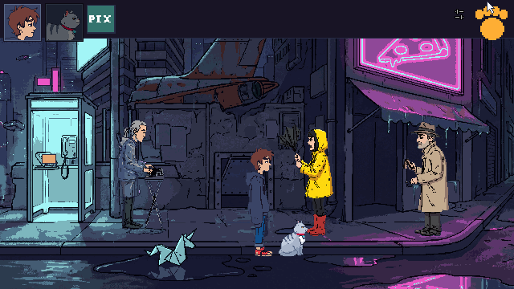

| Nr. | Prio | Kategorie | Fund | Beleg | Vorschlag |
| --- | --- | --- | --- | --- | --- |
| W3-R01-01 | **kritisch** | Rätsel, Technik | **Nach einer falschen Antwort im Mensch-Test lässt sich der Test nicht neu starten.** Option `W3_TEST_MAX_0090` hat kein „(bleibt)“; `waehlen()` setzt `opt.used`, und `option_sichtbar()` blendet sie danach aus. Nach dem Durchfallen bietet Deckert nur noch die zwei Plauderfragen, dann die Abschiedszeile. Ohne R1b bleibt die Gasse zu (`W3_STR_DEC_0290`), einen anderen Einstieg gibt es nicht. Wer ohne Notizen ins Gespräch geht, hat nur „logisch“ und „Unsinn“ und fällt zwangsläufig durch. Deckerts Gespräch hat keine Abschiedsoption. **Achtung bei der Behebung:** Eine Sichtbarkeitsregel `sichtbar_deckert_0090()` greift nicht, weil `option_sichtbar()` zuerst `used` prüft (`cq_dialog.gd` Z. 60). Herr Vier 0090 hat vermutlich dieselbe Falle, wenn man die Bestellung mit Esc abbricht (nur im Code gesehen). (ND-01, EV) | [Menü erstes Mal](belege/evidenz/ND-01_deckert_menue_erstes_mal.png), [nach Durchfallen](belege/evidenz/ND-01_deckert_menue_nach_durchfallen.png), [nur Abschied](belege/evidenz/ND-01_deckert_nur_abschied.png), [Log](belege/evidenz/ev_nd01_log.txt) | 0090 im Skript mit „(bleibt)“; Abschiedsoption ergänzen („Ich schau mich erst mal um.“); Herr Vier 0090 ebenso prüfen. Prüfregel: Optionen, die ein Rätsel starten, brauchen „bleibt“. Anspieltest über `d.waehlen("0090")`. |
| W3-R01-02 | kosmetisch | Timing | Ankunft: 11 Zeilen, 16 Blasen, rund 2 Minuten bis zum ersten Klick (fünf Pixel-Kaskaden; geschätzt aus Zeichenzahlen). (ND-17) | `welt_3.gd` Z. 489 | Zwei der fünf Kaskaden einblasig. |
| W3-R01-03 | kosmetisch | Größen | Das Origami-Einhorn ist so groß wie Pixel (etwa 55 × 45 px) und leuchtet hell türkis, es zieht den Blick stärker als die Figuren. (TA-07) | [Einhorn und Pixel](belege/technical-art/r01_einhorn_pixel_3x.png) | Auf etwa 20 px verkleinern und abdunkeln, nur die Stelle einsetzen. |
| W3-R01-04 | kosmetisch | Rätsel | Hundekuchen an Herrn Vier: die eigene Zeile `W3_SUPP_MAX_0170` kommt nie, weil die Regel die ID „hundekuchen“ erwartet, der Gegenstand heißt `omas_kekse`. (GD-10) | [Lauf E1](belege/game-design/szenario_haupt.log); `welt_3.gd` Z. 1350 | Schlüssel `omas_kekse`. |

**Animationen:** Ruhe-Schleifen von Musiker, weinendem Mann, Frau und Deckert laufen, Regen, Neon, Nudeldampf und fliegende Autos auch ([Ambiente](belege/animationen/w3_r01_ambiente.gif)). Max wischt sich den Regen ab und bricht die Geste beim Klick sauber ab ([Abbruch](belege/animationen/w3_r01_max_abbruch.gif)). Deckert redet ohne Mund (W3-09), sein `seitschritt` ist ein Zucken mit 2 Bildern; Herr Viers Kelle verschwindet (W3-15), Morphäus tritt nicht auf (W3-17).

## 5. Apothekengasse (R02)

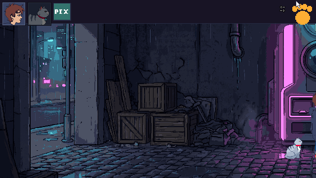

| Nr. | Prio | Kategorie | Fund | Beleg | Vorschlag |
| --- | --- | --- | --- | --- | --- |
| W3-R02-01 | wichtig | Technik, Positionierung | **Der Raum ist 1280 px breit gemalt, die Szene ist 640 px breit.** `room_apothekengasse.tscn` Z. 20 `width = 640`, Hintergrund und Laufbereich reichen bis x 1180 (Entscheidung 20.11.). Die Kamera bleibt bei x 320: Der Pastillenautomat (Rätsel 3) ist am rechten Rand halb abgeschnitten, Wandlampe, Gully und Ratte sind nie zu sehen, Max läuft bei Klicks rechts aus dem Bild. Rätsel 3 bleibt lösbar. Fall von X-04 im Review 17.11. (TA-01 = LD-01 = GS-04) | [Max am Automaten](belege/evidenz/LD-01_max_am_automaten.png), [Max läuft aus dem Bild](belege/level-design/LD01_apothekengasse_max_laeuft_aus_dem_bild.png), [Log](belege/evidenz/ev_apo_log.txt) | `width = 1280`, danach Startmarker (640, 322) und Pixels Doppelgang prüfen. In `alles_pruefen.py`: Szenenbreite = Breite des Hintergrunds. |
| W3-R02-02 | wichtig | Rätsel | **Die Pfote führt beim Déjà-vu (R3a) in eine Schleife.** Stufe 2 und 3: „Wechsel zu mir und lauf zweimal über den Gehweg vor dem Automaten“. Einen Gehweg-Hotspot gibt es nicht; Pixels Klick auf den Automaten zählt nicht (setzt nicht einmal `W3_PIXEL_EINMAL`), zurück bei Max kommt „Das war nicht gleich“ und „Behauptung ohne Befund“. Lösbar ist R3a nur, wenn Max Pixel benutzt, das sagt kein Hinweis. Trifft Spieler in den ersten Minuten. (GD-01, EV) | [Im Spiel](belege/evidenz/GD-01_dejavu_ohne_befund.png), [Lauf B2–B5](belege/game-design/szenario_haupt.log); `W3_HINT_PIX_0320`, `0330` | Hinweise auf „Sag mir, ich soll zweimal vorbeigehen“ (Max benutzt Pixel) ändern oder den Pixel-Weg wirklich zählen lassen. |
| W3-R02-03 | kosmetisch | Rätsel | Die blaue Pastille bleibt bis zum Ende der Welt im Inventar; Benutzen spielt überall, auch im Labor, die Automaten-Szene ab. Nur im Code belegt. (GD-11) | `welt_3.gd` Z. 773, 797–801 | Nach der roten Wahl ebenfalls abgeben. |

**Animationen:** Ratte, Regen und scannender Automat laufen ([Ambiente](belege/animationen/w3_r02_ambiente_ratte.gif)). Morphäus fängt Pixel mit gutem Ausfallschritt, endet aber mit leeren Händen statt `kater_halten`. Ohrfeigen und Sofa fehlen (W3-07).

## 6. Widerstandsbasis (R03)

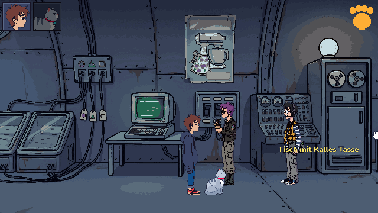

| Nr. | Prio | Kategorie | Fund | Beleg | Vorschlag |
| --- | --- | --- | --- | --- | --- |
| W3-R03-01 | wichtig | Klickflächen, Rätsel | **Die „Kaffeepfütze“ gibt es schon vor Rätsel 13.** Der Boden-Hotspot (x 760–1230) gilt von Anfang an; beim Überfahren steht „Kaffeepfütze“ über sauberem Boden, Ansehen verrät Pixels Lösung. Dasselbe in der Küche: „Scherben“ steht über leerem Boden, solange das Sparschwein heil ist. Kein Welt-3-Hotspot hat eine Bedingung. (LD-05 = GS-07) | [Zeigerkarte Basis](belege/godot/widerstandsbasis_anfang_zeiger.png), [Overlay](belege/raeume/widerstandsbasis_anfang_klick.png), [Zeigerkarte Küche](belege/godot/kueche_orakel_anfang_zeiger.png) | Im Layout `nach: R13` bzw. `nach: R4`, Pfütze auf die gemalte Stelle verkleinern. |
| W3-R03-02 | kosmetisch | Positionierung | **Der Rebell fehlt, die Rebellin steht an seinem Platz vor dem Stromkasten** und verdeckt den Schalter, an dem Pixel hantiert. Szene (Rebellin x 700) und Layout (Rebellin 380, Rebell 700) weichen ab; „Die beiden Rebellen essen Nudeln“ zeigt nur eine Figur, `benutzen_rebell` ist nicht erreichbar. Fall von X-04. (TA-15 ≈ AN-15) | [Rebellin vor dem Stromkasten](belege/technical-art/r03_rebellin_vor_stromkasten_2x.png); `room_widerstandsbasis.tscn` Z. 215 | Szene nach Layout neu bauen. |
| W3-R03-03 | kosmetisch | Klickflächen | Hotspot „Rebellen“ ist ein Graubox-Streifen (400 × 30 px) quer über Kapseln, Terminal und Stromkasten, wo niemand gemalt ist; Kapseln und Terminal verlieren dort ihre Klicks. (GS-13) | [Zeigerkarte](belege/godot/widerstandsbasis_anfang_zeiger.png) | Streichen (die Figur Rebellin trägt die Zeilen). |
| W3-R03-04 | kosmetisch | Klickflächen | Lüftungsschacht und Ausgang Kühlung haben dasselbe Rechteck; welches gewinnt, hängt von Mausrichtung und Zufall ab. Wirkt erst nach Behebung von W3-01. Sonst ist X-01 in Welt 3 behoben (keine sichtbare Figur unter 83 % anklickbar). (GS-16) | [Zeigerkarte Ende](belege/godot/widerstandsbasis_ende_zeiger.png) | Einen der beiden streichen. |
| W3-R03-05 | kosmetisch | Timing | Erstes Aufwachen 16 Zeilen, 22 Blasen; Piepsi und Hologramm 19 Zeilen, 22 Blasen; je rund 2 Minuten ohne Eingriff (geschätzt). (ND-17) | `welt_3.gd` Z. 526, 1272 | `BAS_PIX_0050`, `0170` als Zuruf nach dem ersten Klick; bei Piepsi `PIEP_PIX_0090`, `0150` kürzen. |
| W3-R03-06 | kosmetisch | Rätsel | Ist das Fenster schon offen (Schnee-Gag), kühlt die Zelle nach R10 nicht, und wer dem Hinweis „ich öffne das Fenster“ folgt, schließt es. (GD-09) | [Lauf E3, G2–G5](belege/game-design/szenario_haupt.log); `welt_3.gd` Z. 557–565 | Lösung B auch direkt nach R10 prüfen. |
| W3-R03-07 | kosmetisch | Humor | Text zitiert, was im Bild fehlt: M.U.T.T.I.-Plakat ohne Satz und Unterstreichung (`BAS_MAX_0820`), das runde Fenster ist über Kapsel 2 und 3, nicht „über meiner Kapsel“. Pixels Eimer-Versprechen „Drüben regnet es jetzt, und zwar drinnen“ hat in der Simulation keine Wirkung. (ND-12, ND-11) | `w3_bg_widerstandsbasis_v01.png`; `welt_3.gd` Z. 902–907 | Schrift aufs Plakat setzen; Zeilen anpassen. |

**Animationen:** Spulen und Lampen laufen ([Ambiente](belege/animationen/w3_r03_ambiente.gif)). Kalles Gesten sind lesbar, der Laptop springt (W3-15). Piepsi fährt hoch, piept, druckt; `fahren` ungenutzt. Hologramm (W3-07) und Kapsel (W3-10) fehlen.

## 7. Kühlung (R04)

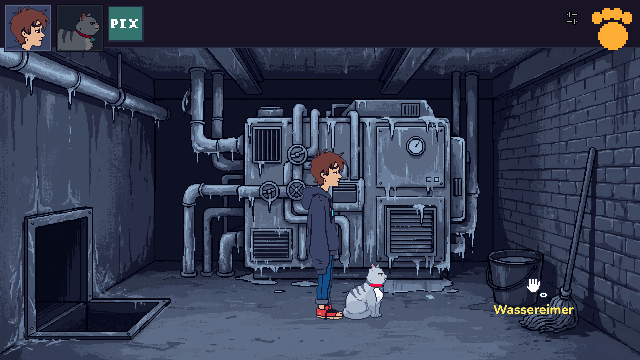

Keine eigenen Funde. Die Kühlung ist für Pixel im Spiel heute nicht erreichbar (W3-01), Pixels Wege dort sind nur über Regelaufrufe geprüft. Die getaute Fassung wechselt sauber ([getaut](belege/raeume/kuehlung_var_w3_eimer_gekippt.png)). Ob Max dort im echten Ablauf ausgeblendet ist, wurde nicht geprüft (in den Testmodus-Aufnahmen steht er im Raum).

## 8. Laboreingang (R05)

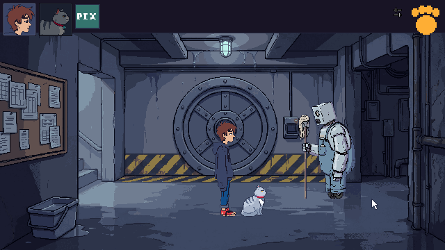

| Nr. | Prio | Kategorie | Fund | Beleg | Vorschlag |
| --- | --- | --- | --- | --- | --- |
| W3-R05-01 | wichtig | Klickflächen, Rätsel | **Der Datenanschluss liegt vor dem Öffnen auf der geschlossenen Panzertür** (90 × 110 px mitten auf dem Rad); Benutzen bringt Kalles „Bin da! Hab die Trommel mitgebracht“, obwohl Kalle nicht da ist, auch nach R9a noch einmal. (GS-06) | [Zeigerkarte](belege/godot/laboreingang_anfang_zeiger.png), Klickprotokolle; `welt_3.gd` Z. 1334–1340 | Datenanschluss erst mit `W3_PANZERTUER_OFFEN`; Benutzen-Zeile an „nach R9a“ binden; eigene Ansehen-Zeile. |
| W3-R05-02 | kosmetisch | Grafik | Der Roboter-Hausmeister hält den Mopp verkehrt herum (Fransen oben), das gelbe Rundauge ist nicht zu erkennen; der Mopp kippt außerdem zwischen Stand und Wischen. (TA-09, AN-06) | [Hausmeister](belege/technical-art/r05_hausmeister_mopp_3x.png) | Sprite umzeichnen, Mopp-Kopf am Boden. |
| W3-R05-03 | kosmetisch | Laufwege | Der „Gang“ rechts sieht wie ein Ausgang aus, Benutzen gibt die Ersatzzeile; ebenso die offene Eingangstür in Kammer 1 ohne Klickfläche. Wie W1-21. (LD-10) | [Overlay](belege/raeume/laboreingang_anfang_klick.png) | Benutzen-Zeile für den Gang; Hotspot „Eingang“ in Kammer 1. |

**Animationen:** Kartenleser und Deckenlampe laufen ([Ambiente](belege/animationen/w3_r05_ambiente.gif)). Der Hausmeister wischt, verbeugt sich, dreht den Arm nach dem Öl; beim Reden wischt er weiter (W3-09). Nach R8 verschwindet er ohne Rollen (W3-07).

## 9. Stadtstraße (R06)

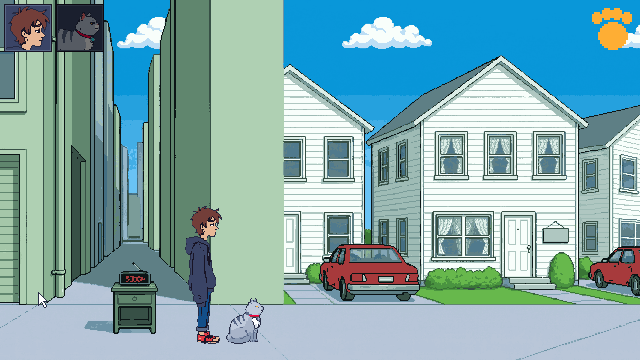

| Nr. | Prio | Kategorie | Fund | Beleg | Vorschlag |
| --- | --- | --- | --- | --- | --- |
| W3-R06-01 | wichtig (hoch) | Klickflächen, Rätsel | **Rätsel 5 (Code-Sicht freischalten) hängt an einem 14 × 33 px großen Streifen in der Glastür.** Die übrige Glastür (73 × 105 px) ist der Ausgang. Zweimal Ansehen der Glasfläche bringt `W3_SIM_MAX_0260` und eine Wiederholungszeile, keine Code-Sicht; zweimal auf dem Streifen „Die Tür“ startet sie. Pixels Hinweis „sieh dir die Tür an. Zweimal“ führt auf den Ausgang. Keine harte Sackgasse, aber ein Suchbild auf dem Pflichtweg. Die Sprechanlage rechts, wo die Animation „Glastür redet“ läuft, ist nicht anklickbar. (GS-02, EV) | [Klickflächen der Glastür](belege/evidenz/GS-02_glastuer_klickflaechen_3x.png), [Log](belege/evidenz/ev_tuer_log.txt), [Zeigerkarte](belege/godot/stadtstrasse_anfang_zeiger.png) | Ansehen des Ausgangs vor R5 auf `ansehen_tuer` umleiten oder die Tür-Figur auf Glasfläche und Sprechanlage legen. |
| W3-R06-02 | wichtig | Grafik, Positionierung | **Die fahrenden roten Autos fahren über den Rasen, mitten durch die gemalten geparkten Autos und vor dem Nachttisch mit dem Radiowecker** (der gemalt im Hintergrund steht); an der Glastür fahren sie hinter Max' Beinen durch seinen Laufbereich. Außerdem sind sie gut 30 % größer als die geparkten. Max läuft selbst durch den Nachttisch. (TA-04 ≈ AN-14 = GS-10, LD-06 Teil Nachttisch) | [Autos durch geparkte](belege/technical-art/r06_autos_fahren_durch_geparkte_2x.png), [vor dem Nachttisch](belege/animationen/w3_r06_auto_vor_nachttisch.png), [durch Max](belege/animationen/w3_r06_auto_faehrt_durch_max_an_der_glastuer.png), [Nachttisch und Sockel](belege/level-design/LD06_durch_gemalte_moebel.png) | Autos hinten auf der Querallee fahren lassen (y 262–270, Skala etwa 0,5) oder die geparkten aus dem Bild nehmen; Nachttisch als Vordergrund-Teil ausschneiden und aus dem Laufbereich nehmen. |
| W3-R06-03 | kosmetisch | Größen | Max ist hinten etwa 120 px groß, die parkenden Autos 55 px, Omas Haustür 60 px: Er betritt eine Tür von halber Körpergröße. Die Glastür passt. (LD-07) | [Größen](belege/level-design/LD07_stadtstrasse_groessen.png) | Omas Haustür als größeres Prop näher am Gehweg. |
| W3-R06-04 | kosmetisch | Timing | Die 30 s bis zum Klingeln des Weckers starten bei jedem Betreten neu; wer vor dem ersten Aufstehen zwischen Küche und Straße pendelt, hört ihn nie (die Eieruhr weckt trotzdem). Wege Radiowecker ↔ Glaseingang 7 bis 8 s. (LD-09, LD-08) | `welt_3.gd` Z. 432–444; [Lauftest](belege/level-design/lauftest_w3.txt) | Startzeit einmal je Traum merken. |
| W3-R06-05 | kosmetisch | Klickflächen | Klickfläche „klingelnder Radiowecker“ liegt 18 px unter dem Wecker. (GS-09) | [Radiowecker](belege/godot/stadtstrasse_radiowecker_zustaende.png) | Beide auf dasselbe Rechteck. |
| W3-R06-06 | kosmetisch | Grafik | Toter Hotspot „Sonne“ über einem Himmel ohne Sonne (auch nachts); Omas Türschild ist leer, obwohl der Text es zitiert. Die gemalte Weckeranzeige ist ein roter Klecks statt „5:59“, nachts fast unsichtbar. (GS-17 ⊂ ND-12, TA-16) | [Himmel](belege/narrative/stadtstrasse_sonne_hotspot.png), [Weckeranzeige](belege/technical-art/r06_radiowecker_anzeige_559_8x.png) | Sonne malen oder Hotspot streichen; Schild beschriften; „5:59“ als Ziffern wie „6:00“. |

**Animationen:** Takt-Autos, Gleichschritt-Passanten, Vogelschwarm, blinkender Wecker und die Katze machen die Simulation ohne Text spürbar ([links](belege/animationen/w3_r06_ambiente_links.gif), [rechts](belege/animationen/w3_r06_ambiente_rechts.gif)). Nacht, klingelnder Wecker und redende Glastür sind angeschlossen und schalten richtig, auch nach Speichern und Laden ([Glastür Tag und Nacht](belege/godot/stadtstrasse_glastuer_spricht_tag_nacht.png), [Wecker](belege/godot/stadtstrasse_radiowecker_klingelt.gif)). Schnee nach Pixels Fenster bleibt unsichtbar (W3-07). Hinken siehe W3-R08-04.

## 10. Küche der Orakel-Oma (R07)

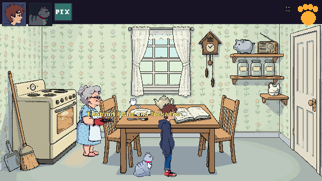

| Nr. | Prio | Kategorie | Fund | Beleg | Vorschlag |
| --- | --- | --- | --- | --- | --- |
| W3-R07-01 | wichtig | Größen | **Max und die Oma sind für die Möbel rund 30 % zu klein.** Die Tischplatte reicht Max bis zur Brust (er ist 1,6 Tische hoch, echt etwa 2,3), die Oma überragt die Stuhllehne nur um eine Kopflänge und steht hinter ihr. (TA-06) | [Größen mit Maßstab](belege/technical-art/r07_kueche_groessen_2x.png) | `skala` vorn auf etwa 1,05, danach Laufbereich und Kopfraum prüfen. |
| W3-R07-02 | kosmetisch | Humor | Der Kuckuck ruft „Milch! Milch! Milch!“ nur als Erzählzeile oben im Bild, obwohl die Uhr eine Bildfolge hat. Ein gesprochenes Wort als Gag. (ND-18) | `welt-3.json` (Raumplan Küche) | Als Zeile der Uhr mit Sprechblase. |

Scherben vor Rätsel 4: siehe W3-R03-01. **Animationen:** Eieruhr und Ofenlicht laufen ([Ambiente](belege/animationen/w3_r07_ambiente.gif)), Omas Ofen-, Stirn-, Sparschwein- und Kehr-Gesten kehren in die Ruhe zurück ([Kehren](belege/animationen/w3_r07_oma_kehren.gif)). Reden ohne Mund (W3-09), Küchenradio ohne Bewegung (W3-08).

## 11. Büroturm, 50. Stock (R08)

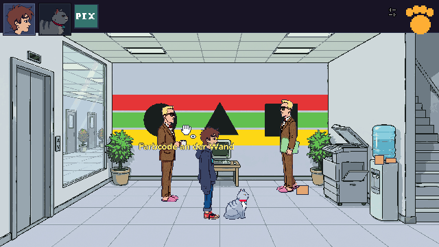

| Nr. | Prio | Kategorie | Fund | Beleg | Vorschlag |
| --- | --- | --- | --- | --- | --- |
| W3-R08-01 | wichtig | Rätsel | **Code-Sicht ohne Tasse verbraucht das Budget, und der Raum hat keinen Ausgang.** Ohne Kaffeetasse gibt es nur zwei Fehltausche; danach sagt Max „Einmal raus und wieder rein“, der Ausgang ist aber gesperrt. Zurückgesetzt wird nur über den nicht erklärten Figurenwechsel zu Pixel und zurück. Dasselbe in Kammer 1 („Du darfst gehen und wiederkommen“ ohne offenen Ausgang). (GD-02, GD-03) | [Lauf C1–C6, F1–F4](belege/game-design/szenario_haupt.log); `W3_TURM_MAX_0530`, `W3_KAM1_MUT_0570` | Budget-leer-Zeilen für Büro und Kammer 1 eigens fassen („Ich wechsle kurz zu Pixel, dann ist alles zurückgesetzt“); Fehltausche ohne Tasse nicht anbieten. |
| W3-R08-02 | wichtig | Rätsel | **Nach Behebung von W3-01 lassen sich R7 (Ausgang im 50. Stock) und R13 (Morse-Tabelle) ganz auslassen.** Pixel kann die Kapsel jederzeit schütteln, auch während Max im Büroturm festsitzt; die Welt endet dann regulär ohne R7a, R7b und R13. Es entfallen ein Rätsel, der Enten-Gag und Opas Hologramm, und die Pfote schlägt R13 bis zum Ende vor. Die Rätseldoku widerspricht sich hier selbst (Z. 28 gegen 43 und 99). Heute per Klick nicht erreichbar, weil W3-01 auch das Schütteln verhindert. (GD-04, EV) | [Lauf H1](belege/game-design/szenario_haupt.log) (über Regelaufruf); `welt_3.gd` Z. 859–866 | Zusammen mit W3-01 entscheiden: Schütteln im Büroturm sperren („Er liegt zu tief im Turm“) oder R7/R13 als freiwillig führen und das Hologramm an eine Pflichtstelle hängen. |
| W3-R08-03 | wichtig | Rätsel, Animation | **Sonnenbrille und Schmidts Akte liegen von Anfang an im Büro und lassen sich vor Rätsel 6 nehmen** (im Spiel geklickt, beide sofort im Inventar). Umgekehrt hat Schmidt nach `brille_ab` die Brille nach 3 s wieder auf und die Akte unter dem Arm, obwohl Max beides hat; `schmidt_ohne_brille` wird nie geladen. (GS-05, AN-07) | [Nehmen vor dem Rätsel](belege/godot/nehmen_vor_dem_raetsel.txt), [Brille ab](belege/animationen/w3_r08_schmidt_brille_ab.gif) | Props mit `nach: R6b` oder streichen (das Skript gibt sie ohnehin); nach `W3_TURM_SCH_0430` `grafik_laden("schmidt_ohne_brille")` und ab R6b beibehalten. |
| W3-R08-04 | wichtig | Animation, Laufwege | **Der hinkende Max gleitet.** `_max_gang()` tauscht nur die Animation, `walk_speed` bleibt: 115 px/s hinkend gegen 139 normal, die Hinken-Folge ist aber halb so schnell. Die Füße rutschen rund 56 % (normaler Gang 6 %), und das gilt ab hier auf allen Wegen bis zum Ende der Welt. Die Hinken-Grafik selbst ist gut. (AN-08) | [Gänge nachgestellt](belege/animationen/gaenge_im_spieltempo_nachgestellt.gif) (Zeilen 1 und 2); `welt_3.gd` Z. 476–483 | Beim Hinken `walk_speed` 80 bis 90 und Bilddauer etwa 80 ms. |
| W3-R08-05 | wichtig | Rätsel, Grafik | **Der Farbcode an der Wand zeigt die Zuordnung nicht.** Alle drei Formen liegen über allen drei Streifen; „Kreis auf Rot, Dreieck auf Grün, Quadrat auf Gelb“ ist nicht abzulesen, nur Max' Satz verrät es. Betrifft auch die Idee „Symbol je Farbe“ für Farbenblinde. (ND-08) | [Farbcode](belege/narrative/buero_50_farbcode.png) | Je Form ein eigenes Farbfeld; nur die Stelle einsetzen. |
| W3-R08-06 | kosmetisch | Grafik, Humor | Der Klon-Gag ist nicht zu sehen: Der Text spricht von „dreißig Männern im Cordanzug“ und „zwölf Pflanzen“, im Raum stehen Schmidt und ein Klon, dazu drei Mini-Klone hinter Glas und zwei Pflanzen. Die Klone gehen auch nicht ab (W3-17) und heben keinen Hausschuh. (ND-07) | [Raum mit Max](belege/raeume/buero_50_anfang_mitmax.png) | Mehr Klone gestaffelt in die Tiefe, oder Text: „Ein Dutzend Männer im Cordanzug“. |

**Animationen:** Klone tippen, Kopierer rattert ([Ambiente](belege/animationen/w3_r08_ambiente.gif)). Locherwurf, Zeitlupe und Hexenschuss sind die stärkste Bewegungsfolge der Welt ([Zeitlupe](belege/animationen/w3_r08_max_zeitlupe.gif), [Hexenschuss](belege/animationen/w3_r08_max_hexenschuss.gif)). Platzhalter für Tasse, Brille und Akte: W3-12.

## 12. Testkammer 1 (R09)

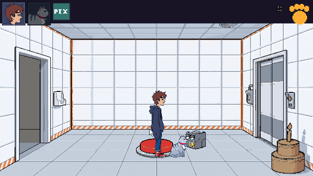

| Nr. | Prio | Kategorie | Fund | Beleg | Vorschlag |
| --- | --- | --- | --- | --- | --- |
| W3-R09-01 | wichtig | Klickflächen | **Das Portalgerät ist nur an 14 % seiner Fläche anklickbar**, die fast deckungsgleiche „Halterung“ gewinnt als kleineres Objekt. Die Opa-Szene durch das Portal startet nur über den 2-px-Rand. (GS-08) | [Zeigerkarte](belege/godot/testkammer_1_anfang_zeiger.png) | Halterung erst nach `W3_PORTAL_GENOMMEN` einblenden oder streichen. |
| W3-R09-02 | kosmetisch | Animation | Bernd „schwebt heran“ (`W3_KAM1_BER_0170`), gespielt wird `davonschweben`: Er dreht sich weg und wieder her, ohne sich zu bewegen. (AN-11) | [Bernd](belege/animationen/w3_r09_bernd_davonschweben.gif) | Für 0170 eine Bewegung heran; `davonschweben` an den beleidigten Abgang. |

Budget ohne Ausgang: siehe W3-R08-01. Max' `portalgeraet` sauber, Portal-Effekt fehlt (W3-07), Lautsprecher ohne Bewegung (W3-08).

## 13. Testkammer 2 (R10)

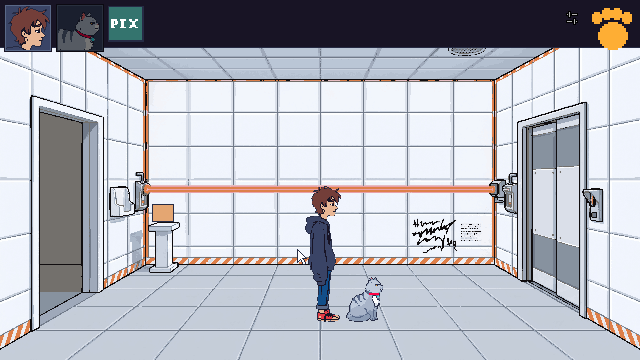

| Nr. | Prio | Kategorie | Fund | Beleg | Vorschlag |
| --- | --- | --- | --- | --- | --- |
| W3-R10-01 | wichtig | Rätsel, Laufwege | **Die Lasersperre sperrt nichts.** Der Strahl läuft an der Rückwand entlang, beide Türen liegen in den Seitenwänden; Max geht im Lauftest von Tür zu Tür vor dem Laser vorbei. Der Spieler sieht nicht, warum er erst nach dem Tausch weiter darf. (LD-02) | [Max vor dem Laser](belege/level-design/LD02_testkammer_2_laser_sperrt_nichts.png) | Laser quer vor die Ausgangstür (Effekt-Sprite), Laufbereich vor der Tür bis R9c abschneiden. |
| W3-R10-02 | kosmetisch | Grafik | In der Code-Sicht überdecken sich die Etiketten von Gummihuhn und Sockel. (TA-14) | [Etiketten](belege/technical-art/r10_codesicht_etiketten_3x.png) | `_code_etikett()` weicht bei Überlappung nach oben aus. |

## 14. Testkammer 3 (R11)

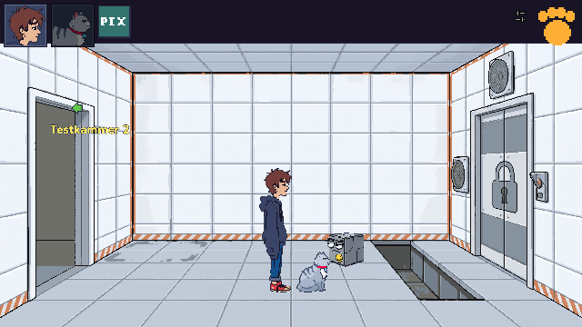

| Nr. | Prio | Kategorie | Fund | Beleg | Vorschlag |
| --- | --- | --- | --- | --- | --- |
| W3-R11-01 | wichtig | Rätsel, Positionierung, Laufwege | **Bernd steht nicht vor der Tür, und Max läuft durch die Grube.** Bernd steht bei x 380 links neben einer breiten Bodengrube, rund 150 px von der Tür; der Weg zur Tür ist frei. Max sagt „du stehst genau vor der Tür“, und Rätsel 9 lebt davon. Der „schmale Spalt, genau Bernd-breit“ ist eine Grube von drei Bernd-Breiten; die Aussparung im Laufbereich passt nicht dazu. Der „Lautsprecher, groß wie ein Fenster“ ist klein. (LD-03 = ND-10 ≈ TA-17) | [Bernd und Grube](belege/level-design/LD03_testkammer_3_bernd_und_grube.png), [Spalt und Lautsprecher](belege/technical-art/r11_spalt_und_lautsprecher_2x.png) | Bernd in einen Spalt direkt vor der Tür, Laufbereich bis R9d vor der Tür enden lassen; nur die Stelle neu malen („a narrow slot in the floor directly in front of the exit door, exactly one small cube wide“). |

## 15. Kern (R12)

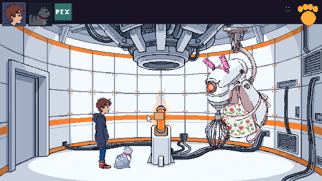

| Nr. | Prio | Kategorie | Fund | Beleg | Vorschlag |
| --- | --- | --- | --- | --- | --- |
| W3-R12-01 | wichtig | Animation | **M.U.T.T.I. geht nicht aus.** Die Geste `herunterfahren` läuft als „vor“ an `W3_KERN_MUT_0200`, danach ist sie sofort wieder an. Während „Das Auge wird dunkel. Die Antennen sinken.“ leuchtet ihr Auge; nach R10 hängt sie weiter leuchtend im Kern, `mutti_aus` wird nie geladen. Die Pointe des Rätsels fehlt. (AN-01, EV) | [während der Erzählzeile](belege/evidenz/AN-01_kern_W3_KERN_NAR_0210.png), [nach R10](belege/evidenz/AN-01_kern_nach_R10.png), [GIF](belege/animationen/w3_r12_mutti_herunterfahren.gif); `gesten_welt_3.gd` Z. 101 | Geste an `W3_KERN_NAR_0210`, danach `grafik_laden("mutti_aus")`; ab R10 die Variante in `_figuren_anwenden`. |
| W3-R12-02 | wichtig | Rätsel | **Paradoxon mit ungelesener Akte schickt aus dem Labor.** Regel 1 gilt erst nach dem Ansehen der Akte im Inventar, nicht beim Erhalt. Fehlt sie, sagt Pixel „Die fehlenden Regeln liegen nicht im Labor“, die Pfote „Du hast drei Regeln“. Wer folgt, verlässt das Labor umsonst. (GD-07) | [Lauf G0, G1](belege/game-design/szenario_haupt.log); `welt_3.gd` Z. 1173, 1431–1435 | Regel 1 beim Erhalt der Akte setzen oder Pixels Zeile unterscheiden („Lies Schmidts Akte“). |
| W3-R12-03 | kosmetisch | Grafik | Die vereiste Zelle bringt 30 Farben außerhalb der Raumpalette und weiche Frostwolken; sie wirkt wie ein leeres Glasrohr statt dunkelgrau bereift wie Plan und Inventarbild. Der leere Sockel hat 27 Fremdfarben. (TA-10) | [Glüht, vereist, leer](belege/technical-art/r12_kern_zelle_glueht_vereist_leer_3x.png) | Mit `raeume_pixelieren.py` auf die Palette, Zelle wie das Inventarbild. |
| W3-R12-04 | kosmetisch | Klickflächen | M.U.T.T.I. ist nur an einem 62 px breiten Streifen anklickbar, Kopf und Auge liegen außerhalb. Max läuft mitten durch den Sockel der Zelle. (GS-18, LD-06) | [Klickfläche](belege/godot/kern_mutti_klickflaeche.png), [Sockel](belege/level-design/LD06_durch_gemalte_moebel.png) | Polygon von Hand auf Kopf und Rührschüssel; Sockel aus dem Laufbereich. |
| W3-R12-05 | kosmetisch | Humor | `W3_KERN_MAX_0590` („… die Tüte ist Kekse. Drüben wäre das ein warmer Hundekuchen …“) erklärt mitten im Finale die Ebenenlogik und ist schwer zu verstehen. (ND-21) | `texte.csv` | Kürzen. |

**Animationen:** Lichtband, Hitzeflimmern und Kabelpuls laufen ([Ambiente](belege/animationen/w3_r12_ambiente.gif)); M.U.T.T.I.s Ruhe, Reden und `beleidigt` sind gut ([beleidigt](belege/animationen/w3_r12_mutti_beleidigt.gif)).

## 16. Nahansichten, Englisch, Übergang

| Nr. | Prio | Kategorie | Fund | Beleg | Vorschlag |
| --- | --- | --- | --- | --- | --- |
| W3-N-01 | wichtig | Rätsel, Technik | **Die Morse-Tabelle (N05) wird nie gezeigt.** Kein Skript ruft sie auf; Ansehen im Inventar liefert nur Max' Satz. Damit ist die Errungenschaft NEUGIER („alle Nahansichten“) nicht erreichbar. (ND-02) | `welt_3.gd` (Nahansichten nur Z. 1129, 1182, 1409, 1648, 1654); `errungenschaften.gd` Z. 129–142 | `ansehen_inventar_morse_tabelle()` wie bei der Akte. |
| W3-N-02 | kosmetisch | Rätsel, Grafik | In der Morse-Tabelle hat T zwei Striche (Morse für M), der Text sagt eins. Die Zeichen sind Punkte und Striche statt der „Pfotenabdrücke“, von denen Max spricht. (ND-03 = TA-12) | [Morse-Tabelle](belege/technical-art/n05_morse_tabelle_3x.png) | T auf einen Strich; kurze Zeichen als deutliche Pfote. |
| W3-N-03 | kosmetisch | Grafik | Verzerrte Schrift in den schrägen Nahansichten: Akte „Gericht“ statt „Bericht“, EN-Stempel „Oare“ statt „Care“, „47ד im Telefonbuch dünn, das „E“ der Morse-Tabelle sieht aus wie „€“, „Regel 3“ in der Kritzelei sehr kontrastarm. Die Akte leuchtet magenta statt weißgrün wie im Plan. (TA-11, TA-13) | [Telefonbuch](belege/technical-art/n01_telefonbuch_47x_6x.png); `game/grafik/nahansichten/schmidts_akte*.png` | Schrift nach dem Verzerren mit fester Strichstärke nachsetzen; Regel 3 dunkler. |
| W3-N-04 | kosmetisch | Humor | Englisch: Der Hausmeister-Witz „Servus“ trägt als „Greetings“ nicht, „Hexenschuss“ ist als „Slipped disc“ übersetzt. Sonst ist die englische Fassung vollständig (keine leeren Zeilen, keine Platzhalter, gleiche Kaskaden). (ND-19) | `texte.csv` EN | „Servus“ behalten; „Put my back out. At sixteen.“ |
| W3-N-05 | kosmetisch | Sonstiges | Welt 3 endet mit einer kalten Zelle, Zwischenspiel 3 beginnt mit „sie glüht orange“. Pixels Handtuch kommt auf dem Dachboden nicht mehr vor. (ND-20) | `skript/welt-3.md` Abschnitt 17; `zwischenspiele-und-finale.md` Z. 209–229 | Ein Satz in ZS3 („Im Fernseher ist sie wieder warm geworden“) oder Zelle kalt lassen. |

N01 bis N04 passen inhaltlich in DE und EN zu ihren Zeilen; schöner Rückbezug: Oma hatte 47 Besucher, Max ist Testperson 48.

---

## 17. Animationen gesamt

| Teil | Anzahl | genutzt | ungenutzt |
| --- | --- | --- | --- |
| Figuren-Sheets Welt 3 (17 Figuren, 5 Varianten) | 117 | 82 | 35 |
| Max, Welt-3-Bewegungen | 19 | 15 | 4 (Kapsel) |
| Pixel, Welt-3-Bewegungen | 7 | 3 | 4 (`ohrfeige`, `tragen`, `vom_schrank_fallen`, `schieben`) |
| Effekt-Bildfolgen `grafik/ambiente/w3_*` | 40 | 26 | 14 |
| Gesten-Tabelle ZEILE | 79 | 47 „vor“, 29 „mit“, 3 sonstige | RUHE `rebell` läuft ins Leere |

**Muster:**
1. **Gebaut, aber nicht eingehängt.** Die Grafik ist weiter als ihr Einbau. Die Tabelle ZEILE ist gefüllt, aber alles, was Code in `welt_3.gd` braucht (Varianten laden, laufen, Effekt an ein Ereignis hängen), fehlt (W3-07, W3-08, W3-10).
2. **Zustandsänderungen kehren zurück.** Brille ab, Herunterfahren, Hausmeister geht: Die Figur endet im alten Stand, weil die Folgevariante nicht geladen wird (W3-R08-03, W3-R12-01).
3. **Übergänge Stand ↔ Geste:** bei Max pixelgenau, bei den Nebenfiguren 2 px Versatz und gelegentlich Gegenstandswechsel (W3-15, W3-16).
4. **Reden:** vier Figuren mit Armgeste statt Mund (W3-09), die übrigen sauber.
5. **Niemand außer Max geht** (W3-17); Auf- und Abtritte sind Ein- und Ausblenden.

**Gangtempo (Rutschen der Füße):** Max `walk` 6 %, Max hinkend 56 %, Deckert 14 %, Schmidt 26 %, Morphäus 32 %, Klon 39 % (die Nebenfiguren gehen heute nie).

**Gut gelöst:** Max' Welt-3-Gesten beginnen und enden pixelgleich mit dem Stand und brechen beim Klick sauber ab. Halbposen sind überall drin, die 5-%-Größenregel halten alle ein, Schleifen springen nicht (anders als Max/Opa `idle` am 17.11.). Locherwurf mit Zeitlupe und Hexenschuss, Morphäus' Fangen und das Ambiente der Stadtstraße sind sehr gelungen. Der Tempo-Ausgleich aus X-03 greift.

**Urteil:** Die einzelnen Bewegungen sind handwerklich deutlich besser als Welt 1 und 2 beim ersten Review. Die Schwäche liegt im Einbau, und die zehn wichtigen Animationsfunde lassen sich größtenteils ohne neue Grafik beheben (Gesten-Tabelle, `grafik_laden`, `spricht:`, `walk_speed`).

## 18. Humor und Ton gesamt

**Stärkste Gags** (Zeilen-IDs in [`notizen/narrative.md`](notizen/narrative.md)):
- Die Oma und das Sparschwein (`KUCH_MAX_0150` bis `KUCH_ORA_0220`, „Ungeschick ist einfach Schicksal, das keine Lust hatte, sich vorzustellen“): Das Rätsel ist selbst die Pointe.
- Herr Vier (`NUD_VIE_0330` „‚Viel‘ ist Faulheit mit Vokalen“, `NUD_VIE_0660`): eine Marotte, konsequent gespielt.
- Der Mensch-Test (`TEST_DEC_0210` „Sinnlos. Nass. Schön.“, `0300`): Die Straße ist Vorbereitung, der Test die Auszahlung.
- Paradoxon und Abschaltung (`KERN_MUT_0180` „… bin ich keine gute Mutti.“ / `KERN_MAX_0190` „Doch. Ehrlich gesagt: ziemlich normal.“): Witz und Herz in einem Satz.
- Türen mit Netzwerk (`KAM3_TUR_0110`, `KAM3_MAX_0120`), Rückbezüge über die Welt (Testperson 48 nach Omas 47, Deckerts Bilanz am Schluss, Milch vom Kuckuck bis zum Werbeblock).

**Schwächste Stellen:**
- Pointen, die ohne Bild nicht zünden (W3-07, W3-R08-06): Ente, Ohrfeige, Klon-Suchbild, Portal-Opa.
- Formeln: Die 16 Fehltausch-Zeilen folgen fast alle dem Muster „X ist jetzt A. Y ist B. Nichts gewonnen.“ (ND-13, kosmetisch); „Das ist kein X. Das ist Y.“ steht zehnmal bei sieben Sprechern, im Prolog wurde es als KI-Muster herausgenommen (ND-14, kosmetisch).
- Pixel: 108 von 247 Zeilen sind Kaskaden (44 %), oft erklärt die zweite Blase die erste (ND-16, kosmetisch). „Junger Mann“ steht genau viermal, an der Obergrenze aus PR #41.
- Nebenfiguren im selben Stakkato (Automat 3,1 Wörter je Satz, Deckert 3,6, Hausmeister 4,5, Kalle 4,6, Oma 4,6; nur Schmidt 14,3): Bei Deckert, Automat und Herrn Vier passt es, Hausmeister („übertrieben höflich, österreichisch“) und Kalle (hektisch) verlieren dadurch ihre Stimme (ND-15, kosmetisch).

| Muster | Anzahl | Bewertung |
| --- | --- | --- |
| Pixel „nass“ | 15 | Thema der Welt, Schlusspointe trägt; in der Basis zu dicht |
| Pixel Fisch/Thunfisch | 15 | im Rahmen, Max nimmt es fünfmal auf |
| „Zu deinem Besten“ / „zu Ihrem Schutz“ | 9 | gewollter Running Gag, trägt |
| „in einer anderen Testkammer“ | 5 | Running Gag mit Auszahlung, gut |
| „Bursche“ (Hausmeister) | 12 in 22 Zeilen | dicht |
| „Das ist kein X. Das ist Y.“ | 10 | zu oft |
| Fehltausch-Bilanz | 16 | Formel |
| Max: Technik-/Medienvergleiche | 21 | passt zur Welt, am Terminal gehäuft |

**Urteil:** Welt 3 ist textlich die stärkste der bisher geprüften Welten. Die Anspielungen (Matrix, Blade Runner, Portal, Star Wars, Terminator) sind eingebaut statt aufgesagt, es gibt echte Herzmomente (Sofa, „keine gute Mutti“, Hausmeister als Freund), und Pixel hat hier seine beste Rolle. Die Schwächen liegen in der Umsetzung (Bild-Pointen fehlen, Tutorial passt nicht zur Bedienung) und in der Menge langer Blasen und Kaskaden, nicht im Witz selbst. (Die Belege-Prüfung hat die Zählungen ND-13 bis ND-16 nicht nachgerechnet; sie sind Einschätzungen einer Rolle.)

## 19. Lessons Learned – Vorschläge

Abgeglichen mit `docs/lessons-learned.md` (Stand `a65f55e0`). Das Dokument wurde nicht geändert. Doppelte Vorschläge der Rollen sind zusammengefasst.

**Aus dem Spiel (Rollen LD, ND, GD, TA, AN, GS):**

| Nr. | Vorschlag | Begründung | Beleg |
| --- | --- | --- | --- |
| L-S01 | **Anspieltests lösen Rätselschritte über den echten Klick- und Gesprächsweg aus** (`on_click()` mit der richtigen Spielfigur, `d.waehlen()`), nicht über `S.regel(...)`. | Beide harten Sackgassen dieser Welt (Pixel-Klicks, Mensch-Test) sind im grünen Anspieltest unsichtbar. | W3-01, W3-R01-01 |
| L-S02 | **Jeden Stufe-3-Hinweis wörtlich als Schritt im Anspieltest nachspielen.** | Der Hinweis zu R3a beschreibt einen Weg, der nicht funktioniert; der Test löste R3a anders. | W3-R02-02 |
| L-S03 | **Optionen, die ein Rätsel starten, das man nicht beim ersten Mal lösen muss, brauchen „(bleibt)“.** Eine Sichtbarkeitsregel reicht nicht, `option_sichtbar()` prüft `used` zuerst. | Mensch-Test nach Durchfallen weg. | W3-R01-01 |
| L-S04 | **Tutorial- und Hinweistexte gegen die gebaute Bedienung lesen**, nicht nur gegen das Bild (ergänzt Lessons Z. 347). | Code-Sicht als Liste, Texte sagen „anklicken“. | W3-03 |
| L-S05 | **Pflichträtsel gegen allgemeine Rückwege prüfen.** Ein Rückweg wie „Kapsel schütteln“ macht Rätsel, die nur einen Ausgang bewachen, still freiwillig. | R7/R13 auslassbar. | W3-R08-02 |
| L-S06 | **Hinweise ortsbezogen wählen, wenn Räume Einbahnstraßen sind.** | Pfote schickt aus dem Büroturm zur Oma. | W3-04 |
| L-S07 | **Szenenbreite gegen Hintergrundbreite prüfen** (`alles_pruefen.py`), besonders nach einer Breitbild-Entscheidung. | Apothekengasse 640 statt 1280; in 640er-Testbildern unsichtbar. | W3-R02-01 |
| L-S08 | **Überlagerungen am Sprite des Hintergrunds ausrichten, nicht am Prop-Knoten:** Popochiu setzt den Knoten auf y 0 und das Sprite auf y 180. | Code-Sicht 180 px zu hoch. | W3-02 |
| L-S09 | **Klickflächen, die einen Zustand zeigen, bekommen dieselbe Bedingung wie das Bild.** | Pfütze, Scherben, Datenanschluss, Brille und Akte vor ihrem Rätsel. | W3-R03-01, W3-R05-01, W3-R08-03 |
| L-S10 | **Nach jedem Raumbau die Gegenstandsbilder neu einsetzen und auf Platzhalterfarbe prüfen.** Die Reihenfolge `godot_raeume.py` vor `gegenstaende_einbau.py` gehört in die Lessons (Z. 426 und 430 nennen die Schritte nur einzeln). | Fünf orange Kästen. | W3-12 |
| L-S11 | **Effekt-Bahnen mit eingeschalteten Effekten gegen die gemalten Gegenstände ansehen** (Review-Aufnahmen im Testmodus zeigen keine Effekte). | Autos durch geparkte Autos und Nachttisch. | W3-R06-02 |
| L-S12 | **Größe auch gegen Möbel messen** (Tischplatte etwa Hüfthöhe, Tür etwa 1,2 × Max). | Küche: Max und Oma passen zueinander, aber nicht zum Tisch. | W3-R07-01 |
| L-S13 | **Erstes Bild jeder Geste automatisch gegen den Stand prüfen** (pixelgleich, gleiche Fußlinie). | 62 Bewegungen 2 px versetzt. | W3-16 |
| L-S14 | **Wenn „reden“ aus dem Posenbogen zu `talk` wird, die Mund-Schleife behalten.** | Vier Figuren reden ohne Mund. | W3-09 |
| L-S15 | **Gesten, die einen Zustand ändern, laden danach eine Folgevariante.** | Brille ab und Herunterfahren springen zurück. | W3-R08-03, W3-R12-01 |
| L-S16 | **Eine neue Gangart bekommt ihr eigenes Tempo**, nicht nur eine neue `walk_animation`. | Hinken rutscht 56 %. | W3-R08-04 |
| L-S17 | **Prüfskript „Grafikdatei ohne Fundstelle“ ins CI.** Die Lessons sagen schon „fertig erst, wenn ein Skript sie aufruft“; trotzdem 35 Bewegungen und 14 Effekte ohne Aufruf. | Inventar | W3-07, W3-08 |
| L-S18 | **Lauftests: nach dem Versetzen einer Figur `sync_buffered_position()` aufrufen**, sonst springt sie ans Ende des vorigen Laufs zurück. Die Zweitläufe der Laufskripte vom 17.11. (Agora, Hafen, Werkstatt, Luftschloss) sollten nachgemessen werden. | Eigener Messfehler im ersten Durchlauf. | `game/tests/_review_ld_w3_laufwege.gd`; `popochiu_character.gd` Z. 1320–1340 |

**Aus Git-Historie und Workflow (Rolle WF, Einzelheiten in [`notizen/workflow.md`](notizen/workflow.md), Teil 2):**

| Nr. | Vorschlag | Beleg |
| --- | --- | --- |
| L-W01 | Wer Grafik in einem Raum ändert, erneuert die Screenshot-Referenzen im selben PR. Eine über einen Tag rote main ist ein Stopp-Signal. | WF-01; 66 h rot |
| L-W02 | Erst mergen, wenn der Lauf auf dem Endstand fertig und grün ist; dafür Branch-Schutz. | WF-02; #42, #43, #44 |
| L-W03 | Referenzen nicht blind erneuern: Übersicht ansehen, gewollte Änderungen im PR nennen. | WF-03; `a65f55e0` (55 Bilder) |
| L-W04 | Übergabe PC → Cloud-Thread über einen Übergabezweig `claude/<welt>-transfer`, nie mergen, nach dem Einbau löschen. | `claude/welt3-transfer` (115 MiB) |
| L-W05 | Nahansichten malt Sebastian im Gemini-Chat, Claude setzt nur die Schrift. | `00858f96` |
| L-W06 | Grafik-Notiz und Prompts einer Welt haben genau einen Besitzer-Thread; für jeden PR ein neuer Zweig. | WF-06, WF-14 |
| L-W07 | Das KI-Protokoll erfasst jede Erzeugung (Chat, Meshy, leere Antworten) mit Status und Kosten. | WF-05 |
| L-W08 | Ist-Kosten je Welt unter der Schätzung festhalten. | WF-10 |
| L-W09 | Werkzeuge, die Geld kosten, nehmen ohne Angabe das günstige Modell. | WF-11 |
| L-W10 | Prüfskripte brauchen Grenzwerte und einen Rückgabewert. | WF-09 |
| L-W11 | Prüftor 0 (Handskizze) gilt auch unter Zeitdruck. | WF-07 |
| L-W12 | „Wartet auf Abnahme“ und „im Spiel“ nicht im selben PR mischen; der Einbau-PR setzt den Status. | WF-04 |
| L-W13 | Lessons kurz halten: Erkenntnis in die Lessons, Schalter und Aufrufe ins `liesmich.md` des Werkzeugs. | WF-15 |

## 20. Workflow

Einzelheiten, Messwerte und Belege in [`notizen/workflow.md`](notizen/workflow.md). Drei Stichproben hat die Belege-Prüfung nachvollzogen (alle bestätigt).

**Ist-Zustand:** main war vom 17.11. 20:55 bis 20.11. 14:43 UTC rund 66 Stunden rot; von 51 Läufen „Prüfen“ waren 24 rot, 25 abgebrochen, 2 grün (Stichprobe: immer der Bildvergleich). #42, #43 und #44 wurden gemergt, bevor ihr CI-Lauf fertig war. Die Kosten lagen nach Protokoll vermutlich deutlich unter Plan (etwa 8 bis 9 $ Gemini statt 15 bis 20 €, rund 54 statt 150 bis 200 Meshy-Credits; geschätzt, Kontostände nicht abgefragt).

| Nr. | Prio | Fund | Vorschlag | Aufwand | Nutzen |
| --- | --- | --- | --- | --- | --- |
| WF-01 | wichtig | Rot war drei Tage der Normalzustand; der Knopf „Referenzen erneuern“ lief einmal in drei Tagen. | Referenzen im selben Grafik-PR erneuern; Bildvergleich als eigener Status. | klein | hoch |
| WF-02 | wichtig | Gemergt vor dem CI-Ergebnis, kein Branch-Schutz (schon WF-07 am 17.11.). | Pflicht-Checks und Pflicht-PR für main; „mergen, wenn grün“ als Auto-Merge. | klein | hoch |
| WF-03 | wichtig | Die Referenz-Erneuerung hat 55 Bilder ohne Sichtprüfung ersetzt, auch 29 aus Prolog, Welt 1, 2 und Finale. | Übersicht als Artefakt, geänderte Räume im PR nennen. | klein | mittel |
| WF-04 | wichtig | Statusliste nicht nachgeführt: 113 von 133 Welt-3-Zeilen „im Spiel: nein“, obwohl eingebaut; 8 IDs nur in der Statusliste. | Status aus den Daten erzeugen (offen seit 17.11.). | mittel | hoch |
| WF-05 | wichtig | KI-Protokoll unvollständig, Pflichtspalten für Steam (Seed, Nacharbeit, Ähnlichkeit) fehlen; Chat-Bilder und 8 Meshy-Aufträge fehlen. | `_protokoll` erweitern, Nachtrags-Werkzeug. | klein | hoch |
| WF-06 | wichtig | Doppelte Arbeit zwischen Threads (Apothekengasse, Stadtstraßen-Prompt in zwei PRs, einmal zurückgenommen). | Besitzer-Thread je Datei, kleine Doku-PRs sofort mergen. | klein | mittel |
| WF-07 | wichtig | Prüftor übersprungen: keine Handskizzen, Raumaufnahmen mit Figuren nur für 2 von 12 Räumen vor dem Merge. Die Funde dieses Reviews wären mit dem Prüftor vor dem Merge aufgefallen. | Häkchenliste in der PR-Vorlage; Review-Aufnahmeskripte als fester Schritt. | klein bis mittel | hoch |
| WF-08 | wichtig | Pipeline teils nur auf dem PC (117 Skripte), Kopien laufen auseinander; Übergabezweig undokumentiert. | `bein_rig2.py`, `bew.py` ins Repo, Pfade über `COUCHQUEST_ASSETS`. | mittel | hoch |
| WF-10 | wichtig | Keine Ist-Kosten für Welt 3. | Kontostand vorher/nachher je Welt. | klein | mittel |
| WF-09 | kosmetisch | Bein-Prüfung meldet nur, ohne Grenzwert. | Grenzwerte, Rückgabe 1. | klein | mittel |
| WF-11 | kosmetisch | Gemini-MCP nimmt ohne Angabe Nano Banana Pro. | Standard auf das günstige Modell. | klein | mittel |
| WF-12 | kosmetisch | 57 Originale als JPEG. | PNG aus dem Chat sichern. | klein | mittel |
| WF-13 | kosmetisch | CI langsamer (Median 17,5 min), viele abgebrochene Läufe. | Godot-Cache, Pfadfilter. | klein bis mittel | mittel |
| WF-14 | kosmetisch | Alte und wiederverwendete Zweige. | „Automatically delete head branches“. | klein | klein |
| WF-15 | kosmetisch | `lessons-learned.md` wächst zum Werkzeug-Handbuch (55 KB). | Rezepte ins `liesmich.md`. | klein | mittel |
| WF-16 | kosmetisch | Aufnahme- und Prüfskripte doppelt und unversioniert. | Als Werkzeug mit Welt-Parameter nach `game/tests/werkzeuge/`, `game/tests/_*` in `.gitignore`. | klein | mittel |

Dazu zwei Doku-Funde aus den Spielrollen: Die Rätseldoku spricht noch von Telefonzellen statt Weckern (GD-12), die Gesten-Regie hat keine Welt-3-Tabelle (AN-17).

**Aus dem Review vom 17.11. umgesetzt:** `alles_pruefen.py`, Web-Build nach grünem „Prüfen“, Referenz-Workflow, Gemini-MCP im Repo. **Offen:** Branch-Schutz, Statusliste erzeugen, Panorama im Bildvergleich, Klick-Durchlauf je Welt, CI-Cache, Zweige löschen, Sicherung der Originale.

**Schnelle Gewinne (je unter einer Stunde):** Branch-Schutz und Auto-Merge, „Automatically delete head branches“, Standardmodell im Gemini-MCP, `game/tests/_*` in `.gitignore`, Prüftor-Häkchenliste als `.github/pull_request_template.md`, Ist-Kosten Welt 3 nachtragen.

## 21. Top 10 der wichtigsten Baustellen

| Rang | Baustelle | Funde | Warum jetzt |
| --- | --- | --- | --- |
| 1 | **Pixel-Klicks an die Regeln anschließen** und dabei entscheiden, ob R7/R13 Pflicht bleiben | W3-01, W3-R08-02 | Harte Sackgasse für jeden Spieler in der Mitte der Welt. Kleiner Code-Eingriff. |
| 2 | **Mensch-Test wiederholbar machen** (0090 „bleibt“, Abschiedsoption; Herr Vier prüfen) | W3-R01-01 | Harte Sackgasse in den ersten Minuten. |
| 3 | **Anspieltest auf den echten Klick- und Gesprächsweg umstellen** | L-S01, L-S02 | Ohne das bleiben Fehler wie 1 und 2 unsichtbar, obwohl der Test grün ist. |
| 4 | **Code-Sicht fertig machen:** Bild 180 px tiefer, Freischaltung an der ganzen Glastür, Bedienung und Texte in Einklang (Entscheidung Liste oder Anklicken) | W3-02, W3-R06-01, W3-03 | Die Kernmechanik der Welt. |
| 5 | **Hilfe-Pfote für Welt 3 richtigstellen:** Déjà-vu-Hinweis, ortsbezogene Auswahl, eigene „nichts offen“-Zeile, Akte-Regel | W3-R02-02, W3-04, W3-05, W3-R12-02 | Wer feststeckt, wird heute in die falsche Richtung geschickt. |
| 6 | **Fertige Bild-Pointen und Bewegungen einhängen:** blaue Pastille mit Ohrfeige, M.U.T.T.I. aus, Hologramm, Ente, Kapsel, Portal, sprechende Lautsprecher | W3-07, W3-08, W3-10, W3-R12-01 | Größter Gewinn an Wirkung, Grafik ist schon da. |
| 7 | **Reden mit Mund, Zustände behalten:** `talk` zurück auf die Mund-Schleife, Schmidt ohne Brille, Hinken mit eigenem Tempo | W3-09, W3-R08-03, W3-R08-04 | Fällt bei jedem Gespräch und jedem Weg auf. |
| 8 | **Bauschäden beheben:** Apothekengasse 1280, Platzhalter-Kästen, Klickflächen mit Zustandsbedingung (Pfütze, Scherben, Datenanschluss, Brille/Akte), Portalgerät klickbar, Morse-Tabelle zeigen | W3-R02-01, W3-12, W3-R03-01, W3-R05-01, W3-R09-01, W3-N-01 | Meist Einzeiler im Layout oder ein erneuter Werkzeuglauf. |
| 9 | **Rätselräume an das Rätsel anpassen:** Laser vor die Tür, Bernd in den Spalt vor der Tür, Farbcode lesbar, Budget-Zeilen in Büro und Kammer 1 | W3-R10-01, W3-R11-01, W3-R08-05, W3-R08-01 | Der Spieler muss sehen, warum etwas sperrt. |
| 10 | **main grün halten und Prüftor vor dem Merge:** Branch-Schutz, Referenzen im selben PR, Raumaufnahme und Zeigerraster vor jedem Einbau-PR | WF-01, WF-02, WF-07 | Die meisten Funde dieses Reviews wären so vor dem Merge aufgefallen. |

Danach: Raumlicht (W3-06), Autos und Nachttisch (W3-R06-02), Küchengrößen (W3-R07-01), Textlängen (W3-11), fehlende Ansehen-Zeilen (W3-13), KI-Protokoll und Ist-Kosten (WF-05, WF-10).

## 22. Nicht geprüft

- **Alles hinter W3-01 im echten Ablauf:** Rätsel 7b, Kühlung, Schnee-Lösung, Pixels Weckruf und das Auslassen von R7/R13 nur über Regelaufrufe. Nach der Behebung erneut im Spiel prüfen.
- **Gespräche nicht bis zum Ende durchgeklickt**, Code-Sicht-Tausche nicht per Maus im Spiel ausgewählt (nur über `vorgabe_auswahl`); Laden mitten in einer Code-Sicht-Auswahl oder im Paradoxon.
- **Echtzeit, die der Testmodus abschaltet:** 30-s-Wecker nur in einem Lauf ohne Testmodus (funktioniert), Katzenschleife und Wartezeiten der Pfote nicht.
- **Effekte** nur in der Stadtstraße, Unterstadt, Gasse, Basis, Laboreingang, Küche, Büro und Kern ohne Testmodus aufgenommen; Kühlung, Testkammer 2 und 3, Nacht- und Schnee-Fassungen nur im Layout gelesen.
- **Figuren, die nur in Szenen erscheinen** (Morphäus beim Auftritt, Opa-Hologramm, Ente, Max in Kapsel und Pfütze): nicht im Bild, weil sie heute nicht gezeigt werden (W3-07).
- **Pixel im echten Ablauf in Simulation und Labor:** In den Testmodus-Aufnahmen steht er neben Max; ob er im Spiel richtig ausgeblendet ist, nicht geprüft.
- **Ton, Stimmen, Musik**; **Controller**; englische Hinweistexte im Spiel; Übergang ins Zwischenspiel 3 nur im Skript gelesen.
- **Statistiken der Rollen** (Rutschwerte, 2-px-Versatz, Satzlängen, Kaskaden) hat die Belege-Prüfung nicht nachgerechnet.
- **Workflow:** Jobs von 20 der 24 roten CI-Läufe (Ratenlimit), Branch-Schutz-Einstellung selbst, echte Kontostände bei Meshy und AI Studio.
- **Aufnahmefehler im ersten Durchgang:** Die Panoramen der drei breiten Räume zeigten zuerst zweimal denselben Ausschnitt (das Skript verschob die falsche Figur); sie wurden neu aufgenommen (Commit `205f0349`). Einige Rollen hatten deshalb dort mit JSON-Werten und eigenen Bildern gearbeitet.

## 23. Reality-Check

_wird nach der Gegenprüfung ergänzt_
